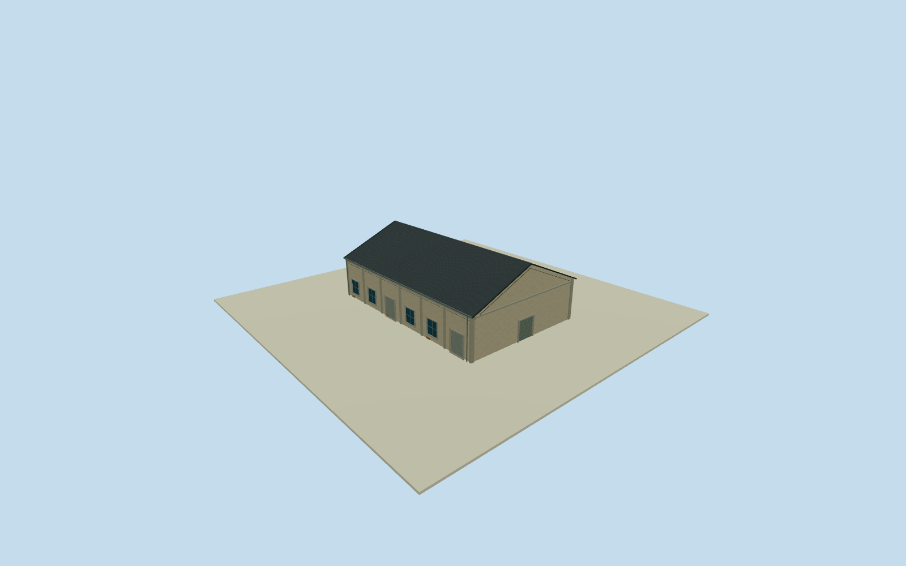

# Dayong C1 Northwest Warehouse

Whole independent original Dayong C1 Northwest Warehouse/way203315630/refC1, all four native controls/full walls/base/two gables/full pitched roof. Adjacent separate C1/C2bodies excluded. Cleared2015 C5overview gives only general local warehouse construction family; every elevation/height/section/opening census estimate, currenttenant context not a2015function claim. Original independent Dayong C1 Northwest Warehouse/way203315630/refC1, full original four native controls, short gableedge approximately19m/long approximately29m. Distinct neighboring C1/C2warehouses excluded despite repeatedC1ref. Original0to1shortedge defines+Xwidth/signed+Zridge. Native current plan approximately registers2015appearance; currentcinema/restaurant tags contextual only, no2015tenant/copy-signage claim. All elevations/sections/census local C5family estimates. Whole independent native Dayong C1 Northwest warehouse, all original controls, walls, base, two gables and full gray pitched roof. Separate neighboring bodies excluded. Exact already-cleared2015 C5overview53500205916 supplies general local pale weathered stucco/concrete framing/gray roof/bluegray window/roller vocabulary only. Every Dayong C1 Northwest elevation, section and opening census estimated; no direct photograph label claim or copied B7oval/C7panel. Floor.25/foundation-2.25/eave6.45/ridge10.65 chosen once after original field and before geometry. Heights6.2/10.4m above floor have2m uncertainty. Original native corner relative grades[1.008799814549433,-0.1571023386456334,-1.9791075882906366,-0.9593180216600476]m; closing skirt is estimated buried extension, not surveyed basement. Historical ground/vertical tie unknown. Original frame/field unchanged; no flattening, masking or floor/roof refit. 6 estimated longwall bays/4 windows/two rollers each side, broad closed northern gable entry4.7m and smaller rear entry, concrete pilasters and small brick base repairs. Precise pitch/covering/.35moverhang/facing/openings/hidden details are local family estimates with2m uncertainty. Independent256m129x129field/16641heights/1rawtile/datum7.861m frozen before geometry. Isolated review plane shows above-floor exterior; raw turntables expose estimated skirt. Original unmasked field separately inspected. Qualla-first38families/zero conflicts previously screened. Reused exact already-cleared photographer53500205916/NSID137596559@N07 CC0original, primary creator/native owner/license9/original URL/dimensions/byte proof bound. Full original previously personally inspected; no repeated source queries/downloads. Signs/posters/art/people/vehicles/photo textures unused. All four LODs retain whole body/full roof/ridge/all walls/base/gables/pilasters/window-roller panels/closed entries. Higher LODs restore mullions/frames/gutters/flutes/corrugation. Parent Pier2 ensemble unfinished; accepted neighboring assets preserved.

Authoring state: **review-in-qa.json**. Current completion evidence is in [qa.json](qa.json) and the [completion ledger](../../../../qualla-structures/batches/qualla-002.PROGRESS.md).

- [Pier-2 Art Center](https://qualla.com/pier-2-art-center/)

Whole independent original Dayong C1 Northwest Warehouse/way203315630/refC1, all four native controls/full walls/base/two gables/full pitched roof. Adjacent separate C1/C2bodies excluded. Cleared2015 C5overview gives only general local warehouse construction family; every elevation/height/section/opening census estimate, currenttenant context not a2015function claim.

Original independent Dayong C1 Northwest Warehouse/way203315630/refC1, full original four native controls, short gableedge approximately19m/long approximately29m. Distinct neighboring C1/C2warehouses excluded despite repeatedC1ref. Original0to1shortedge defines+Xwidth/signed+Zridge. Native current plan approximately registers2015appearance; currentcinema/restaurant tags contextual only, no2015tenant/copy-signage claim. All elevations/sections/census local C5family estimates.

Whole independent native Dayong C1 Northwest warehouse, all original controls, walls, base, two gables and full gray pitched roof. Separate neighboring bodies excluded. Exact already-cleared2015 C5overview53500205916 supplies general local pale weathered stucco/concrete framing/gray roof/bluegray window/roller vocabulary only. Every Dayong C1 Northwest elevation, section and opening census estimated; no direct photograph label claim or copied B7oval/C7panel.

Floor.25/foundation-2.25/eave6.45/ridge10.65 chosen once after original field and before geometry. Heights6.2/10.4m above floor have2m uncertainty. Original native corner relative grades[1.008799814549433,-0.1571023386456334,-1.9791075882906366,-0.9593180216600476]m; closing skirt is estimated buried extension, not surveyed basement. Historical ground/vertical tie unknown. Original frame/field unchanged; no flattening, masking or floor/roof refit.

6 estimated longwall bays/4 windows/two rollers each side, broad closed northern gable entry4.7m and smaller rear entry, concrete pilasters and small brick base repairs. Precise pitch/covering/.35moverhang/facing/openings/hidden details are local family estimates with2m uncertainty.

Independent256m129x129field/16641heights/1rawtile/datum7.861m frozen before geometry. Isolated review plane shows above-floor exterior; raw turntables expose estimated skirt. Original unmasked field separately inspected.

Qualla-first38families/zero conflicts previously screened. Reused exact already-cleared photographer53500205916/NSID137596559@N07 CC0original, primary creator/native owner/license9/original URL/dimensions/byte proof bound. Full original previously personally inspected; no repeated source queries/downloads. Signs/posters/art/people/vehicles/photo textures unused.

All four LODs retain whole body/full roof/ridge/all walls/base/gables/pilasters/window-roller panels/closed entries. Higher LODs restore mullions/frames/gutters/flutes/corrugation. Parent Pier2 ensemble unfinished; accepted neighboring assets preserved.

Build: `node content/worldgen/source/places/ws/wsj/dayong_c1_northwest_warehouse/models/generate-house.mjs`. Add `--check` to verify exact regeneration. 3634 triangles; 5 materials; no embedded photographs.
