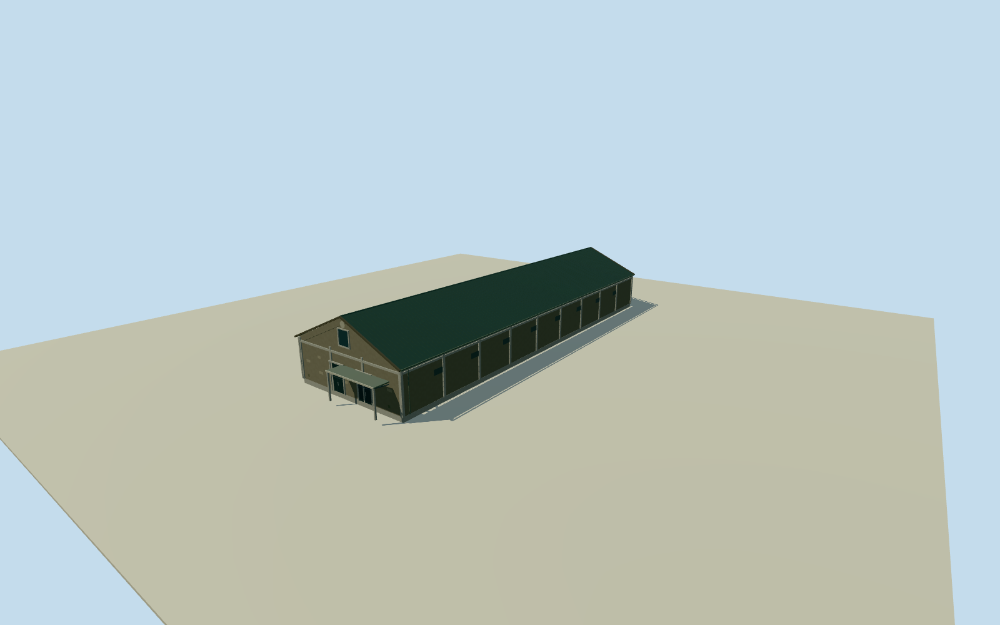

# Dayong C4 warehouse

Whole actualC4warehouse four-corner longbody, full gabled corrugated roof, pale concrete pilasters/bands/weathered darkolivegraywalls, glazedfrontentries/canopy and uppergablewindow. All unseen details/section heights explicitly estimated.

Authoring state: **review-in-qa.json**. Current completion evidence is in [qa.json](qa.json) and the [completion ledger](../../../../qualla-structures/batches/qualla-002.PROGRESS.md).

- [Pier-2 Art Center](https://qualla.com/pier-2-art-center/)

Whole independent Dayong C4 warehouse at original native203315635: all four walls/full mapped footprint, complete corrugated gabled roof and gable ends, front entrance glazing/canopy, concrete pilasters/horizontal framing and upper gable window/blank circular architectural medallion. Exclude adjoining warehouses, whole Pier2 property slab, signs/logos/posters/artworks, shops interior, streets/trees/people.

Full native four-corner approximately19.8x64.7m warehouse envelope preserved; contemporary2026mapping is an approximate registration of2019appearance, not verified historical corner positions. Front southeast facing interpreted from original photograph/street;10degree uncertainty.

Eave6.2m/ridge10.7m above approximatefloor are photographic estimates with2m height uncertainty. Gable pitch, all pilaster/band/window/canopy dimensions and precise door positions estimated. Dark olive-gray weathered stucco/pale concrete frame/dark green corrugated roof and central gable window follow cleared original. Blank round architectural medallion stands in for illegible small relief; logos/signage/posters/lettering/sculpture/people/streets excluded.

Hidden rear elevation/roofplane/window census and repeated longwall bays are conservative estimated continuations, not survey/photo-complete detail. Closed glazing with shallow frames represents entrances, not interior rooms. Intrinsic entrance canopy/supports retained; neighbouring warehouse and large modern office excluded.

Original256m129x129field/16641heights/1tile/datum1.1111m fixed BEFORE floor.25m/foundation-.6..+.25m/eave6.45m/ridge10.95m. Composite source grade/vertical contact approximate; no field flatten/mask/refetch/fitting.

Qualla-first38families/zero conflicts screened; cleared tram image contextonlyunused. Exact4868x3224C4original CC0 primary photographer/FlickrNSID/nativeSHA1 bound and personally inspected. Procedural geometry/colors/shared materials only; photograph not copied as texture. Complete independentC4member; parentthree-group warehouse ensemble remains unfinished.

Build: `node content/worldgen/source/places/ws/wsj/dayong_c4_warehouse/models/generate-house.mjs`. Add `--check` to verify exact regeneration. 3472 triangles; 5 materials; no embedded photographs.
