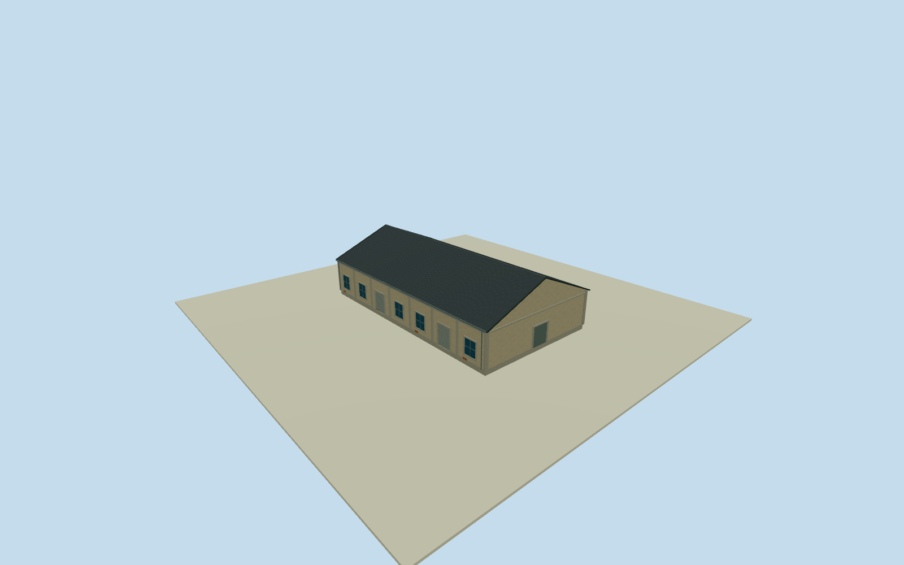

# Dayong C5 East Warehouse

Whole independent eastern C5 warehouse body way224337094/refC5/addressDayongRoad1, all4nativecorners/walls/gableends/roof. Adjacent separately mapped western C5MoonlightTheatre224337098 excluded from this model and remains next. Coherent2015-11-29 exterior from exact photographer-owned CC0 original. Current mapped horizontal registration approximate for2015; section heights/roofpitch/facadeintervals/hiddennorthside estimates. No wholePier2completion by single warehouse. Original C5warehouse way224337094/refC5/address大勇路1號, all4nativeoutsidecorners retained. Separate westC5theatre way224337098 lies adjacent and is not merged into this model. Original source photograph northward across mappedDayongparking supplies observed whole southroof/frontage vocabulary; current originalhorizontalplan is approximate historical2015registration. Signed+X follows original0to1shortedge/gablewidth; +Zperpendicularalonglongridge. Heights/pitch/window/doorintervals/hiddennorthside estimated. Complete original four-corner easternC5body approximately19.1x33.92m with fullwalls/gableends/corrugated pitchedroof/foundation. Separate adjacentwesternC5theatre excluded and retainsownfutureasset. WholeC5photo spans bothnativebodies; seam attribution/window-interval division is approximate. Native2026plan is unsurveyed horizontal registration of2015appearance. Floor.25/foundation-.6/eave5.45/ridge9.45 selected once AFTER independent original256mfield and BEFOREgeometry.5.2m eaveheight/9.2m ridgeheight abovefloor have2m uncertainty. Roofpitch/overhang.3m/7longwallbays/2southrollers/5southwindowpanels/hiddennorthrepeat/gable serviceentries/pilasterdimensions are source-informed estimates; no surveyedheight or exact2015doorcensus. Mainphoto shows longsouthfacade/fullgable-roof mass, paleweatheredstucco/concreteframes/blue-graywindows/rollerdoors; no C4medallion/frontcanopy imported. Qualla-first38families/zero conflicts previously screened; earlier clearedtramcontext notused forwarehouse architecture. Same acceptedC4neighborphoto only informed initial localwarehouse vocabulary. New exactdirectphotographerCC0original53500205916, author/creator immutableNSID137596559@N07, primaryJSONLDgrant+nativephoto-model license9/exactoriginalURL/dimensions/bytes allbound. Whole2015-11-29original personallyinspected. No questionableimagery/posters/artworks/people/cars/parking/modeltrains orphototextures used. Original256m129x129field/16641heights/1rawtile/datum0.2759m frozen before geometry. Nativecornerrelativegrades-.33367..+.91625m; exactthresholdverticaltie unmeasured. No sourcefieldflatten/mask/refetch/reframe or floor/roofrefit. AllfourLODs retainwholebody/pitchedroof/ridge/gableends/allwalls/mainlongwallpilasters/windows/rollers/opaqueclosedserviceentries. HigherLODsrestorewindowmullions/doorflutes/roofcorrugation/gutters; facadeimages notcopied as textures. Hiddennorthwallpattern estimated, interiorrooms excluded. ParentPier2three-groupensembleunfinished.

Authoring state: **review-in-qa.json**. Current completion evidence is in [qa.json](qa.json) and the [completion ledger](../../../../qualla-structures/batches/qualla-002.PROGRESS.md).

- [Pier-2 Art Center](https://qualla.com/pier-2-art-center/)

Whole independent eastern C5 warehouse body way224337094/refC5/addressDayongRoad1, all4nativecorners/walls/gableends/roof. Adjacent separately mapped western C5MoonlightTheatre224337098 excluded from this model and remains next. Coherent2015-11-29 exterior from exact photographer-owned CC0 original. Current mapped horizontal registration approximate for2015; section heights/roofpitch/facadeintervals/hiddennorthside estimates. No wholePier2completion by single warehouse.

Original C5warehouse way224337094/refC5/address大勇路1號, all4nativeoutsidecorners retained. Separate westC5theatre way224337098 lies adjacent and is not merged into this model. Original source photograph northward across mappedDayongparking supplies observed whole southroof/frontage vocabulary; current originalhorizontalplan is approximate historical2015registration. Signed+X follows original0to1shortedge/gablewidth; +Zperpendicularalonglongridge. Heights/pitch/window/doorintervals/hiddennorthside estimated.

Complete original four-corner easternC5body approximately19.1x33.92m with fullwalls/gableends/corrugated pitchedroof/foundation. Separate adjacentwesternC5theatre excluded and retainsownfutureasset. WholeC5photo spans bothnativebodies; seam attribution/window-interval division is approximate. Native2026plan is unsurveyed horizontal registration of2015appearance.

Floor.25/foundation-.6/eave5.45/ridge9.45 selected once AFTER independent original256mfield and BEFOREgeometry.5.2m eaveheight/9.2m ridgeheight abovefloor have2m uncertainty. Roofpitch/overhang.3m/7longwallbays/2southrollers/5southwindowpanels/hiddennorthrepeat/gable serviceentries/pilasterdimensions are source-informed estimates; no surveyedheight or exact2015doorcensus. Mainphoto shows longsouthfacade/fullgable-roof mass, paleweatheredstucco/concreteframes/blue-graywindows/rollerdoors; no C4medallion/frontcanopy imported.

Qualla-first38families/zero conflicts previously screened; earlier clearedtramcontext notused forwarehouse architecture. Same acceptedC4neighborphoto only informed initial localwarehouse vocabulary. New exactdirectphotographerCC0original53500205916, author/creator immutableNSID137596559@N07, primaryJSONLDgrant+nativephoto-model license9/exactoriginalURL/dimensions/bytes allbound. Whole2015-11-29original personallyinspected. No questionableimagery/posters/artworks/people/cars/parking/modeltrains orphototextures used.

Original256m129x129field/16641heights/1rawtile/datum0.2759m frozen before geometry. Nativecornerrelativegrades-.33367..+.91625m; exactthresholdverticaltie unmeasured. No sourcefieldflatten/mask/refetch/reframe or floor/roofrefit.

AllfourLODs retainwholebody/pitchedroof/ridge/gableends/allwalls/mainlongwallpilasters/windows/rollers/opaqueclosedserviceentries. HigherLODsrestorewindowmullions/doorflutes/roofcorrugation/gutters; facadeimages notcopied as textures. Hiddennorthwallpattern estimated, interiorrooms excluded. ParentPier2three-groupensembleunfinished.

Build: `node content/worldgen/source/places/ws/wsj/dayong_c5_east_warehouse/models/generate-house.mjs`. Add `--check` to verify exact regeneration. 3498 triangles; 5 materials; no embedded photographs.
