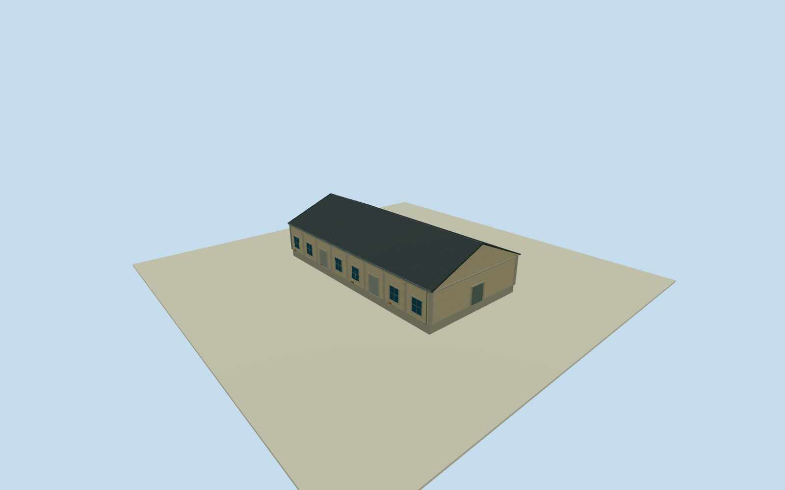

# Dayong C5 West Warehouse

Whole independent western C5 warehouse body way224337098/refC5/native name月光劇場, all4nativecorners/walls/gableends/roof. Separate adjacent easternC5way224337094 atDayongRoad1 is already completed and excluded from this model. Same coherent2015-11-29 exactphotographerCC0overview spans fullC5southwall/roof; currentoriginalhorizontalplan is approximate historicalregistration. Sectionheights/roofpitch/facadeintervals/hiddennorthwall estimates. No claim exact2015theatrefunction or wholePier2completion. Original westernC5warehouse way224337098/refC5/name月光劇場, all4nativeoutsidecorners retained. Adjacent easternC5warehouse224337094/address大勇路1號 already authored separately. Same exact2015northwardphotograph across originalDayongparking to south shows the wholeC5roof and southfacade; originalDayongRoad lies to east of the wholeC5pair. Contemporarynativeplan is unsurveyed horizontalregistration of2015appearance. +Xfollows original0to1shortedge/gablewidth, +Zperpendicularalongridge; widthsfromnativecontrols, heights/pitch/facadeintervals/hiddennorthside estimated. Complete original four-corner westernC5body approximately19.0x36.97m with fullwalls/gableends/corrugated pitchedroof/foundation. Separate adjacent easternC5warehouse already completed and excluded. WholeC5photo spans bothnativebodies; seam attribution/window-interval division is approximate. Native2026plan is unsurveyed horizontal registration of2015appearance. Floor.25/foundation-1.25/eave5.45/ridge9.45 selected once AFTER independent original256mfield and BEFOREgeometry.5.2m eaveheight/9.2m ridgeheight abovefloor have2m uncertainty. Roofpitch/overhang.3m/8longwallbays/2southrollers/6southwindowpanels/hiddennorthrepeat/gable serviceentries/pilasterdimensions are source-informed estimates; no surveyedheight or exact2015doorcensus. Mainphoto shows longsouthfacade/fullgable-roof mass, paleweatheredstucco/concreteframes/blue-graywindows/rollerdoors; no C4medallion/frontcanopy imported. Qualla-first38families/zero conflicts previously screened; earlier clearedtramcontext notused forwarehouse architecture. Same acceptedC4neighborphoto only informed initial localwarehouse vocabulary. New exactdirectphotographerCC0original53500205916, author/creator immutableNSID137596559@N07, primaryJSONLDgrant+nativephoto-model license9/exactoriginalURL/dimensions/bytes allbound. Whole2015-11-29original personallyinspected. No questionableimagery/posters/artworks/people/cars/parking/modeltrains orphototextures used. Original256m129x129field/16641heights/1rawtile/datum1.2016m frozen before geometry. Nativecornerrelativegrades-.94436..+1.09360m; exactthresholdverticaltie unmeasured. No sourcefieldflatten/mask/refetch/reframe or floor/roofrefit. AllfourLODs retainwholebody/pitchedroof/ridge/gableends/allwalls/mainlongwallpilasters/windows/rollers/opaqueclosedserviceentries. HigherLODsrestorewindowmullions/doorflutes/roofcorrugation/gutters; facadeimages notcopied as textures. Hiddennorthwallpattern estimated, interiorrooms excluded. ParentPier2three-groupensembleunfinished.

Authoring state: **review-in-qa.json**. Current completion evidence is in [qa.json](qa.json) and the [completion ledger](../../../../qualla-structures/batches/qualla-002.PROGRESS.md).

- [Pier-2 Art Center](https://qualla.com/pier-2-art-center/)

Whole independent western C5 warehouse body way224337098/refC5/native name月光劇場, all4nativecorners/walls/gableends/roof. Separate adjacent easternC5way224337094 atDayongRoad1 is already completed and excluded from this model. Same coherent2015-11-29 exactphotographerCC0overview spans fullC5southwall/roof; currentoriginalhorizontalplan is approximate historicalregistration. Sectionheights/roofpitch/facadeintervals/hiddennorthwall estimates. No claim exact2015theatrefunction or wholePier2completion.

Original westernC5warehouse way224337098/refC5/name月光劇場, all4nativeoutsidecorners retained. Adjacent easternC5warehouse224337094/address大勇路1號 already authored separately. Same exact2015northwardphotograph across originalDayongparking to south shows the wholeC5roof and southfacade; originalDayongRoad lies to east of the wholeC5pair. Contemporarynativeplan is unsurveyed horizontalregistration of2015appearance. +Xfollows original0to1shortedge/gablewidth, +Zperpendicularalongridge; widthsfromnativecontrols, heights/pitch/facadeintervals/hiddennorthside estimated.

Complete original four-corner westernC5body approximately19.0x36.97m with fullwalls/gableends/corrugated pitchedroof/foundation. Separate adjacent easternC5warehouse already completed and excluded. WholeC5photo spans bothnativebodies; seam attribution/window-interval division is approximate. Native2026plan is unsurveyed horizontal registration of2015appearance.

Floor.25/foundation-1.25/eave5.45/ridge9.45 selected once AFTER independent original256mfield and BEFOREgeometry.5.2m eaveheight/9.2m ridgeheight abovefloor have2m uncertainty. Roofpitch/overhang.3m/8longwallbays/2southrollers/6southwindowpanels/hiddennorthrepeat/gable serviceentries/pilasterdimensions are source-informed estimates; no surveyedheight or exact2015doorcensus. Mainphoto shows longsouthfacade/fullgable-roof mass, paleweatheredstucco/concreteframes/blue-graywindows/rollerdoors; no C4medallion/frontcanopy imported.

Qualla-first38families/zero conflicts previously screened; earlier clearedtramcontext notused forwarehouse architecture. Same acceptedC4neighborphoto only informed initial localwarehouse vocabulary. New exactdirectphotographerCC0original53500205916, author/creator immutableNSID137596559@N07, primaryJSONLDgrant+nativephoto-model license9/exactoriginalURL/dimensions/bytes allbound. Whole2015-11-29original personallyinspected. No questionableimagery/posters/artworks/people/cars/parking/modeltrains orphototextures used.

Original256m129x129field/16641heights/1rawtile/datum1.2016m frozen before geometry. Nativecornerrelativegrades-.94436..+1.09360m; exactthresholdverticaltie unmeasured. No sourcefieldflatten/mask/refetch/reframe or floor/roofrefit.

AllfourLODs retainwholebody/pitchedroof/ridge/gableends/allwalls/mainlongwallpilasters/windows/rollers/opaqueclosedserviceentries. HigherLODsrestorewindowmullions/doorflutes/roofcorrugation/gutters; facadeimages notcopied as textures. Hiddennorthwallpattern estimated, interiorrooms excluded. ParentPier2three-groupensembleunfinished.

Build: `node content/worldgen/source/places/ws/wsj/dayong_c5_west_warehouse/models/generate-house.mjs`. Add `--check` to verify exact regeneration. 3670 triangles; 5 materials; no embedded photographs.
