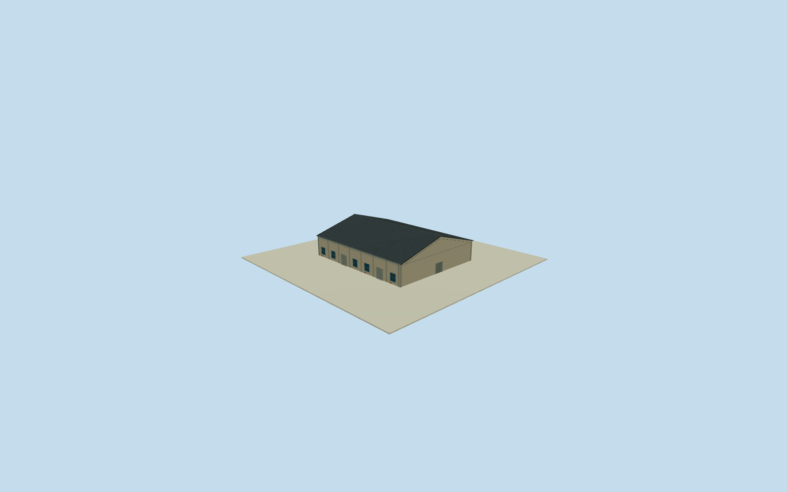

# Dayong Warehouse 9

Whole independent original Dayong Warehouse 9/way203315631/ref9, all 4 original native outside controls/full walls/base/full roof, including any mapped clipped corner or rear extension. Separate neighboring bodies excluded. Exact cleared2015 C5overview supplies general local Pier2warehouse construction family only; all elevations/heights/sections/opening census estimates. Current native tenant tags contextual only, no2015function/signage claim. Original independent Dayong Warehouse 9/way203315631/ref9, all 4 native controls must remain in full outer body. Original1to2shortedge defines+Xgablewidth/signed+Zridge along main warehouse direction. Current native footprint approximately registers2015appearance. Distinct neighboring bodies excluded; all member elevations/sections/openings are local C5warehouse family estimates. Do not replace irregular native corners or extensions with a bounding box. Whole independent native Dayong Warehouse 9 warehouse, all original controls, walls, base, two gables and full gray pitched roof. Separate neighboring bodies excluded. Exact already-cleared2015 C5overview photograph53500205916 supplies general local pale weathered stucco/concrete framing/gray roof/bluegray window/roller vocabulary only. Every Dayong Warehouse 9 elevation, section and opening census estimated; no direct photograph label claim or copied B7oval/C7panel. Floor.25/foundation-3.2/eave6.45/ridge10.65 chosen once after original field and before geometry. Heights6.2/10.4m above floor have2m uncertainty. Original native corner relative grades[2.207059128094805,0.02279420544094002,-2.901334659526423,-0.7682229053640794]m; closing skirt is estimated buried extension, not surveyed basement. Historical ground/vertical tie unknown. Original frame/field unchanged; no flattening, masking or floor/roof refit. 7 estimated longwall bays/5 windows/two rollers each side, broad closed negative-Z gable entry4.7m and smaller rear entry, concrete pilasters and small brick base repairs. Precise pitch/covering/.35moverhang/facing/openings/hidden details are local family estimates with2m uncertainty. Independent256m129x129field/16641heights/1rawtile/datum7.9313m frozen before geometry. Isolated review plane shows above-floor exterior; raw turntables expose estimated skirt. Original unmasked field separately inspected. Qualla-first38families/zero conflicts previously screened. Reused exact already-cleared photographer53500205916/NSID137596559@N07 CC0original, primary creator/native owner/license9/original URL/dimensions/byte proof bound. Full original previously personally inspected; no repeated source queries/downloads. Signs/posters/art/people/vehicles/photo textures unused. All four LODs retain the native tapered envelope; facade panels, pilasters, both gables and roof are bilinearly mapped to the original four controls with recomputed outward normals. Original source frame/field unchanged. All four LODs retain whole body/full roof/ridge/all walls/base/gables/pilasters/window-roller panels/closed entries. Higher LODs restore mullions/frames/gutters/flutes/corrugation. Parent Pier2 ensemble unfinished; accepted neighboring assets preserved.

Authoring state: **review-in-qa.json**. Current completion evidence is in [qa.json](qa.json) and the [completion ledger](../../../../qualla-structures/batches/qualla-002.PROGRESS.md).

- [Pier-2 Art Center](https://qualla.com/pier-2-art-center/)

Whole independent original Dayong Warehouse 9/way203315631/ref9, all 4 original native outside controls/full walls/base/full roof, including any mapped clipped corner or rear extension. Separate neighboring bodies excluded. Exact cleared2015 C5overview supplies general local Pier2warehouse construction family only; all elevations/heights/sections/opening census estimates. Current native tenant tags contextual only, no2015function/signage claim.

Original independent Dayong Warehouse 9/way203315631/ref9, all 4 native controls must remain in full outer body. Original1to2shortedge defines+Xgablewidth/signed+Zridge along main warehouse direction. Current native footprint approximately registers2015appearance. Distinct neighboring bodies excluded; all member elevations/sections/openings are local C5warehouse family estimates. Do not replace irregular native corners or extensions with a bounding box.

Whole independent native Dayong Warehouse 9 warehouse, all original controls, walls, base, two gables and full gray pitched roof. Separate neighboring bodies excluded. Exact already-cleared2015 C5overview photograph53500205916 supplies general local pale weathered stucco/concrete framing/gray roof/bluegray window/roller vocabulary only. Every Dayong Warehouse 9 elevation, section and opening census estimated; no direct photograph label claim or copied B7oval/C7panel.

Floor.25/foundation-3.2/eave6.45/ridge10.65 chosen once after original field and before geometry. Heights6.2/10.4m above floor have2m uncertainty. Original native corner relative grades[2.207059128094805,0.02279420544094002,-2.901334659526423,-0.7682229053640794]m; closing skirt is estimated buried extension, not surveyed basement. Historical ground/vertical tie unknown. Original frame/field unchanged; no flattening, masking or floor/roof refit.

7 estimated longwall bays/5 windows/two rollers each side, broad closed negative-Z gable entry4.7m and smaller rear entry, concrete pilasters and small brick base repairs. Precise pitch/covering/.35moverhang/facing/openings/hidden details are local family estimates with2m uncertainty.

Independent256m129x129field/16641heights/1rawtile/datum7.9313m frozen before geometry. Isolated review plane shows above-floor exterior; raw turntables expose estimated skirt. Original unmasked field separately inspected.

Qualla-first38families/zero conflicts previously screened. Reused exact already-cleared photographer53500205916/NSID137596559@N07 CC0original, primary creator/native owner/license9/original URL/dimensions/byte proof bound. Full original previously personally inspected; no repeated source queries/downloads. Signs/posters/art/people/vehicles/photo textures unused.

All four LODs retain the native tapered envelope; facade panels, pilasters, both gables and roof are bilinearly mapped to the original four controls with recomputed outward normals. Original source frame/field unchanged. All four LODs retain whole body/full roof/ridge/all walls/base/gables/pilasters/window-roller panels/closed entries. Higher LODs restore mullions/frames/gutters/flutes/corrugation. Parent Pier2 ensemble unfinished; accepted neighboring assets preserved.

Build: `node content/worldgen/source/places/ws/wsj/dayong_warehouse_9/models/generate-house.mjs`. Add `--check` to verify exact regeneration. 3810 triangles; 5 materials; no embedded photographs.
