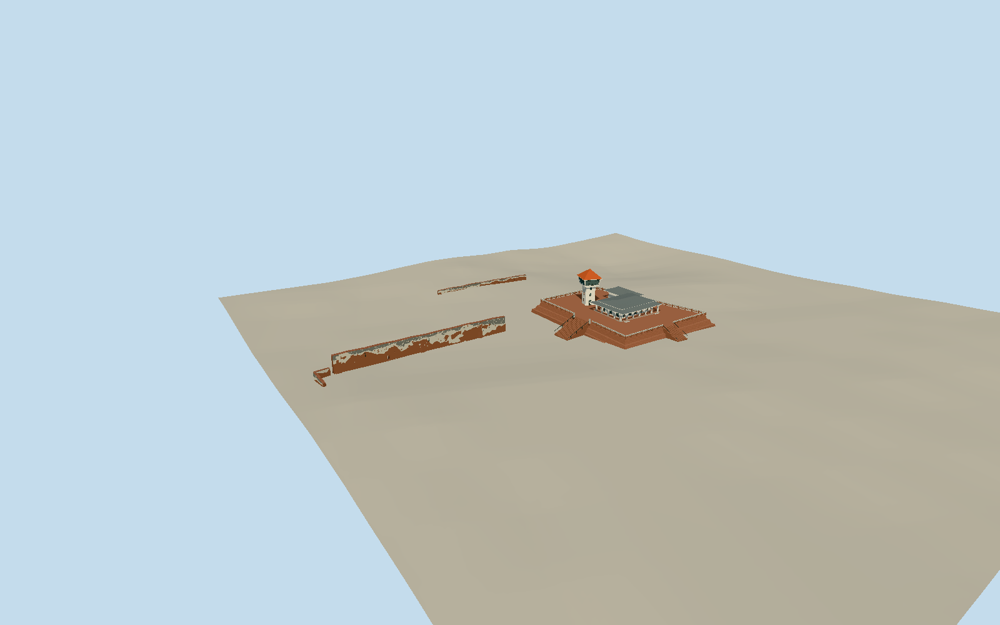

# Fort Zeelandia

Current Anping Fort later three-tier battered brick platform with perforated railing and own broad stairs, gray double-eave tiled arcaded memorial hall and independently cardinal square white lookout with splayed glazed cabin/red pyramid roof. Separate ragged plaster/brick southern wall with real narrow gate and blind pockets/iron ties, low northern remnant and southwest broken wall remain distinct; no complete vanished Dutch fortress. Whole-model geographic/visual approval remains separate.

Authoring state: **review-in-qa.json**. Current completion evidence is in [qa.json](qa.json) and the [local 100 ledger](../../../../qualla-structures/batches/PROGRESS.md).

- [Fort Zeelandia](https://qualla.com/fort-zeelandia-taiwan/)

Native broad site/terrace root height5 must not be uniformly extruded into a complete fortress. Native inner platform is a cap outline, not a roof or surveyed batter toe.

No precise measured current tower height, platform step levels or individual bay dimensions have been verified. Historical fort dimensions cannot set present silhouette.

Independent ground must be frozen before geometry. Review output spacing is not survey accuracy; no fitting/flattening or universal host-terrain claim.

Surviving-wall traces are bounded aerial/guide/photo interpretations with3.5m southern,4.5m northern and5m southwest uncertainty; top heights, cap loss, buttresses and small openings are photographic estimates. No construction-survey claim.

Whole scope now includes separate surviving southern/northern/southwest wall runs. Axes are bounded aerial/guide interpretations with3.5/4.5/5m uncertainty; original cap loss, plaster patch patterns, buttresses, tie anchors and small openings are photographic estimates. Current visual/shared/context/geographic evidence and final approval are recorded separately in qa.json.

Tower ground outline uses approximate official EMAP square-footprint trace; actual red roof is displaced in aerial imagery and is not a measured ground correction. Cardinal tower is rotated independently of later platform. Terrace heights, tower shaft/cabin proportions, hall arcade bay counts and roof junctions are photographic estimates.

Original photographs only constrain authored geometry/palette; no photographic pixels or copied heraldry. Modern trees, vegetation, people, temporary scaffolding, adjacent former Customs House museum and city excluded.

Original independent ground remains byte-identical. Terrarium composite heights may interpolate building/vegetation; precise structural ground classification and compatibility with other host fields remain unverified.

Build: `node packages/worldgen/scripts/generate-authored-places.mjs --ids=fort_zeelandia`. Add `--check` to verify exact regeneration. 39583 triangles; 6 materials; no embedded photographs.
