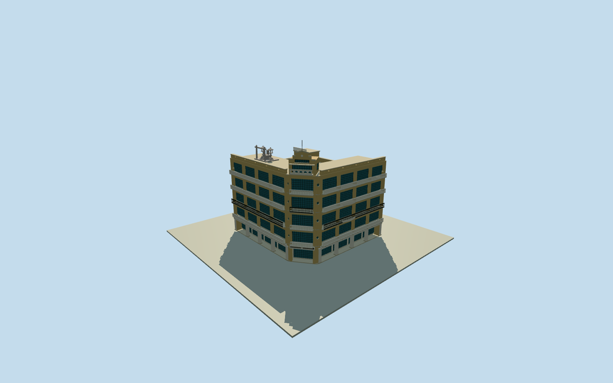

# Hayashi Department Store

Native northeast chamfer with rounded porthole shoulders, five primary store floors, two broad horizontal-window street facades and concrete/iron balconies. Sixth-floor corner observation bay with five circular balcony holes and stepped parapet, fifth-floor open terrace, elevator headhouse and stone torii/shrine remains. Buff grooved tile, gray concrete/stone, dark frames and opaque backed glazing; own structure only, excluding neighboring stores, street scenery, temporary signs and interiors.

Authoring state: **medium-fi-exterior-source-preview-reviewed-in-qa**. Current completion evidence is in [qa.json](qa.json) and the [local 100 ledger](../../../../qualla-structures/batches/PROGRESS.md).

- [Hayashi Department Store](https://qualla.com/hayashi-department-store/)

Approximate photographic exterior with bounded source-ground preview. Current source/story completion evidence is bound in qa.json; this is not a surveyed current replacement or navigable interior.

Quantized native551.25m² polygon and generic15m map height retained as map facts. Photo-directed approximately17.4m street roof and21.7m corner parapet are visualization estimates, not survey dimensions.

Rounded corner shoulders, terrace/elevator-house/shrine positions, upper/rear fenestration and fine artwork are conservative estimates; interior and neighboring buildings excluded.

Third-party published NLSC-claimed20mDTM preserved before geometry; original official raster/private conversion unavailable.1m interpolation is not1m accuracy. Compatible source preview only; another host DEM needs contact review.

Original photo pixels are not model textures; all shared materials use ordinary catalog graphs. No generic footprint replacement or whole-site terrain pad.

Build: `node packages/worldgen/scripts/generate-authored-places.mjs --ids=hayashi_department_store`. Add `--check` to verify exact regeneration. 15924 triangles; 6 materials; no embedded photographs.
