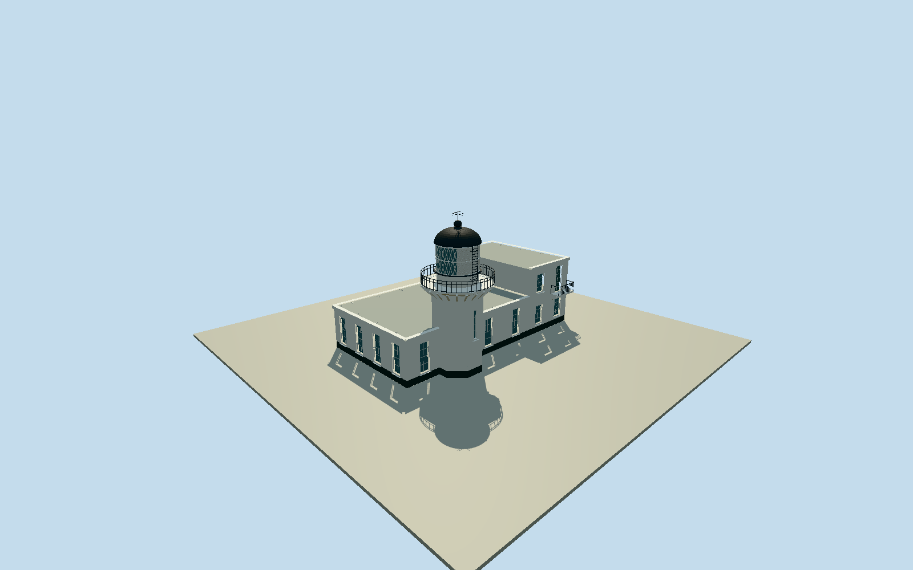

# Kaohsiung Lighthouse

Whole principal Kaohsiung/Cihou lighthouse and physically attached station: complete original6-vertex principal building containing named lighthouse/seamark node, white octagonal brick shaft/black plinth, projecting octagonal corbelled gallery/black open circular rail, white drum/diamond-framed glazing/opaque shutters/black dome/vented finial/weather vane/access ladder, attached single-storey connector and taller two-storey end room with recessed windows/door/balcony/flat roofs/cornices/drainpipe. Exclude separate museum683896246/signal station891000539/other compound buildings/fort/hill/harbor/site-paving slab/flags/signletters/people/plants/interiors. Preserve complete original6-point mapped envelope and named tower location, not tower-only crop or entire hill/compound. Original octagonal tower/body and attachment division estimated inside native footprint; white gallery brackets/open black circular rail, physical recessed narrow shaft/attached-station windows, diamond two-row lantern glazing/opaque white shutters/ladder/domed black roof/vented finial/weather vane. Official15.2m overall height as upper-control; gallery/shaft/room heights/radius/photo proportions bounded. No50m shaft or58.2m tower confusion. Explicitly distinguish separate museum/signal/outbuildings. Freeze independent256m129x129field before geometry at fixed landward bank; no fit/flatten/reacquire. Articulate the full original station into native split-vertex west two-storey room and lower connector; photo-based octagonal shaft projects from seaward facade rather than being buried in a solid station box. POI is identity anchor,3.451m shaft-centre offset explicitly bounded.

Authoring state: **review-in-qa.json**. Current completion evidence is in [qa.json](qa.json) and the [completion ledger](../../../../qualla-structures/batches/qualla-002.PROGRESS.md).

- [Kaohsiung Lighthouse](https://qualla.com/kaohsiung-lighthouse/)

Named lighthouse/seamark node3250130923/Q3847130 lies within whole6-vertex physical buildingway683896236 (two collinear original split vertices retained), not nearby independent museum683896246/signal891000539 or visitor compound parcel. Fixed named-node anchor and heading along original NW-to-SE long edge before terrain/geometry; +X southeast/+Z southwest landward. Official lighthouse15.2m structural height overrides maplandmark50m, which is not used as a tower height; separate58.2m elevation-of-light is not structural height or provider terrain datum. Station height/shaft radius/octagonal orientation/interior attachment partition and precise tower within mapped-envelope plan are bounded photo-derived estimates; native node identifies the tower, not a measured octagonal perimeter. Story/official tourism point north of physical mapped building is approximate POI, not adopted as a roof polygon. The native lighthouse point is an approximate identity POI, not a surveyed shaft centre. Original photo-based shaft centre is placed on the seaward station facade at[0,-3.45100279] local,3.451m seaward of that POI; octagonal shaft projects from the coarse rectangular mapped station, as the clear rear photograph shows. Station keeps all6 original vertices; no map/anchor/heading/terrain refit.

Whole original6-vertex coarse principal attached station retained, split at original collinear west-room vertex into higher two-storey room and lower connector. Station7.9/4.75m roofs and partition/white window census/hidden landward facade are bounded original photo interpretation. Octagonal shaft radius2.55m/white gallery3.55m/glazing/drum/dome/ladder/finial intermediate heights estimated against official15.2m overall structural height, not official58.2m light elevation or native50m landmark tag. Named native point is identity proxy; photo-derived shaft centre3.451m seaward on coarse station facade, not a surveyed octagonal footprint.

Three exact2025/2026TheNatureBox own/self-cc-zero whole/lantern/rear originals individually inspected/nativeSHA1matched/item-specific grants bound; Qualla-first80families/zero conflicts. Published lighthousePD-self has no clear named source/author and is unused. Samecreatorfourthnight view inspected but distant duplicate/unused, never claimed as a close landward photograph. No restricted pixels/photo textures/generated bitmap/downloaded mesh/metadata repair.

White octagonal shaft/black plinth, actual recessed narrow shaft/room windows and upper door, projecting corbelled gallery with physically open black rails, white drum/diamond-framed glass/representative opaque white shutters, black dome/vent finial/open weather vane and access ladder. Exact shutter/pane/bracket/rung/vent census and current patina bounded; skyline windows flatten their0.24m recess within0.65m error while detailed openings have physical reveals; original fine fittings simplify at distance, full station/tower/black crown survive. No compass text/signletters/flags/people/interiors.

Independent museum683896246/signal891000539/fort/other detached compound buildings not included. No invented hill/harbor/tree/whole visitor compound or city ground/paving slab. Intrinsic station body only, thresholds/plinth/upper balcony photo estimates; hidden foundation/actual steep hillside support unknown.

Independent256m129x129field/all16641values/two raw tilebytes frozen before geometry and unchanged.40.3312m provider-relative approach datum/absolute-357.0477..43.6849m contains implausible coastal composite pits, not bathymetry/foundation control; official58.2m light elevation and native50m landmark heights not terrain-fit constraints. Portable/shared/context flat fixtures separate; ordinary native preview/replaceFootprint=false, true hilltop entry grade and host contact unverified.

Build: `node packages/worldgen/scripts/generate-authored-places.mjs --ids=kaohsiung_lighthouse`. Add `--check` to verify exact regeneration. 9348 triangles; 5 materials; no embedded photographs.
