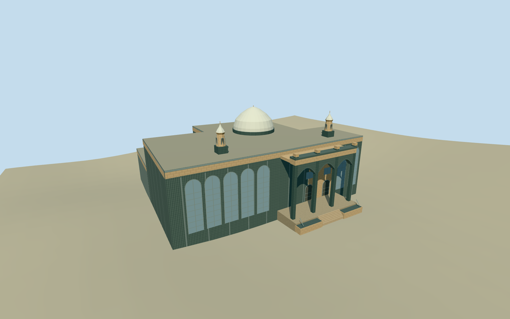

# Kaohsiung Mosque

The mosque on Jianjyun Road with a dark green glazed-tile portico, tall arched windows, and pale dome and minaret crowns.

Authoring state: **review-in-qa.json**. Current completion evidence is in [qa.json](qa.json) and the [completion ledger](../../../../qualla-structures/batches/qualla-004.PROGRESS.md).

- [Kaohsiung Mosque](https://qualla.com/kaohsiung-mosque/)

The e-Map footprint and the photo guide orientation and visible proportions. The roof height, dome scale, rear windows and smaller service wings are approximate.

Build: `node content/worldgen/source/places/ws/wsj/kaohsiung_mosque/models/generate-kaohsiung-mosque.mjs`. Add `--check` to verify exact regeneration. 3137 triangles; 6 materials; no embedded photographs.
