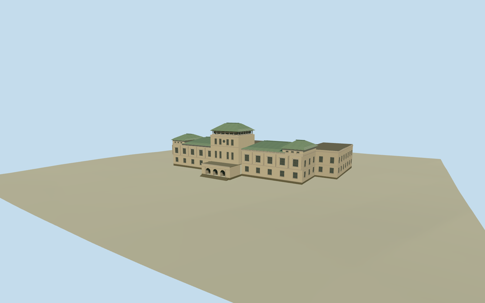

# Kaohsiung Museum of History

The former 1939 Kaohsiung City Hall with cream elevations and three green-tiled pavilions over a symmetrical civic front.

Authoring state: **review-in-qa.json**. Current completion evidence is in [qa.json](qa.json) and the [completion ledger](../../../../qualla-structures/batches/qualla-004.PROGRESS.md).

- [Kaohsiung Museum of History](https://qualla.com/kaohsiung-museum-of-history/)

Primary front and flanking ranges follow the 1939–1940 references and mapped extents. The rear elevations, small window proportions and restoration paint are representative.

The regional 20 m elevation field preserves the site grade. Individual curb and paving levels are estimated.

Build: `node content/worldgen/source/places/ws/wsj/kaohsiung_museum_of_history/models/generate-kaohsiung-museum-of-history.mjs`. Add `--check` to verify exact regeneration. 7790 triangles; 6 materials; no embedded photographs.
