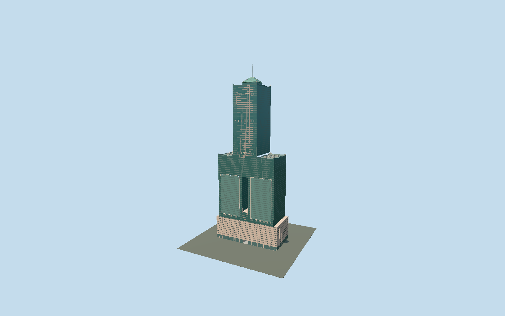

# 85 Sky Tower (Tuntex)

Kaohsiung’s two-pronged tower with its real through-aperture, raised pink podium and ground passage, pale projecting glazed panels, main elevated shaft, curved Chinese crown lines, layered hip roof and ringed white antenna.

## Evidence and reconstruction

Published dimensions and reconstructed details are separated in spec.json. Primary references:

- [Reference](https://www.cylee.com/project/T-C-Tower?lang=tw)
- [Reference](https://www.skyscrapercenter.com/building/85/338)
- [Reference](https://www.openstreetmap.org/way/34170948)
- [Reference](https://www.openstreetmap.org/way/344740874)
- [Reference](https://www.openstreetmap.org/way/345038767)

No third-party geometry, photograph or bitmap texture is embedded. Shared surface graphs come from the central library; vertex tints carry model colors. Glazing uses PBR materials; transparent surfaces are declared per model.

## Model and axes

19,006 triangles; 47,182 vertices; 4 material groups; 1,929,432 bytes. Native bounds: -72.174, 0.000, -34.900 to 72.174, 378.000, 34.900. Source hash: `sha256:63e7ec338f969e02744abdc139774b3a92d9d3be88a8da290896755a4b483d65`.

{"up":"+Y","longitudinal":"+X south-southeast long podium axis","front":"+Z west-southwest harbor-facing broad face","origin":"Ground-level mapped podium frame at street entry"}

Fresh OSM API on 2026-10-10 confirms exact Q337631 podium 34170948 and six unchanged separately retained parts: north/south prongs, central sill, elevated shaft, hip roof and antenna. Heading -1.245554419864 retained: native +X south-southeast along prong separation, +Z west-southwest toward the harbor. Native +X follows the long podium axis. Independent antenna 345038767 and asymmetric mapped prongs corroborate signed frame; architect harbor and aerial photos establish both open aperture and raised podium. Ground Y=0 is street entry; 13.1 m ground passage and 70–145 m upper aperture are photo/map reconstructions. Accept 2 m footprint / 1 degree reconstruction allowance; automatic replacement disabled. Surrounding towers, street canopy stalls and local grade are separate context.

## Reproduce

Run `node packages/worldgen/scripts/generate-signature-towers.mjs --ids=N0179` (or add `--check`). The generator preserves manually edited masters by checking their baseline hashes. Import through the standard authored-model workflow with optimization disabled; then capture all QA cameras, including shared-surface views.

## Pending work

- Original 108530-triangle, 11094712-byte detailed master remains exactly reproducible from unchanged world-tower recipe. Reviewed source/four levels preserve signed mapped podium, both prongs, low central sill and genuinely open 70–145 m aperture, separate 13.1 m ground passage, elevated main shaft, pale projecting panel rectangles, scalloped crown profiles, layered hip roof to 347.5 m and ringed antenna to 378 m. Continuous opaque facade backings with long mullion/spandrel strips replace independent bays. Skyline averages glazing/trim, omits podium ribbons/projection frames and reduces crown/antenna samples; district aggregates sixteen pane/floor pitches and omits podium piers, panel brackets and hip seams; street aggregates three pitches. Near levels retain pink relief frames, roof plant, underside transfer beams and finer hip roof seams. The hardcoded prong cutoff is replaced by separately mapped shaft edges, closing thin vertical join gaps; prong roofs/crowns use the same mapped corners. Original capped roof, antenna and sill piers remain closed; continuous scallop top strips replace thick segmented coping. Three canonical shared 256 px graphs, four near draw groups, opaque glass and zero images; tinted granite is an approximate stone-like exterior/foundation binding, not proof of actual stone species. CTBUH measured heights/completion 1997 differ from architect page height 408 m/completion 1999; both are documented, CTBUH adopted. Exact pane schedule, scallop thickness, projection depth, tunnel width and roof equipment inventory are reconstructions. Tenant lettering, interiors, moving equipment and animated night illumination are excluded. Finite-probe 1.5/.75/.3/.1 m allowances exclude omitted thin mullions, roof seams and antenna collars. No physical-device or surveyed grade claim.

This bundle follows the medium-fi standard. Medium-fi appearance and geographic fit are reviewed separately. Hash-bound visual acceptance is recorded separately after capture inspection.
