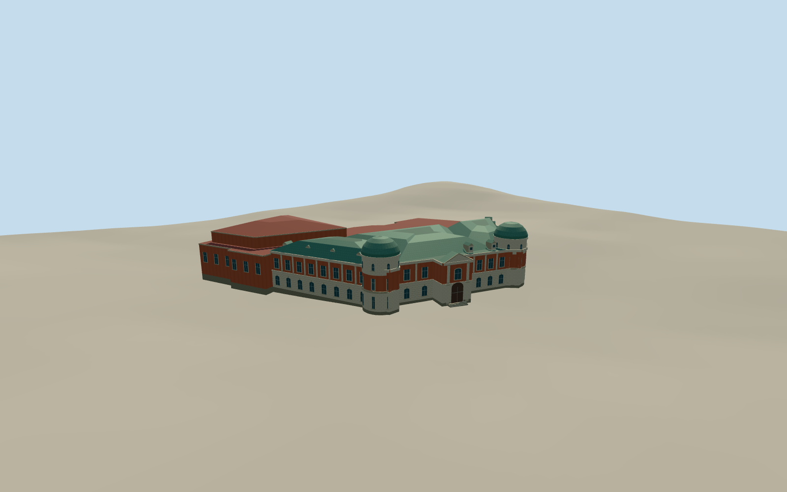

# National Museum of Taiwan Literature

The former Tainan Prefecture Hall in June 2025, with paired copper-domed towers, rusticated masonry and red brick, copper mansards, and the attached museum expansion.

Authoring state: **review-in-qa.json**. Current completion evidence is in [qa.json](qa.json) and the [completion ledger](../../../../qualla-structures/batches/qualla-003.PROGRESS.md).

- [National Museum of Taiwan Literature](https://qualla.com/national-museum-of-taiwan-literature/)

The exact June 2025 Qualla image supports the northwestern exterior. Written accounts and the mapped frontage support the paired towers, mansard forms and entrance. Exact fenestration, heights, copper color variation and rear elevations are estimated.

The independent site field uses public composite elevation data. Threshold and exposed foundation heights are approximate. The museum sculpture and interiors are outside the model scope.

Build: `node content/worldgen/source/places/ws/wsj/national_museum_of_taiwan_literature/models/generate-taiwan-literature.mjs`. Add `--check` to verify exact regeneration. 4871 triangles; 5 materials; no embedded photographs.
