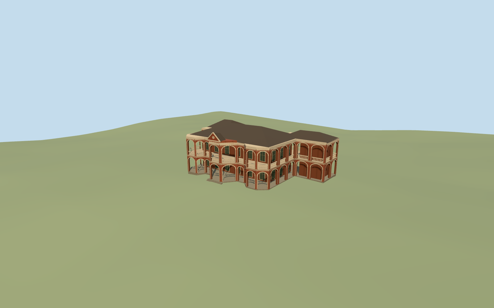

# Old Tainan Magistrate Residence

Restored west-facing Tainan governor’s residence with two levels of open red-brick arcades, three chamfered bays and a low triangular pediment.

Authoring state: **review-in-qa.json**. Current completion evidence is in [qa.json](qa.json) and the [completion ledger](../../../../qualla-structures/batches/qualla-003.PROGRESS.md).

- [Old Tainan Magistrate Residence](https://qualla.com/old-tainan-magistrate-residence/)

The present restored mansion has the lower triangular third-generation pediment. The original high rounded clock-shaped gable is recorded as historic and is not installed on the contemporary roof.

Native walls and major projections are fixed within the 27-point outline. Opening sequence, cornice profiles, tile color and wall heights are estimated from the 1908 evidence and written current heritage details.

Only the Western residence and its front steps are represented. The vanished Japanese timber counterpart, garden contents, and separately mapped air-raid shelter are excluded.

Build: `node content/worldgen/source/places/ws/wsj/old_tainan_magistrate_residence/models/generate-old-tainan-magistrate-residence.mjs`. Add `--check` to verify exact regeneration. 22398 triangles; 6 materials; no embedded photographs.
