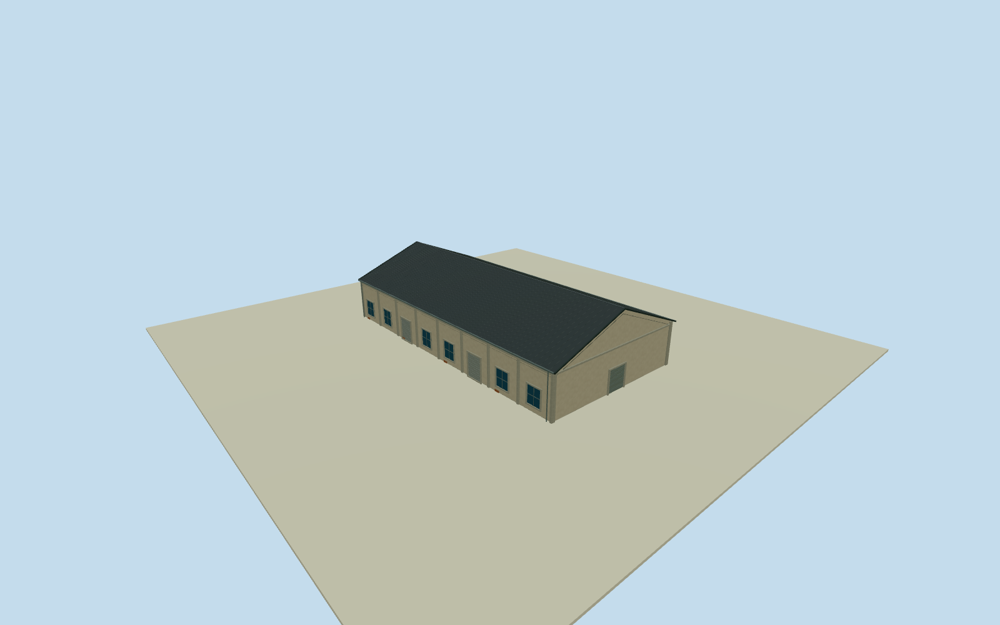

# Penglai B10 Warehouse

Whole independent original Penglai B10 warehouse1248239053/refB10, all four native corners/full walls/base/both gables/full pitched roof. Adjacent B9/B8/B7 and whole Pier2 ensemble excluded. Cleared2015 Penglai B7 row photograph supplies general neighboring warehouse construction vocabulary, not direct B10 labeled facade evidence; all B10 elevations/height/sections/census estimates. Independent native whole B10 warehouse1248239053/refB10, original four outside controls. Native B9/B8/B7 row establishes independent neighboring bodies. Cleared2015 B7 row photograph supplies general warehouse family only; B10facades/precise height/pitch/opening census unseen and explicitly estimated. Original0to1shortedge defines+Xwidth/+Zridge south. Current native former restaurant label locates body without a2015function claim; native plan is approximate historical registration. Whole independent native four-control B10 warehouse20.28x39.38m, full walls/base/both gables/full gray pitched roof. Already-cleared2015 Penglai B7row photo53499321477 supplies general neighboring weathered stucco/concrete/gray roof/closed industrial entry vocabulary only. No photographed B10label or exact B10elevation asserted; native plan establishes body. No B7oval/raisedpanel/emblem copied. Floor.25/foundation-4.05/eave6.05/ridge10.05 chosen once after independent original field and before geometry. Above-floor heights5.8/9.8m have2m uncertainty. Original corner grades-3.80009..+3.73810m show substantial unsurveyed composite coastal DEM variation. Estimated below-grade closing skirt is not a measured basement. Exact historical ground contact/vertical tie unavailable; do not mask/flatten/refetch/reframe or refit floors/roof after geometry. All B10facades explicitly estimated from general local warehouse family: eight bays/six window panels/two rollers each longwall, plain broad closed northern gable entry4.7mwide and smaller rear serviceentry, concrete framing/brick base repair patches. Roofpitch/gray covering/.35moverhang/height/door-window census/hidden elevations/pilaster dimensions are2m component estimates. Current former-restaurant native label locates body without a2015function claim. Original256m129x129 independent field/16641heights/2rawtiles/datum1.7625m fixed before geometry; isolated flat review plane at floor-.03 hides only the estimated buried extension, not the original field used for separate unmasked geographic inspection. Qualla-first38families/zero conflicts already screened. Reused exact photographer53499321477/NSID137596559@N07/CC0/license9/primary dual creator/native owner/original rendition/dimensions/byte proof. Full original previously personally inspected; no repeated source query/download. Flags/signs/letters/clock/lanterns/art/people/vehicles/photo textures unused. All four LODs retain full B10nativebody/base/all walls/gables/full roof/ridge/major concrete framing/windows/rollers/closed front and rear entries. Higher LODs restore frames/mullions/gutters/flutes/corrugation. One independent warehouse body, parent Pier2 ensemble unfinished.

Authoring state: **review-in-qa.json**. Current completion evidence is in [qa.json](qa.json) and the [completion ledger](../../../../qualla-structures/batches/qualla-002.PROGRESS.md).

- [Pier-2 Art Center](https://qualla.com/pier-2-art-center/)

Whole independent original Penglai B10 warehouse1248239053/refB10, all four native corners/full walls/base/both gables/full pitched roof. Adjacent B9/B8/B7 and whole Pier2 ensemble excluded. Cleared2015 Penglai B7 row photograph supplies general neighboring warehouse construction vocabulary, not direct B10 labeled facade evidence; all B10 elevations/height/sections/census estimates.

Independent native whole B10 warehouse1248239053/refB10, original four outside controls. Native B9/B8/B7 row establishes independent neighboring bodies. Cleared2015 B7 row photograph supplies general warehouse family only; B10facades/precise height/pitch/opening census unseen and explicitly estimated. Original0to1shortedge defines+Xwidth/+Zridge south. Current native former restaurant label locates body without a2015function claim; native plan is approximate historical registration.

Whole independent native four-control B10 warehouse20.28x39.38m, full walls/base/both gables/full gray pitched roof. Already-cleared2015 Penglai B7row photo53499321477 supplies general neighboring weathered stucco/concrete/gray roof/closed industrial entry vocabulary only. No photographed B10label or exact B10elevation asserted; native plan establishes body. No B7oval/raisedpanel/emblem copied.

Floor.25/foundation-4.05/eave6.05/ridge10.05 chosen once after independent original field and before geometry. Above-floor heights5.8/9.8m have2m uncertainty. Original corner grades-3.80009..+3.73810m show substantial unsurveyed composite coastal DEM variation. Estimated below-grade closing skirt is not a measured basement. Exact historical ground contact/vertical tie unavailable; do not mask/flatten/refetch/reframe or refit floors/roof after geometry.

All B10facades explicitly estimated from general local warehouse family: eight bays/six window panels/two rollers each longwall, plain broad closed northern gable entry4.7mwide and smaller rear serviceentry, concrete framing/brick base repair patches. Roofpitch/gray covering/.35moverhang/height/door-window census/hidden elevations/pilaster dimensions are2m component estimates. Current former-restaurant native label locates body without a2015function claim.

Original256m129x129 independent field/16641heights/2rawtiles/datum1.7625m fixed before geometry; isolated flat review plane at floor-.03 hides only the estimated buried extension, not the original field used for separate unmasked geographic inspection.

Qualla-first38families/zero conflicts already screened. Reused exact photographer53499321477/NSID137596559@N07/CC0/license9/primary dual creator/native owner/original rendition/dimensions/byte proof. Full original previously personally inspected; no repeated source query/download. Flags/signs/letters/clock/lanterns/art/people/vehicles/photo textures unused.

All four LODs retain full B10nativebody/base/all walls/gables/full roof/ridge/major concrete framing/windows/rollers/closed front and rear entries. Higher LODs restore frames/mullions/gutters/flutes/corrugation. One independent warehouse body, parent Pier2 ensemble unfinished.

Build: `node content/worldgen/source/places/ws/wsj/penglai_b10_warehouse/models/generate-house.mjs`. Add `--check` to verify exact regeneration. 3982 triangles; 5 materials; no embedded photographs.
