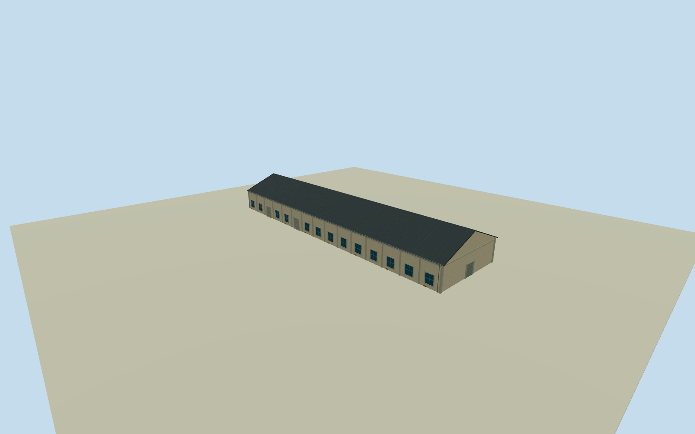

# Penglai B3 Warehouse

Whole independent original Penglai B3 Warehouse/way203314724/refB3, original four-control tapered envelope/full walls/base/two gables/full long pitched roof. Neighboring B3/B4/P2/P3 bodies excluded. Cleared2015 B7row supplies general neighboring warehouse construction family only; every elevation/height/section/opening census estimate. Retain original taper and attach facade details to native wall edges. Original independent Penglai B3 Warehouse/way203314724/refB3, all four native corners retained. Original1to2shortedge defines+Xgablewidth/signed+Zridge along long body. Distinct neighboring B3/B4/P2/P3 bodies excluded. Native current plan approximately registers2015appearance, all elevations/sections/census from local Penglai warehouse family estimated. Whole tapered native body, no bounding-box substitute. Whole independent native Penglai B3 warehouse, all original controls, walls, base, two gables and full gray pitched roof. Separate neighboring bodies excluded. Exact already-cleared2015 B7row photograph53499321477 supplies general local pale weathered stucco/concrete framing/gray roof/bluegray window/roller vocabulary only. Every Penglai B3 elevation, section and opening census estimated; no direct photograph label claim or copied B7oval/C7panel. Floor.25/foundation-0.25/eave6.05/ridge10.05 chosen once after original field and before geometry. Heights5.8/9.8m above floor have2m uncertainty. Original native corner relative grades[0.5973864630512304,5.329164656045619,2.9075182688353016,1.5335036111700246]m; closing skirt is estimated buried extension, not surveyed basement. Historical ground/vertical tie unknown. Original frame/field unchanged; no flattening, masking or floor/roof refit. 15 estimated longwall bays/13 windows/two rollers each side, broad closed northern gable entry4.7m and smaller rear entry, concrete pilasters and small brick base repairs. Precise pitch/covering/.35moverhang/facing/openings/hidden details are local family estimates with2m uncertainty. Independent256m129x129field/16641heights/2rawtile/datum-2.5464m frozen before geometry. Isolated review plane shows above-floor exterior; raw turntables expose estimated skirt. Original unmasked field separately inspected. Qualla-first38families/zero conflicts previously screened. Reused exact already-cleared photographer53499321477/NSID137596559@N07 CC0original, primary creator/native owner/license9/original URL/dimensions/byte proof bound. Full original previously personally inspected; no repeated source queries/downloads. Signs/posters/art/people/vehicles/photo textures unused. All four LODs retain the native tapered envelope; facade panels, pilasters, both gables and roof are bilinearly mapped to the original four controls with recomputed outward normals. Original source frame/field unchanged. All four LODs retain whole body/full roof/ridge/all walls/base/gables/pilasters/window-roller panels/closed entries. Higher LODs restore mullions/frames/gutters/flutes/corrugation. Parent Pier2 ensemble unfinished; accepted neighboring assets preserved.

Authoring state: **review-in-qa.json**. Current completion evidence is in [qa.json](qa.json) and the [completion ledger](../../../../qualla-structures/batches/qualla-002.PROGRESS.md).

- [Pier-2 Art Center](https://qualla.com/pier-2-art-center/)

Whole independent original Penglai B3 Warehouse/way203314724/refB3, original four-control tapered envelope/full walls/base/two gables/full long pitched roof. Neighboring B3/B4/P2/P3 bodies excluded. Cleared2015 B7row supplies general neighboring warehouse construction family only; every elevation/height/section/opening census estimate. Retain original taper and attach facade details to native wall edges.

Original independent Penglai B3 Warehouse/way203314724/refB3, all four native corners retained. Original1to2shortedge defines+Xgablewidth/signed+Zridge along long body. Distinct neighboring B3/B4/P2/P3 bodies excluded. Native current plan approximately registers2015appearance, all elevations/sections/census from local Penglai warehouse family estimated. Whole tapered native body, no bounding-box substitute.

Whole independent native Penglai B3 warehouse, all original controls, walls, base, two gables and full gray pitched roof. Separate neighboring bodies excluded. Exact already-cleared2015 B7row photograph53499321477 supplies general local pale weathered stucco/concrete framing/gray roof/bluegray window/roller vocabulary only. Every Penglai B3 elevation, section and opening census estimated; no direct photograph label claim or copied B7oval/C7panel.

Floor.25/foundation-0.25/eave6.05/ridge10.05 chosen once after original field and before geometry. Heights5.8/9.8m above floor have2m uncertainty. Original native corner relative grades[0.5973864630512304,5.329164656045619,2.9075182688353016,1.5335036111700246]m; closing skirt is estimated buried extension, not surveyed basement. Historical ground/vertical tie unknown. Original frame/field unchanged; no flattening, masking or floor/roof refit.

15 estimated longwall bays/13 windows/two rollers each side, broad closed northern gable entry4.7m and smaller rear entry, concrete pilasters and small brick base repairs. Precise pitch/covering/.35moverhang/facing/openings/hidden details are local family estimates with2m uncertainty.

Independent256m129x129field/16641heights/2rawtile/datum-2.5464m frozen before geometry. Isolated review plane shows above-floor exterior; raw turntables expose estimated skirt. Original unmasked field separately inspected.

Qualla-first38families/zero conflicts previously screened. Reused exact already-cleared photographer53499321477/NSID137596559@N07 CC0original, primary creator/native owner/license9/original URL/dimensions/byte proof bound. Full original previously personally inspected; no repeated source queries/downloads. Signs/posters/art/people/vehicles/photo textures unused.

All four LODs retain the native tapered envelope; facade panels, pilasters, both gables and roof are bilinearly mapped to the original four controls with recomputed outward normals. Original source frame/field unchanged. All four LODs retain whole body/full roof/ridge/all walls/base/gables/pilasters/window-roller panels/closed entries. Higher LODs restore mullions/frames/gutters/flutes/corrugation. Parent Pier2 ensemble unfinished; accepted neighboring assets preserved.

Build: `node content/worldgen/source/places/ws/wsj/penglai_b3_warehouse/models/generate-house.mjs`. Add `--check` to verify exact regeneration. 5202 triangles; 5 materials; no embedded photographs.
