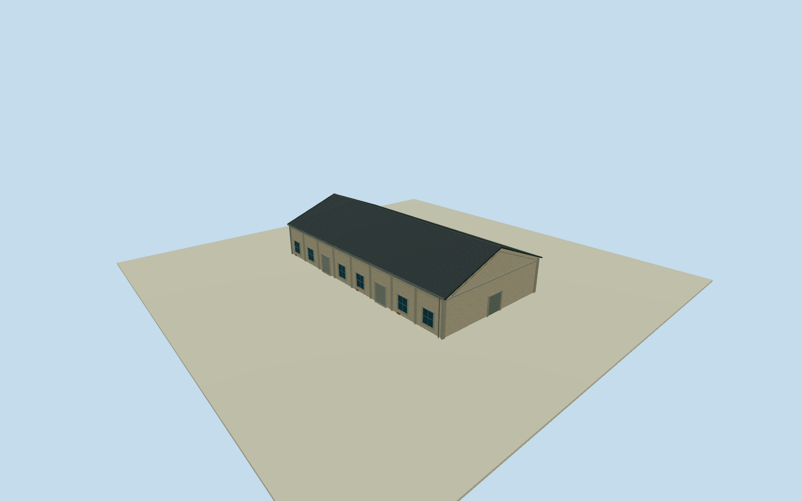

# Penglai B6 Warehouse

Whole independent original Penglai B6warehouse203315640/refB6, all four native outside controls/full walls/base/both gables/full pitched roof. Accepted B7-B10 excluded. Cleared2015 B7row photograph gives general neighboring construction family only; all B6elevations/height/sections/opening census estimated. Independent original B6way203315640/refB6, full four-control native body with first short edge20.27m/second long39.39m. Separate B7-B10 establish distinct neighboring bodies. Original0to1shortedge defines+Xgable width and signed+Zridge; current native plan approximately registers2015appearance, not surveyed historical plan. General B7row photo only, all B6elevations/sections/opening census estimated. Whole original independent Penglai B6body20.28x39.39m, all four native controls/full walls/base/two gables/full gray pitched roof. Native B7-B10 excluded. Exact cleared2015 B7row photograph53499321477 supplies general neighboring stucco/concrete framing/window/roller/gabled roof construction family only. Every B6elevation/height/section/opening census estimated; no direct B6photo-label claim, no B7oval/frontpanel/signage/art copied. Floor.25/foundation-1.5/eave6.05/ridge10.05 selected once after original independent field, before geometry. Heights5.8/9.8m above floor have2m uncertainty. Original native corner grades[-1.2490641455549214,0.011824018641064526,2.446259189741104,-0.8117384850018601]m. Closing skirt is estimated buried extension; rough northeastern sourcegrade can cover lowerwalls/thresholds/window bottoms. Historic ground/vertical tie unknown, no frame/field/floor/roof refit, masking or flattening. Eight estimated longwall bays/six window panels/two rollers each side, broad closed northern entry4.7m and smaller rear service entry. Roofpitch/.35moverhang/covering/precise wall openings/hidden elevations are local construction estimates with2m uncertainty. Independent256m129x129field/16641heights/two rawtiles/datum1.7787m frozen before geometry. Isolated plane shows above-floor exterior, raw turntables show estimated skirt. Original unmasked sourcefield separately inspected. Qualla-first38families/zero conflicts previously screened. Exact previously inspected/cleared53499321477/NSID137596559@N07 CC0original reused without queries/downloads, primarycreator/nativeowner/license9/exactoriginal URL/dimensions/bytes bound. Only general B7row architecture used, protected letters/flags/signs/art/people/vehicles/photo textures unused. All fourLODs retain whole body/fullroof/ridge/allwalls/base/gables/pilasters/window-roller panels/closed gableentries. Fine mullions/frames/flutes/gutters/corrugation simplify with distance. Accepted neighboring models preserved, parent Pier2unfinished.

Authoring state: **review-in-qa.json**. Current completion evidence is in [qa.json](qa.json) and the [completion ledger](../../../../qualla-structures/batches/qualla-002.PROGRESS.md).

- [Pier-2 Art Center](https://qualla.com/pier-2-art-center/)

Whole independent original Penglai B6warehouse203315640/refB6, all four native outside controls/full walls/base/both gables/full pitched roof. Accepted B7-B10 excluded. Cleared2015 B7row photograph gives general neighboring construction family only; all B6elevations/height/sections/opening census estimated.

Independent original B6way203315640/refB6, full four-control native body with first short edge20.27m/second long39.39m. Separate B7-B10 establish distinct neighboring bodies. Original0to1shortedge defines+Xgable width and signed+Zridge; current native plan approximately registers2015appearance, not surveyed historical plan. General B7row photo only, all B6elevations/sections/opening census estimated.

Whole original independent Penglai B6body20.28x39.39m, all four native controls/full walls/base/two gables/full gray pitched roof. Native B7-B10 excluded. Exact cleared2015 B7row photograph53499321477 supplies general neighboring stucco/concrete framing/window/roller/gabled roof construction family only. Every B6elevation/height/section/opening census estimated; no direct B6photo-label claim, no B7oval/frontpanel/signage/art copied.

Floor.25/foundation-1.5/eave6.05/ridge10.05 selected once after original independent field, before geometry. Heights5.8/9.8m above floor have2m uncertainty. Original native corner grades[-1.2490641455549214,0.011824018641064526,2.446259189741104,-0.8117384850018601]m. Closing skirt is estimated buried extension; rough northeastern sourcegrade can cover lowerwalls/thresholds/window bottoms. Historic ground/vertical tie unknown, no frame/field/floor/roof refit, masking or flattening.

Eight estimated longwall bays/six window panels/two rollers each side, broad closed northern entry4.7m and smaller rear service entry. Roofpitch/.35moverhang/covering/precise wall openings/hidden elevations are local construction estimates with2m uncertainty.

Independent256m129x129field/16641heights/two rawtiles/datum1.7787m frozen before geometry. Isolated plane shows above-floor exterior, raw turntables show estimated skirt. Original unmasked sourcefield separately inspected.

Qualla-first38families/zero conflicts previously screened. Exact previously inspected/cleared53499321477/NSID137596559@N07 CC0original reused without queries/downloads, primarycreator/nativeowner/license9/exactoriginal URL/dimensions/bytes bound. Only general B7row architecture used, protected letters/flags/signs/art/people/vehicles/photo textures unused.

All fourLODs retain whole body/fullroof/ridge/allwalls/base/gables/pilasters/window-roller panels/closed gableentries. Fine mullions/frames/flutes/gutters/corrugation simplify with distance. Accepted neighboring models preserved, parent Pier2unfinished.

Build: `node content/worldgen/source/places/ws/wsj/penglai_b6_warehouse/models/generate-house.mjs`. Add `--check` to verify exact regeneration. 3982 triangles; 5 materials; no embedded photographs.
