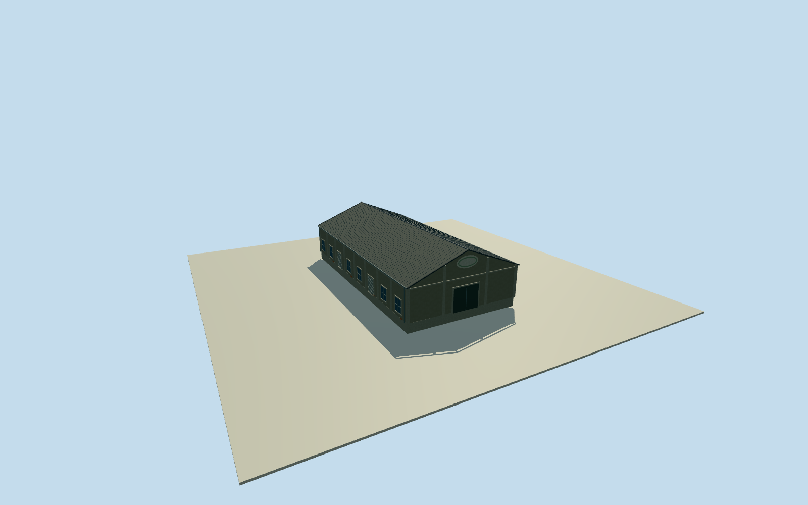

# Penglai B7 Warehouse

Whole original independent Penglai B7 warehouse way1248239050/refB7, all four native corners, all walls/foundation/both gables/full pitched roof. Separate B8/B9/B4 and whole Pier2 ensemble excluded. Exact2015 B7-marked gable photographed; hidden longwalls/rear/height/census estimates. Independent original native B7 way1248239050/refB7, all four native outside corners retained. Exact cleared2015 photo53500624705 explicitly shows B7-marked gable, corroborated by already-cleared full row photo53499321477. Original0to1shortedge defines+Xwidth, signed+Zridge toward south; photographed B7gable interpreted at negativeZfront by road/row context. Current native plan approximately registers2015 appearance; no survey of height or hidden facades. Whole B7 original four-corner20.28x39.39m body/all walls/foundation/both gables/full pitched roof retained. Exact2015 B7 close gable photo53500624705 shows large horizontal oval architectural frame, concrete framing and weathered gray stucco/exposed brick patch. B7 lettering binds identity only; central emblem/letters excluded. Broad front entry inferred from already-cleared whole B7 row photo53499321477. Hidden longwalls/rear and8-bay census/6windows/2rollers per side are explicit estimates. Floor.25/foundation-1.5/eave6.05/ridge10.05 chosen once after independent original field and before geometry. Heights5.8/9.8m above floor have2m uncertainty. Roofpitch/overhang.3m/ellipse center8.3m/radii2.0x1.0m/entrywidth4.7m/flankingpiers/pilastercensus are source-informed2m component estimates. Historical horizontal/vertical tie unsurveyed; no floor/roof refit or field masking/flattening. Original independent256m129x129 field/16641heights/2rawtiles/datum-1.198m fixed before geometry; corner relativegrades-1.17402..+1.54048m. Estimated closing skirt is not surveyed basement. Qualla-first38families/zero conflicts screened before photographer references. Exact original53500624705 CC0/license9/primary dual creator+native NSID137596559@N07/exact original URL/dimensions/bytes bound; original personally inspected. Already-cleared full row53499321477 corroborates B7, not C7. No repeated rights query/download; no signs/lettering/emblem/sculptures/people/vehicles/photo textures. All four LODs retain full mapped B7 body/roof/ridge/gables/base/concrete framing/main closed front entry, with plain oval frame at district and above. Higher LODs add window/door frames/mullions/gutters/corrugation/flutes. One independent B7 physical body, not a whole Pier2 proxy.

Authoring state: **review-in-qa.json**. Current completion evidence is in [qa.json](qa.json) and the [completion ledger](../../../../qualla-structures/batches/qualla-002.PROGRESS.md).

- [Pier-2 Art Center](https://qualla.com/pier-2-art-center/)

Whole original independent Penglai B7 warehouse way1248239050/refB7, all four native corners, all walls/foundation/both gables/full pitched roof. Separate B8/B9/B4 and whole Pier2 ensemble excluded. Exact2015 B7-marked gable photographed; hidden longwalls/rear/height/census estimates.

Independent original native B7 way1248239050/refB7, all four native outside corners retained. Exact cleared2015 photo53500624705 explicitly shows B7-marked gable, corroborated by already-cleared full row photo53499321477. Original0to1shortedge defines+Xwidth, signed+Zridge toward south; photographed B7gable interpreted at negativeZfront by road/row context. Current native plan approximately registers2015 appearance; no survey of height or hidden facades.

Whole B7 original four-corner20.28x39.39m body/all walls/foundation/both gables/full pitched roof retained. Exact2015 B7 close gable photo53500624705 shows large horizontal oval architectural frame, concrete framing and weathered gray stucco/exposed brick patch. B7 lettering binds identity only; central emblem/letters excluded. Broad front entry inferred from already-cleared whole B7 row photo53499321477. Hidden longwalls/rear and8-bay census/6windows/2rollers per side are explicit estimates.

Floor.25/foundation-1.5/eave6.05/ridge10.05 chosen once after independent original field and before geometry. Heights5.8/9.8m above floor have2m uncertainty. Roofpitch/overhang.3m/ellipse center8.3m/radii2.0x1.0m/entrywidth4.7m/flankingpiers/pilastercensus are source-informed2m component estimates. Historical horizontal/vertical tie unsurveyed; no floor/roof refit or field masking/flattening.

Original independent256m129x129 field/16641heights/2rawtiles/datum-1.198m fixed before geometry; corner relativegrades-1.17402..+1.54048m. Estimated closing skirt is not surveyed basement.

Qualla-first38families/zero conflicts screened before photographer references. Exact original53500624705 CC0/license9/primary dual creator+native NSID137596559@N07/exact original URL/dimensions/bytes bound; original personally inspected. Already-cleared full row53499321477 corroborates B7, not C7. No repeated rights query/download; no signs/lettering/emblem/sculptures/people/vehicles/photo textures.

All four LODs retain full mapped B7 body/roof/ridge/gables/base/concrete framing/main closed front entry, with plain oval frame at district and above. Higher LODs add window/door frames/mullions/gutters/corrugation/flutes. One independent B7 physical body, not a whole Pier2 proxy.

Build: `node content/worldgen/source/places/ws/wsj/penglai_b7_warehouse/models/generate-house.mjs`. Add `--check` to verify exact regeneration. 3810 triangles; 5 materials; no embedded photographs.
