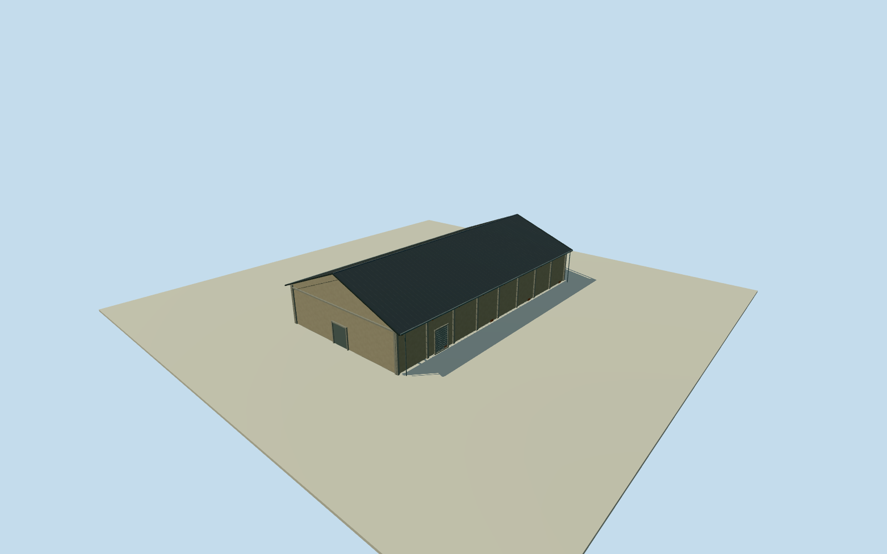

# Penglai B9 Warehouse

Whole independent original native Penglai B9 warehouse1248239052/refB9/current Kaohsiung experimental theatre, all four native corners/full walls/base/two gables/full pitched roof. Adjacent B8/B10 and whole Pier2 ensemble excluded. Cleared2015 B8 railway alley original supplies adjacent stucco warehouse/eave vocabulary, with B9 association inferred from native row order, not visible B9 lettering. Original independent B9 warehouse1248239052/refB9, four native outside corners retained. Adjacent native B8museum1248239051 lies east and B10 lies west. Cleared B8 railway alley original53500360478 shows opposite stucco warehouse side; B9 side association inferred from adjacency and row orientation, not exact source label. Original0to1shortedge defines+Xwidth/+Zridge toward south. Current theatre label locates body, not a verified2015 function claim. Full native geometry, heights/sections/hidden elevations estimates. Whole original native four-control B9 warehouse20.28x39.38m, full walls/base/both gables/full pitched gray roof. Original cleared railway alley photo53500360478 shows opposite mostly blank gray stucco/concrete-pilaster wall/exposed brick base patches and dark timber eave soffit/rafter ends. Native B8-B9 row supports inferred B9 eastern positiveXalley side, not a photographed B9 label or exact camera solution. Floor.25/foundation-3.1/eave6.05/ridge10.05 chosen once after original independent field and before geometry. Heights5.8/9.8m above floor have2m uncertainty. Original corner grades-2.81573..+4.51898m show rough coastal composite DEM variation; skirt is estimated below-grade closure, not measured basement. Exact historical grade and vertical tie unsurveyed. Do not mask/flatten/refetch/reframe or refit floor/roof to hide sourcegrade limitations. Eight estimated longwall bays, mostly blank eastern stucco alley wall with one estimated closed service door, nine projecting timber rafter ends/deep soffit. Hidden western wall conservatively has six window panels/two rollers; both gables have plain closed service entries. Side roof overhang1.0m/end.35m, precise height/pitch/covering/rafters/pilaster dimensions/door-window census and hidden elevations are2m component estimates. No B7oval/emblem or B8brick/glazed-entry frontage copied. Original256m129x129 independent field/16641heights/2rawtiles/datum-0.0827m frozen before geometry. Composite DEM does not certify historical ground contact. Qualla-first38families/zero conflicts already screened. Reused exact already-cleared photographer53500360478/NSID137596559@N07 CC0 original, dual primary creator/native owner/license9/exact original URL/dimensions/bytes bound. Full original previously personally inspected. No repeated rights query/download; train/people/signage/art/clock/lanterns/photo textures unused. Current native experimental theatre label locates B9, not verified2015function. All four LODs retain whole body/roof/ridge/all walls/gables/base/pilasters/blank stucco alley face/service door/major timber rafter ends. District+restores estimated western window frames/mullions, finer gutters/flutes/corrugation simplify. Independent B9 physical body; parent Pier2 ensemble remains unfinished.

Authoring state: **review-in-qa.json**. Current completion evidence is in [qa.json](qa.json) and the [completion ledger](../../../../qualla-structures/batches/qualla-002.PROGRESS.md).

- [Pier-2 Art Center](https://qualla.com/pier-2-art-center/)

Whole independent original native Penglai B9 warehouse1248239052/refB9/current Kaohsiung experimental theatre, all four native corners/full walls/base/two gables/full pitched roof. Adjacent B8/B10 and whole Pier2 ensemble excluded. Cleared2015 B8 railway alley original supplies adjacent stucco warehouse/eave vocabulary, with B9 association inferred from native row order, not visible B9 lettering.

Original independent B9 warehouse1248239052/refB9, four native outside corners retained. Adjacent native B8museum1248239051 lies east and B10 lies west. Cleared B8 railway alley original53500360478 shows opposite stucco warehouse side; B9 side association inferred from adjacency and row orientation, not exact source label. Original0to1shortedge defines+Xwidth/+Zridge toward south. Current theatre label locates body, not a verified2015 function claim. Full native geometry, heights/sections/hidden elevations estimates.

Whole original native four-control B9 warehouse20.28x39.38m, full walls/base/both gables/full pitched gray roof. Original cleared railway alley photo53500360478 shows opposite mostly blank gray stucco/concrete-pilaster wall/exposed brick base patches and dark timber eave soffit/rafter ends. Native B8-B9 row supports inferred B9 eastern positiveXalley side, not a photographed B9 label or exact camera solution.

Floor.25/foundation-3.1/eave6.05/ridge10.05 chosen once after original independent field and before geometry. Heights5.8/9.8m above floor have2m uncertainty. Original corner grades-2.81573..+4.51898m show rough coastal composite DEM variation; skirt is estimated below-grade closure, not measured basement. Exact historical grade and vertical tie unsurveyed. Do not mask/flatten/refetch/reframe or refit floor/roof to hide sourcegrade limitations.

Eight estimated longwall bays, mostly blank eastern stucco alley wall with one estimated closed service door, nine projecting timber rafter ends/deep soffit. Hidden western wall conservatively has six window panels/two rollers; both gables have plain closed service entries. Side roof overhang1.0m/end.35m, precise height/pitch/covering/rafters/pilaster dimensions/door-window census and hidden elevations are2m component estimates. No B7oval/emblem or B8brick/glazed-entry frontage copied.

Original256m129x129 independent field/16641heights/2rawtiles/datum-0.0827m frozen before geometry. Composite DEM does not certify historical ground contact.

Qualla-first38families/zero conflicts already screened. Reused exact already-cleared photographer53500360478/NSID137596559@N07 CC0 original, dual primary creator/native owner/license9/exact original URL/dimensions/bytes bound. Full original previously personally inspected. No repeated rights query/download; train/people/signage/art/clock/lanterns/photo textures unused. Current native experimental theatre label locates B9, not verified2015function.

All four LODs retain whole body/roof/ridge/all walls/gables/base/pilasters/blank stucco alley face/service door/major timber rafter ends. District+restores estimated western window frames/mullions, finer gutters/flutes/corrugation simplify. Independent B9 physical body; parent Pier2 ensemble remains unfinished.

Build: `node content/worldgen/source/places/ws/wsj/penglai_b9_warehouse/models/generate-house.mjs`. Add `--check` to verify exact regeneration. 3154 triangles; 6 materials; no embedded photographs.
