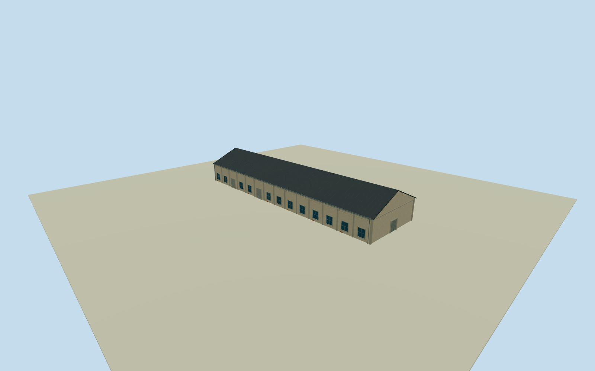

# Penglai P2 Warehouse

Whole independent original Penglai P2warehouse203315632/refP2, all four native outside controls/full walls/base/both gables/full long pitched roof. Distinct P3/B3/B4 bodies excluded. Cleared2015 C5overview gives general local Pier2warehouse construction family only, every P2elevation/height/sections/opening census estimate. Original independent P2way203315632/refP2, whole native four-control body18.61x66.1m. First native0to1shortedge defines+Xgable width, signed+Zridge along body. Distinct P3/B3/B4original bodies excluded. Current native plan approximately registers2015appearance; every elevation/section/census estimated from general neighboring C5family, no photographed P2label claim. Whole independent native Penglai P2 warehouse, all original controls, walls, base, two gables and full gray pitched roof. Separate neighboring bodies excluded. Exact already-cleared2015 C5overview53500205916 supplies general local pale weathered stucco/concrete framing/gray roof/bluegray window/roller vocabulary only. Every Penglai P2 elevation, section and opening census estimated; no direct photograph label claim or copied B7oval/C7panel. Floor.25/foundation-1.15/eave6.45/ridge10.65 chosen once after original field and before geometry. Heights6.2/10.4m above floor have2m uncertainty. Original native corner relative grades[1.6281861659568744,2.0120976979863805,-0.8864999999999998,-0.8864999999999998]m; closing skirt is estimated buried extension, not surveyed basement. Historical ground/vertical tie unknown. Original frame/field unchanged; no flattening, masking or floor/roof refit. 14 estimated longwall bays/12 windows/two rollers each side, broad closed northern gable entry4.7m and smaller rear entry, concrete pilasters and small brick base repairs. Precise pitch/covering/.35moverhang/facing/openings/hidden details are local family estimates with2m uncertainty. Independent256m129x129field/16641heights/1rawtile/datum2.8865m frozen before geometry. Isolated review plane shows above-floor exterior; raw turntables expose estimated skirt. Original unmasked field separately inspected. Qualla-first38families/zero conflicts previously screened. Reused exact already-cleared photographer53500205916/NSID137596559@N07 CC0original, primary creator/native owner/license9/original URL/dimensions/byte proof bound. Full original previously personally inspected; no repeated source queries/downloads. Signs/posters/art/people/vehicles/photo textures unused. All four LODs retain whole body/full roof/ridge/all walls/base/gables/pilasters/window-roller panels/closed entries. Higher LODs restore mullions/frames/gutters/flutes/corrugation. Parent Pier2 ensemble unfinished; accepted neighboring assets preserved.

Authoring state: **review-in-qa.json**. Current completion evidence is in [qa.json](qa.json) and the [completion ledger](../../../../qualla-structures/batches/qualla-002.PROGRESS.md).

- [Pier-2 Art Center](https://qualla.com/pier-2-art-center/)

Whole independent original Penglai P2warehouse203315632/refP2, all four native outside controls/full walls/base/both gables/full long pitched roof. Distinct P3/B3/B4 bodies excluded. Cleared2015 C5overview gives general local Pier2warehouse construction family only, every P2elevation/height/sections/opening census estimate.

Original independent P2way203315632/refP2, whole native four-control body18.61x66.1m. First native0to1shortedge defines+Xgable width, signed+Zridge along body. Distinct P3/B3/B4original bodies excluded. Current native plan approximately registers2015appearance; every elevation/section/census estimated from general neighboring C5family, no photographed P2label claim.

Whole independent native Penglai P2 warehouse, all original controls, walls, base, two gables and full gray pitched roof. Separate neighboring bodies excluded. Exact already-cleared2015 C5overview53500205916 supplies general local pale weathered stucco/concrete framing/gray roof/bluegray window/roller vocabulary only. Every Penglai P2 elevation, section and opening census estimated; no direct photograph label claim or copied B7oval/C7panel.

Floor.25/foundation-1.15/eave6.45/ridge10.65 chosen once after original field and before geometry. Heights6.2/10.4m above floor have2m uncertainty. Original native corner relative grades[1.6281861659568744,2.0120976979863805,-0.8864999999999998,-0.8864999999999998]m; closing skirt is estimated buried extension, not surveyed basement. Historical ground/vertical tie unknown. Original frame/field unchanged; no flattening, masking or floor/roof refit.

14 estimated longwall bays/12 windows/two rollers each side, broad closed northern gable entry4.7m and smaller rear entry, concrete pilasters and small brick base repairs. Precise pitch/covering/.35moverhang/facing/openings/hidden details are local family estimates with2m uncertainty.

Independent256m129x129field/16641heights/1rawtile/datum2.8865m frozen before geometry. Isolated review plane shows above-floor exterior; raw turntables expose estimated skirt. Original unmasked field separately inspected.

Qualla-first38families/zero conflicts previously screened. Reused exact already-cleared photographer53500205916/NSID137596559@N07 CC0original, primary creator/native owner/license9/original URL/dimensions/byte proof bound. Full original previously personally inspected; no repeated source queries/downloads. Signs/posters/art/people/vehicles/photo textures unused.

All four LODs retain whole body/full roof/ridge/all walls/base/gables/pilasters/window-roller panels/closed entries. Higher LODs restore mullions/frames/gutters/flutes/corrugation. Parent Pier2 ensemble unfinished; accepted neighboring assets preserved.

Build: `node content/worldgen/source/places/ws/wsj/penglai_p2_warehouse/models/generate-house.mjs`. Add `--check` to verify exact regeneration. 5026 triangles; 5 materials; no embedded photographs.
