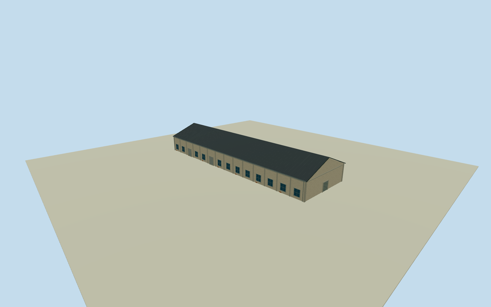

# Penglai P3 Warehouse

Whole independent original Penglai P3warehouse203315647/refP3, all four original controls/slightly tapered envelope/full walls/base/two gables/full long pitched roof. Separate P2/B3/B4 excluded. Cleared2015 C5overview gives general local warehouse construction family only; every P3elevation/height/sections/opening census estimated. Retain original taper in body and keep facade panels attached to native wall edges. Independent native whole P3way203315647/refP3, original four outside controls, short firstedge20.20m/oppositewidth21.13m/longedges66.71and66.86m; slight native taper must remain. Original0to1shortedge defines+Xgablewidth and signed+Zridge along native body. Distinct P2/B3/B4bodies excluded. Current map plan approximately registers2015appearance; all elevations/sections/census from local C5construction family estimated, no exact P3photo identity. Whole independent native Penglai P3 warehouse, all original controls, walls, base, two gables and full gray pitched roof. Separate neighboring bodies excluded. Exact already-cleared2015 C5overview53500205916 supplies general local pale weathered stucco/concrete framing/gray roof/bluegray window/roller vocabulary only. Every Penglai P3 elevation, section and opening census estimated; no direct photograph label claim or copied B7oval/C7panel. Floor.25/foundation-1.85/eave6.45/ridge10.65 chosen once after original field and before geometry. Heights6.2/10.4m above floor have2m uncertainty. Original native corner relative grades[-1.5798179299098667,1.217587587176098,0.608786287384615,0.5142388952576091]m; closing skirt is estimated buried extension, not surveyed basement. Historical ground/vertical tie unknown. Original frame/field unchanged; no flattening, masking or floor/roof refit. 14 estimated longwall bays/12 windows/two rollers each side, broad closed northern gable entry4.7m and smaller rear entry, concrete pilasters and small brick base repairs. Precise pitch/covering/.35moverhang/facing/openings/hidden details are local family estimates with2m uncertainty. Independent256m129x129field/16641heights/1rawtile/datum4.339m frozen before geometry. Isolated review plane shows above-floor exterior; raw turntables expose estimated skirt. Original unmasked field separately inspected. Qualla-first38families/zero conflicts previously screened. Reused exact already-cleared photographer53500205916/NSID137596559@N07 CC0original, primary creator/native owner/license9/original URL/dimensions/byte proof bound. Full original previously personally inspected; no repeated source queries/downloads. Signs/posters/art/people/vehicles/photo textures unused. All four LODs retain the native tapered envelope; facade panels, pilasters, both gables and roof are bilinearly mapped to the original four controls with recomputed outward normals. Original source frame/field unchanged. All four LODs retain whole body/full roof/ridge/all walls/base/gables/pilasters/window-roller panels/closed entries. Higher LODs restore mullions/frames/gutters/flutes/corrugation. Parent Pier2 ensemble unfinished; accepted neighboring assets preserved.

Authoring state: **review-in-qa.json**. Current completion evidence is in [qa.json](qa.json) and the [completion ledger](../../../../qualla-structures/batches/qualla-002.PROGRESS.md).

- [Pier-2 Art Center](https://qualla.com/pier-2-art-center/)

Whole independent original Penglai P3warehouse203315647/refP3, all four original controls/slightly tapered envelope/full walls/base/two gables/full long pitched roof. Separate P2/B3/B4 excluded. Cleared2015 C5overview gives general local warehouse construction family only; every P3elevation/height/sections/opening census estimated. Retain original taper in body and keep facade panels attached to native wall edges.

Independent native whole P3way203315647/refP3, original four outside controls, short firstedge20.20m/oppositewidth21.13m/longedges66.71and66.86m; slight native taper must remain. Original0to1shortedge defines+Xgablewidth and signed+Zridge along native body. Distinct P2/B3/B4bodies excluded. Current map plan approximately registers2015appearance; all elevations/sections/census from local C5construction family estimated, no exact P3photo identity.

Whole independent native Penglai P3 warehouse, all original controls, walls, base, two gables and full gray pitched roof. Separate neighboring bodies excluded. Exact already-cleared2015 C5overview53500205916 supplies general local pale weathered stucco/concrete framing/gray roof/bluegray window/roller vocabulary only. Every Penglai P3 elevation, section and opening census estimated; no direct photograph label claim or copied B7oval/C7panel.

Floor.25/foundation-1.85/eave6.45/ridge10.65 chosen once after original field and before geometry. Heights6.2/10.4m above floor have2m uncertainty. Original native corner relative grades[-1.5798179299098667,1.217587587176098,0.608786287384615,0.5142388952576091]m; closing skirt is estimated buried extension, not surveyed basement. Historical ground/vertical tie unknown. Original frame/field unchanged; no flattening, masking or floor/roof refit.

14 estimated longwall bays/12 windows/two rollers each side, broad closed northern gable entry4.7m and smaller rear entry, concrete pilasters and small brick base repairs. Precise pitch/covering/.35moverhang/facing/openings/hidden details are local family estimates with2m uncertainty.

Independent256m129x129field/16641heights/1rawtile/datum4.339m frozen before geometry. Isolated review plane shows above-floor exterior; raw turntables expose estimated skirt. Original unmasked field separately inspected.

Qualla-first38families/zero conflicts previously screened. Reused exact already-cleared photographer53500205916/NSID137596559@N07 CC0original, primary creator/native owner/license9/original URL/dimensions/byte proof bound. Full original previously personally inspected; no repeated source queries/downloads. Signs/posters/art/people/vehicles/photo textures unused.

All four LODs retain the native tapered envelope; facade panels, pilasters, both gables and roof are bilinearly mapped to the original four controls with recomputed outward normals. Original source frame/field unchanged. All four LODs retain whole body/full roof/ridge/all walls/base/gables/pilasters/window-roller panels/closed entries. Higher LODs restore mullions/frames/gutters/flutes/corrugation. Parent Pier2 ensemble unfinished; accepted neighboring assets preserved.

Build: `node content/worldgen/source/places/ws/wsj/penglai_p3_warehouse/models/generate-house.mjs`. Add `--check` to verify exact regeneration. 5026 triangles; 5 materials; no embedded photographs.
