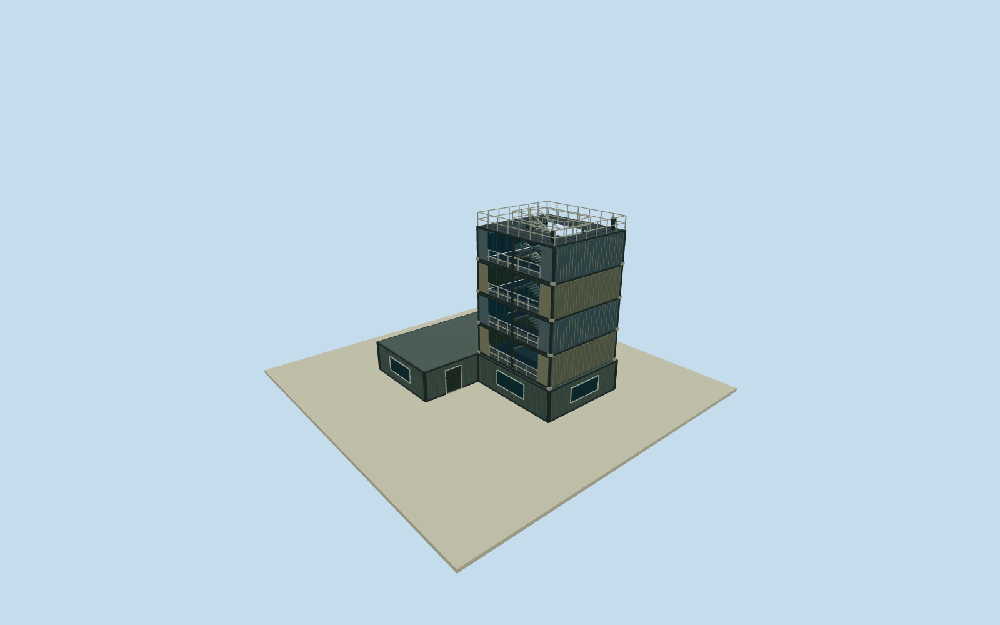

# Pier-2 Observation Tower

Whole independent Pier2 observation tower and integral boat waiting-room container base, way755347283, all six original native controls. Contemporary2015 account establishes roughly five-storey stacked-container observation tower with horizontal container waiting rooms below. Original current footprint approximately registers2015 appearance; tower/low-wing split, exact metric heights, stairs, colors and openings explicitly estimated. Separate warehouses, boat, grounds, art and modern murals excluded. Independent original native named observation tower way755347283, all six original outer controls retained in complete integral base. Original0to1edge defines signed+X across native footprint; +Z perpendicular. Current native plan approximately registers2015; sections/stack arrangement/precise dimensions estimated from contemporaneous written stacked-container/five-storey/waiting-room form. No slab represents the whole art center. Contemporaneous city account dated2015-12-29 identifies the newly completed2015 Pier2tower with a culture-boat ticket office and waiting area below. The2015-11-04 firsthand report describes a roughly five-storey observation tower made from stacked shipping containers, with horizontal container waiting rooms below, designed by Lin Chih-Feng. These are factual written descriptions only; no article photographs, diagrams, maps, murals, designs or image-derived descriptions adopted. Exact native way755347283 supplies the six-corner whole integral base, not the upper stack divisions. Exact metric height, solid/open facades, container orientation/color and stair arrangement remain estimates. Whole independently mapped L-shaped six-control integral waiting-room/container base retained, with all walls/closed entries/full low roof/base, plus bounded roughly five-level open-sided container lookout. Upper stack footprint [-3.1..4.82]x[.69..9.35]m is an estimated subdivision inside the original base, not a surveyed container layout. Public switchback stairs/landings/open bays/upper observation deck/rails/castings/corrugation modeled; all are bounded approximations of the documented form. Original independent256m129x129field/16641heights/1rawtile/datum1.9975m fixed before floor.25/base-.6/waitingroof3.1/fouradditional2.85mlevels/deck14.5/toprail15.62m. Metric tower height has3m uncertainty and components2m uncertainty. Original corner relative grades[-0.2840873259590695,-0.011638712163080545,0.047247922150831734,0.0024999999999999467,-0.043020903478274475,-0.03816817270466877]m. No original field/frame/floor/sections refit, mask or flattening; historical ground tie unsurveyed. Estimated buried closing skirt is not a surveyed basement. Already-cleared2015 original53500205916/NSID137596559@N07 CC0 photograph, taken from the deck, supplies neighboring harbor context only. It does not depict the own tower exterior and supplies no tower dimensions/stack layout/feature census. Qualla first38families/zero conflicts already screened. All other imagery, copyrighted illustrations, protected signs/people/boats and modern2024murals unused. Historical2015 pre-mural appearance only. Estimated plain muted green-gray, blue-gray and pale painted metal do not reproduce later artwork. Every LOD retains the complete native base, five-level container silhouette, open bays, stairs and observation deck; fine rails/treads/castings/corrugation simplify at distance. Parent Pier2 ensemble remains independent and unfinished.

Authoring state: **review-in-qa.json**. Current completion evidence is in [qa.json](qa.json) and the [completion ledger](../../../../qualla-structures/batches/qualla-002.PROGRESS.md).

- [Pier-2 Art Center](https://qualla.com/pier-2-art-center/)

Whole independent Pier2 observation tower and integral boat waiting-room container base, way755347283, all six original native controls. Contemporary2015 account establishes roughly five-storey stacked-container observation tower with horizontal container waiting rooms below. Original current footprint approximately registers2015 appearance; tower/low-wing split, exact metric heights, stairs, colors and openings explicitly estimated. Separate warehouses, boat, grounds, art and modern murals excluded.

Independent original native named observation tower way755347283, all six original outer controls retained in complete integral base. Original0to1edge defines signed+X across native footprint; +Z perpendicular. Current native plan approximately registers2015; sections/stack arrangement/precise dimensions estimated from contemporaneous written stacked-container/five-storey/waiting-room form. No slab represents the whole art center.

Contemporaneous city account dated2015-12-29 identifies the newly completed2015 Pier2tower with a culture-boat ticket office and waiting area below. The2015-11-04 firsthand report describes a roughly five-storey observation tower made from stacked shipping containers, with horizontal container waiting rooms below, designed by Lin Chih-Feng. These are factual written descriptions only; no article photographs, diagrams, maps, murals, designs or image-derived descriptions adopted. Exact native way755347283 supplies the six-corner whole integral base, not the upper stack divisions. Exact metric height, solid/open facades, container orientation/color and stair arrangement remain estimates.

Whole independently mapped L-shaped six-control integral waiting-room/container base retained, with all walls/closed entries/full low roof/base, plus bounded roughly five-level open-sided container lookout. Upper stack footprint [-3.1..4.82]x[.69..9.35]m is an estimated subdivision inside the original base, not a surveyed container layout. Public switchback stairs/landings/open bays/upper observation deck/rails/castings/corrugation modeled; all are bounded approximations of the documented form.

Original independent256m129x129field/16641heights/1rawtile/datum1.9975m fixed before floor.25/base-.6/waitingroof3.1/fouradditional2.85mlevels/deck14.5/toprail15.62m. Metric tower height has3m uncertainty and components2m uncertainty. Original corner relative grades[-0.2840873259590695,-0.011638712163080545,0.047247922150831734,0.0024999999999999467,-0.043020903478274475,-0.03816817270466877]m. No original field/frame/floor/sections refit, mask or flattening; historical ground tie unsurveyed. Estimated buried closing skirt is not a surveyed basement.

Already-cleared2015 original53500205916/NSID137596559@N07 CC0 photograph, taken from the deck, supplies neighboring harbor context only. It does not depict the own tower exterior and supplies no tower dimensions/stack layout/feature census. Qualla first38families/zero conflicts already screened. All other imagery, copyrighted illustrations, protected signs/people/boats and modern2024murals unused.

Historical2015 pre-mural appearance only. Estimated plain muted green-gray, blue-gray and pale painted metal do not reproduce later artwork. Every LOD retains the complete native base, five-level container silhouette, open bays, stairs and observation deck; fine rails/treads/castings/corrugation simplify at distance. Parent Pier2 ensemble remains independent and unfinished.

Build: `node content/worldgen/source/places/ws/wsj/pier_2_observation_tower/models/generate-house.mjs`. Add `--check` to verify exact regeneration. 9484 triangles; 3 materials; no embedded photographs.
