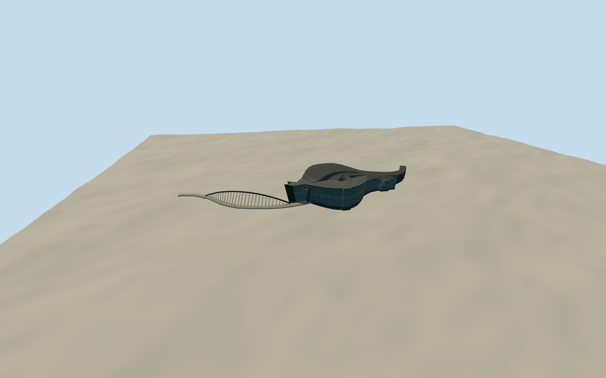

# Southern Branch of the National Palace Museum and Zhimei Bridge

The National Palace Museum’s curved dark galleries, sloping glazed public wing and the Zhimei Bridge’s dark steel arch and S-shaped deck.

Authoring state: **review-in-qa.json**. Current completion evidence is in [qa.json](qa.json) and the [completion ledger](../../../../qualla-structures/batches/qualla-003.PROGRESS.md).

- [Southern Branch of the National Palace Museum](https://qualla.com/southern-branch-of-the-national-palace-museum/)

The model represents the main building and Zhimei Bridge at the December 2015 opening. Its main elevations and bridge use two exact public-domain views from the same visit.

The main building outline and three openings are mapped. Roof curves, the dimensions of the three intersecting volumes and elevations hidden from the photographs are estimates.

The bridge deck follows its mapped centerline. The published 142 m span and 25 ribs guide the arch. Deck widths, abutment stations and connection details are approximate.

The original Terrarium field is preserved. Exact pavement and seasonal lake levels require local survey.

Build: `node content/worldgen/source/places/ws/wsj/southern_branch_of_the_national_palace_museum/models/generate-taiwan-palace-south.mjs`. Add `--check` to verify exact regeneration. 16123 triangles; 5 materials; no embedded photographs.
