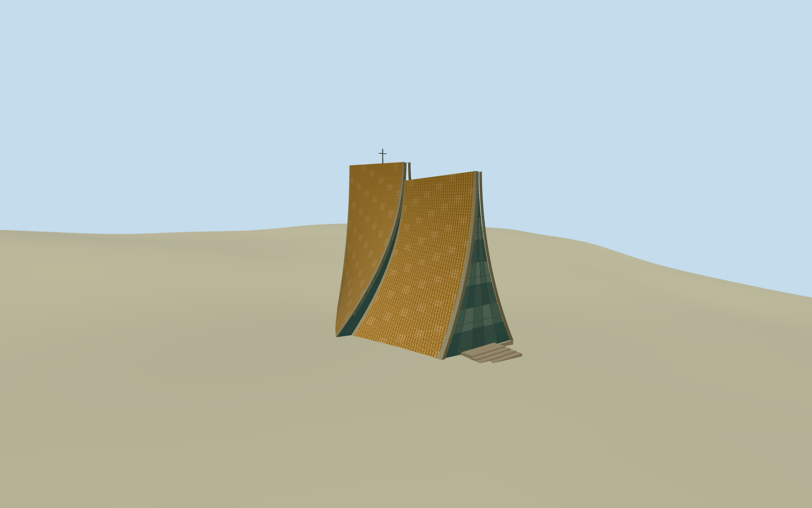

# Luce Memorial Chapel

The Luce Memorial Chapel at Tunghai University, with four ochre-tiled curved concrete shells and tall glazed seams.

Authoring state: **review-in-qa.json**. Current completion evidence is in [qa.json](qa.json) and the [completion ledger](../../../../qualla-structures/batches/qualla-004.PROGRESS.md).

- [Luce Memorial Chapel](https://qualla.com/luce-memorial-chapel/)

Standing exterior and its approach steps. Interior omitted.

Shell curvature is estimated from the three exterior angles and the measured roof heights. Individual tile seams and structural connection details are simplified.

Build: `node content/worldgen/source/places/ws/wsm/luce_memorial_chapel/models/generate-luce-memorial-chapel.mjs`. Add `--check` to verify exact regeneration. 6732 triangles; 5 materials; no embedded photographs.
