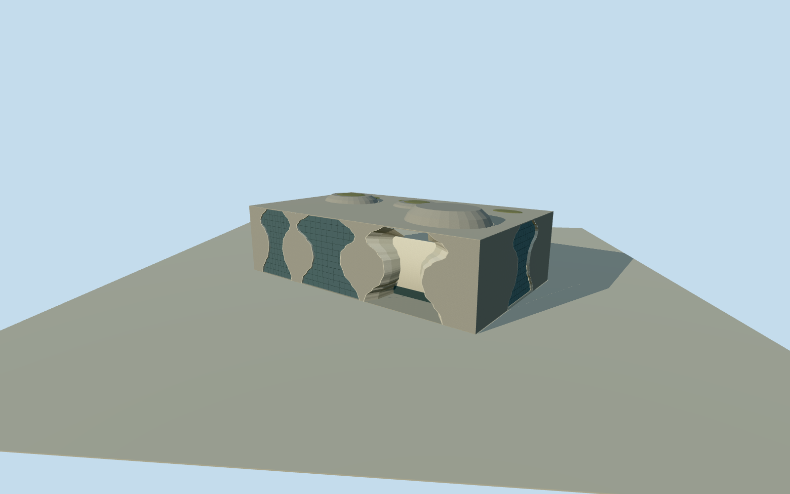

# National Taichung Theater

Toyo Ito’s National Taichung Theater with curving concrete walls, hourglass glazing, a recessed plaza entrance and roof gardens.

Authoring state: **review-in-qa.json**. Current completion evidence is in [qa.json](qa.json) and the [completion ledger](../../../../qualla-structures/batches/qualla-003.PROGRESS.md).

- [National Taichung Theater](https://qualla.com/national-taichung-theater/)

The model represents the March 2024 exterior, including the plaza elevation, entrance shell and rooftop garden volume. Interior theater spaces and the plaza’s temporary installations are outside scope.

The exact image establishes the glazing patterns, colors and white folds of the main frontage. Rear and side apertures, roof gardens, and shell depth are approximate.

The mapped building defines the footprint. The public elevation model is retained and local grade remains approximate.

Build: `node content/worldgen/source/places/ws/wsm/national_taichung_theater/models/generate-national-taichung-theater.mjs`. Add `--check` to verify exact regeneration. 5630 triangles; 5 materials; no embedded photographs.
