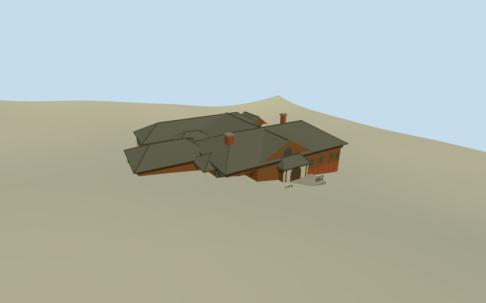

# Beitou Hot Spring Museum

Taipei’s historic hillside bathhouse with intersecting Japanese tiled roofs, uphill timber entrance and downhill red-brick arcades.

Authoring state: **review-in-qa.json**. Current completion evidence is in [qa.json](qa.json) and the [completion ledger](../../../../qualla-structures/batches/qualla-004.PROGRESS.md).

- [Beitou Hot Spring Museum](https://qualla.com/beitou-hot-spring-museum/)

The road entrance, roof intersections and brick downhill wing follow the map, verified photographs and city facts. Unpublished sections, lesser roofs and some windows are approximate.

The model covers the exterior bathhouse and attached entrance shelter. Pool interiors, heritage exhibits and neighboring park structures are outside the model scope.

Build: `node content/worldgen/source/places/ws/wsq/beitou_hot_spring_museum/models/generate-beitou-hot-spring-museum.mjs`. Add `--check` to verify exact regeneration. 6210 triangles; 7 materials; no embedded photographs.
