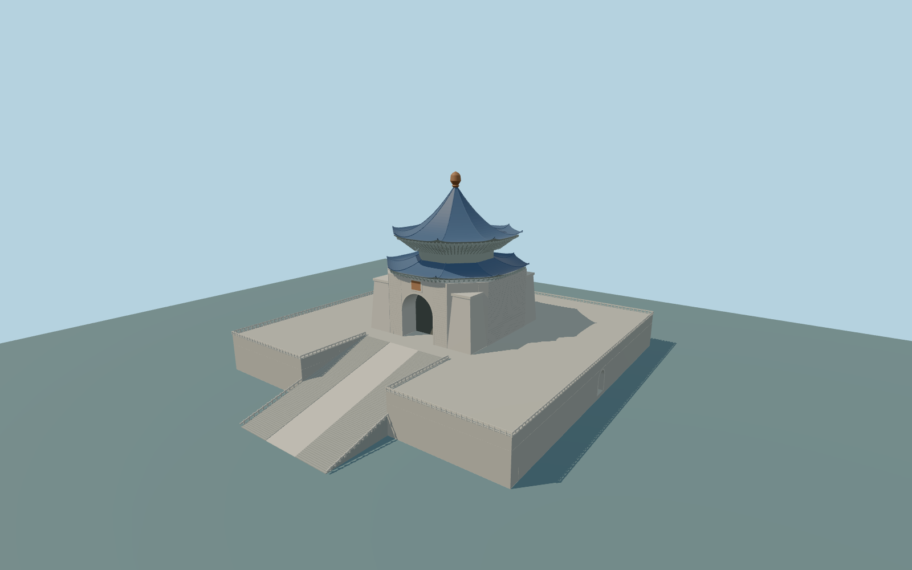

# Chiang Kai-shek Memorial Hall

Complete individual principal Chiang Kai-shek Memorial Hall exterior:whole124.5by147m stepped basement/podium witha stair notch,paired broad stair flights andclosed central relief ramp,white open platform/stair balustrades,closed recessed basement side arches,the complete light-stone upper mass withfour tapered corner buttresses,a genuine deep arched entrance withclosed backing/floor/soffit,plain framed plaque,two separately closed curved dark-blue octagonal roofs withupturned eaves,layered pale bracket stacks,hip ridges,closed raised roof center andbrown bulb finial. Original geometric coursing/brackets replace copied ornament;inscriptions,relief sculpture,statue,ceremonial fittings andnavigable interiors areomitted. Independent gardens,square gates,theater/concert hall andneighbors remain native.

Rebuild: `node packages/worldgen/scripts/generate-chiang-kai-shek-memorial-hall.mjs`;append `--check` for exact source bytes. Select import/LOD/placement with `--ids=chiang_kai_shek_memorial_hall`. Detailed source and four browser tiers are separate ignored GLB outputs.

Complete individual principal Chiang Kai-shek Memorial Hall exterior:whole124.5by147m stepped basement/podium witha stair notch,paired broad stair flights andclosed central relief ramp,white open platform/stair balustrades,closed recessed basement side arches,the complete light-stone upper mass withfour tapered corner buttresses,a genuine deep arched entrance withclosed backing/floor/soffit,plain framed plaque,two separately closed curved dark-blue octagonal roofs withupturned eaves,layered pale bracket stacks,hip ridges,closed raised roof center andbrown bulb finial. Original geometric coursing/brackets replace copied ornament;inscriptions,relief sculpture,statue,ceremonial fittings andnavigable interiors areomitted. Independent gardens,square gates,theater/concert hall andneighbors remain native.

Retained whole height76m andcurrent principal footprint/upper parts guide the envelope. Parent14.5m describes thepodium;native upper body14.5–38.5m androof70m setthe main levels. Lower roof32m is preserved as a conflicting generalized tag;the photographs require its eaves above the main wall,so approximate lower eaves39–40m,upper eaves53–54m,curved crown70m andfinial76m are authored. Great arch width15m,spring25m,crown32.5m,8m depth;body/corner taper,89 detailed stair treads,roof curvature,bracket rhythm andhidden rear inventory are original medium-fi proportions. Source originY=0 usesone host sample at the front stair toe[0,74],absolute standard field12.346957m;center22.455659m hasurban/building returns andis notground. The fixture preserves raw heights/PNG andonlyrebases the datum. Exact paving,stair thresholds andhistoric grades remain approximate;current native fit needs actual review.

Two ordinary exterior photos actually inspected. Front supplies thewhole principal shape,paired stairs/central ramp,deep arch,tapering corners,blue double roof,brackets andfinial;low side supplies a basement arch andblank upper wall. Hidden rear/roof inventory,precise stonework,abstract brackets,curves and89-tread interpretation are approximate. No copied inscriptions,relief,portrait orstatue. Standard field hasurban bias;do not invent flattening orbespoke survey sources. Numerical LOD errors andphysical-device timings remain unmeasured.

Five existing shared256px limestone,marble,glazed tile,plain wood andcast-bronze graphs in five groups maximum. Metric UVs,linear colors,zero private orembedded images. Alltiers retain thewhole podium,paired flights/central ramp,genuine great arch andbasement recesses,allfaces/corner masses,two separately closed upturned blue roofs andfinial. Detailed source keeps finer curves,bracket stacks,stone courses andbalustrades. Nominal LOD tolerances are not measured surface errors.

Original geometry:repository license. Map:© OpenStreetMap contributors,ODbL-1.0;Protomaps. Standard terrain:terrain-grid.json. Ordinary pictures stay local and are not redistributed or used as textures. Current acceptance:qa.json.
