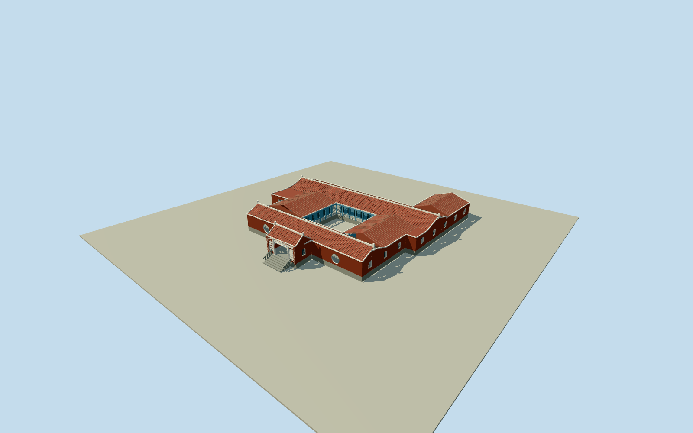

# Cihu Mausoleum

Complete native stepped brick courtyard residence/mausoleum: all14outer/4inner vertices, genuinely open court, projecting round-column entrance and pierced screens, pale-coped red tile roofs, bounded stairs/stone rails, blue courtyard colonnades/doors and white open railing, plus complete mapped west/rear/northeast extensions. Photographic roof partitions/heights/concealed details are approximate; detached paifang/visitor center/sculpture park/tomb interiors excluded.

Authoring state: **review-in-qa.json**. Current completion evidence is in [qa.json](qa.json) and the [completion ledger](../../../../qualla-structures/batches/qualla-002.PROGRESS.md).

- [Cihu Mausoleum](https://qualla.com/cihu-mausoleum/)

Exact named OSMmausoleumbuildingrelation7469074/Q5119906contains outerway315152237with14distinct vertices and innercourtyardway515209158with4vertices. Both complete rings are retained in every detail level; the roughly47x50mstepped building envelope is not replaced by one rectangle or filled across the courtyard. Projecting south entrance pavilion and north/east/west service extensions are intrinsic. Native mapping supplies no elevation or roof/room subdivision survey: roof partitions, colonnade setbacks, fine facade sections and relative grade are photographic estimates. Detached ceremonialgate/visitorcenter/lake/statuepark excluded.

All native outer/courtyard corners are retained. Native mapping gives no height or roof/room partition survey. Base1.2m/eaves4.6m/mainridge6.6m/entranceridge7m, subdivided roof ridges/curves and service-extension elevations are photographic estimates; concealed rear room openings/paint/trim and precise host-terrain contact unverified. No hidden courtyard filled for a simpler roof or model.

Three exact cleared Qualla originals: March2024京都東CC0front and June2005JiangPD-userfront/courtyard. Same creator original courtyard upload/release/sole native bytes verify missing artist metadata, filled asJiang on matching local media records without changing license/bytes/story text. Older courtyard supports blue painted timber and white rails with explicit current-persistence limitation. Other licensed views, assumed-author garden/exit images, detached ceremonialgate, sculpturepark and tomb/interior collection not used. No additional image source/photographic texture.

Native parent partitions are complete, but exact roof-tile/white coping sections, white floral/plaque/calligraphic relief, pierced-screen petal motifs and circular ancillary entry counts/sections are representative medium-fi. Door panes and lattice are shallow/recessed geometry, gallery is open. No reproduced indoorart/sarcophagus, guards/visitors, flags, chimes, planters/signage, trees/lake/park or detached visitor facility. Terrain remains raw/unfitted; building step/contact details are approximations.

Build: `node packages/worldgen/scripts/generate-authored-places.mjs --ids=cihu_mausoleum`. Add `--check` to verify exact regeneration. 24258 triangles; 6 materials; no embedded photographs.
