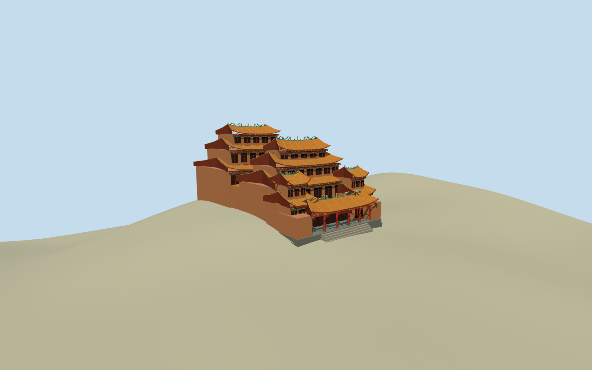

# Ciyou Temple

Songshan Ciyou Temple with five gates, stacked swept roofs, bell and drum pavilions, red columns and ceramic ridge ornaments.

Authoring state: **review-in-qa.json**. Current completion evidence is in [qa.json](qa.json) and the [completion ledger](../../../../qualla-structures/batches/qualla-004.PROGRESS.md).

- [Ciyou Temple](https://qualla.com/ciyou-temple/)

The connected temple exterior and visible entrance steps. The surrounding market, railway access and interior devotional objects lie outside scope.

Hidden roof connections and individual ridge sculpture details are estimated from the cleared front views and government description.

Build: `node content/worldgen/source/places/ws/wsq/ciyou_temple/models/generate-ciyou-temple.mjs`. Add `--check` to verify exact regeneration. 19792 triangles; 6 materials; no embedded photographs.
