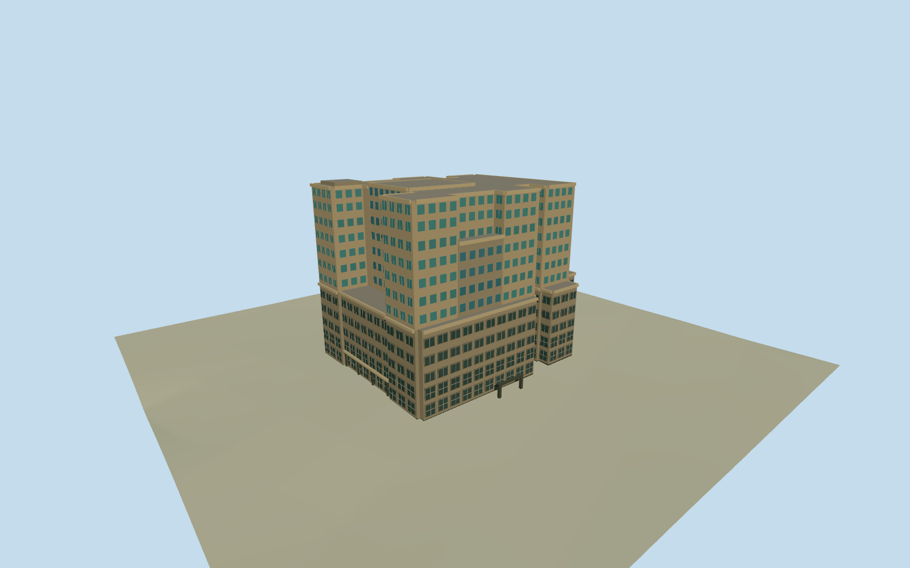

# Evergreen Maritime Museum

The Evergreen Maritime Museum’s Taipei foundation building, with blue-green glazing, deep stone window bays and projecting cornices.

Authoring state: **review-in-qa.json**. Current completion evidence is in [qa.json](qa.json) and the [completion ledger](../../../../qualla-structures/batches/qualla-004.PROGRESS.md).

- [Evergreen Maritime Museum](https://qualla.com/evergreen-maritime-museum/)

Roof elevations of the mapped storeys are estimated from exterior proportions.

The exterior of the shared building is represented. Interiors and street furnishings are outside scope.

Ground comes from a published derivative of Taiwan’s 20 m bare-earth DTM; fine street grades are below its source resolution.

Build: `node content/worldgen/source/places/ws/wsq/evergreen_maritime_museum/models/generate-evergreen-maritime-museum.mjs`. Add `--check` to verify exact regeneration. 41938 triangles; 6 materials; no embedded photographs.
