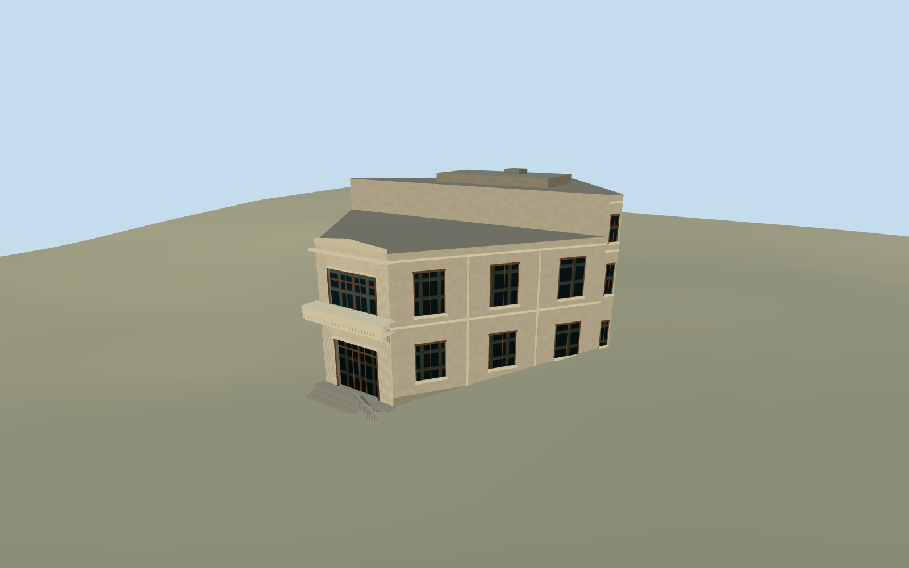

# Guling Street Avant-garde Theatre

The restored former Zhongzheng Second Precinct building, with an Art Deco corner entrance, two street-front floors and taller rear theatre.

Authoring state: **review-in-qa.json**. Current completion evidence is in [qa.json](qa.json) and the [completion ledger](../../../../qualla-structures/batches/qualla-003.PROGRESS.md).

- [Guling Street Avant-garde Theatre](https://qualla.com/guling-street-avant-garde-theatre/)

The 2008 public-domain photo pre-dates the city-funded rehabilitation. Post-restoration surface colors are approximated from municipal descriptive text. Rear opening counts, parapet heights, canopy depth and side trim are estimated.

The model follows the retained historic building and street entry. Interiors, surrounding tenancies, street signs and machinery are outside the selected exterior scope.

Build: `node content/worldgen/source/places/ws/wsq/guling_street_avant_garde_theatre/models/generate-guling-street-avant-garde-theatre.mjs`. Add `--check` to verify exact regeneration. 1632 triangles; 7 materials; no embedded photographs.
