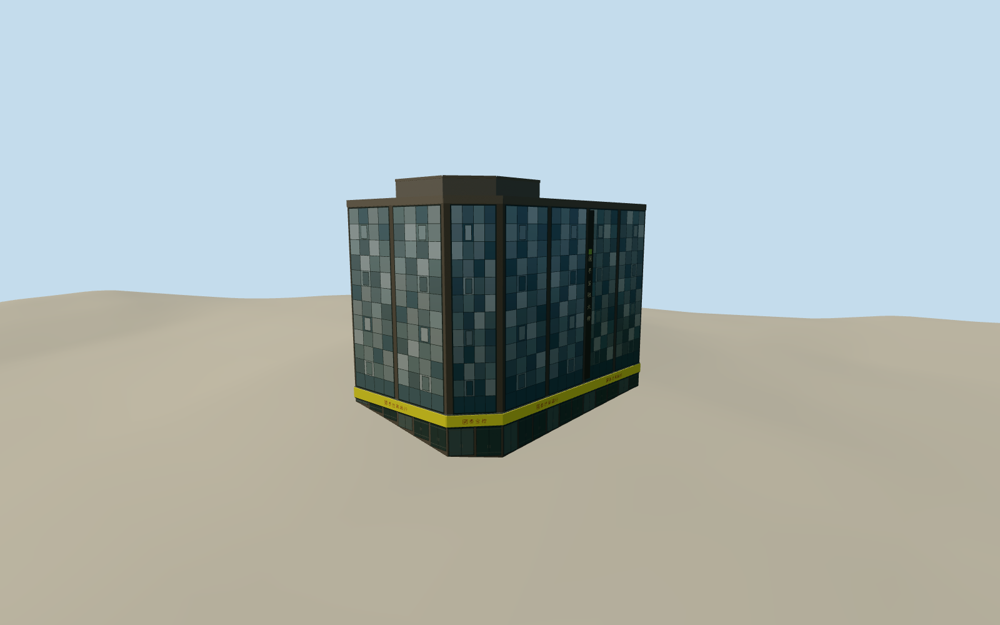

# Kikumoto Department Store

The former Kikumoto Department Store at the Hengyang and Bo’ai corner, in its glass-clad 2003 appearance with a yellow Cathay fascia and stepped rooftop.

Authoring state: **review-in-qa.json**. Current completion evidence is in [qa.json](qa.json) and the [completion ledger](../../../../qualla-structures/batches/qualla-003.PROGRESS.md).

- [Kikumoto Department Store](https://qualla.com/kikumoto-department-store/)

The exterior represents the former department store with its glass-clad Cathay United Bank frontage as photographed in 2003. The pre-renovation street façade is outside this reconstruction.

Rear cladding, seventh-floor rooftop enclosure, curtain-wall heights and secondary signage are estimated. Current mapped parts establish the geographic envelope. Lettering is simplified original geometry.

The original elevation field is preserved. The urban source heights are approximate and include several metres of relief across the footprint. Street-level glazing and wall contact follow the sampled field.

Build: `node content/worldgen/source/places/ws/wsq/kikumoto_department_store/models/generate-kikumoto-department-store.mjs`. Add `--check` to verify exact regeneration. 2521 triangles; 5 materials; no embedded photographs.
