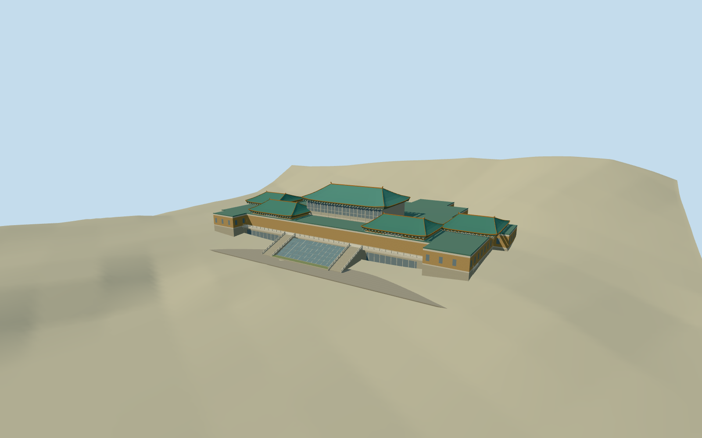

# National Palace Museum

Taipei’s National Palace Museum main building, with five green tile roof pavilions, yellow walls, white upper stairs, balustrades and inclined skylight.

Authoring state: **review-in-qa.json**. Current completion evidence is in [qa.json](qa.json) and the [completion ledger](../../../../qualla-structures/batches/qualla-004.PROGRESS.md).

- [National Palace Museum](https://qualla.com/national-palace-museum/)

The five pavilion forms, white lower walls and central roof proportions follow the cleared original photographs. Exact dimensions, ornament, rear elevations, the terraced right extension and glazed bays are approximate.

The main gallery building and its immediate upper terrace are in scope. The lower campus gate and neighboring museum buildings are separate structures.

Build: `node content/worldgen/source/places/ws/wsq/national_palace_museum/models/generate-national-palace-museum.mjs`. Add `--check` to verify exact regeneration. 13659 triangles; 7 materials; no embedded photographs.
