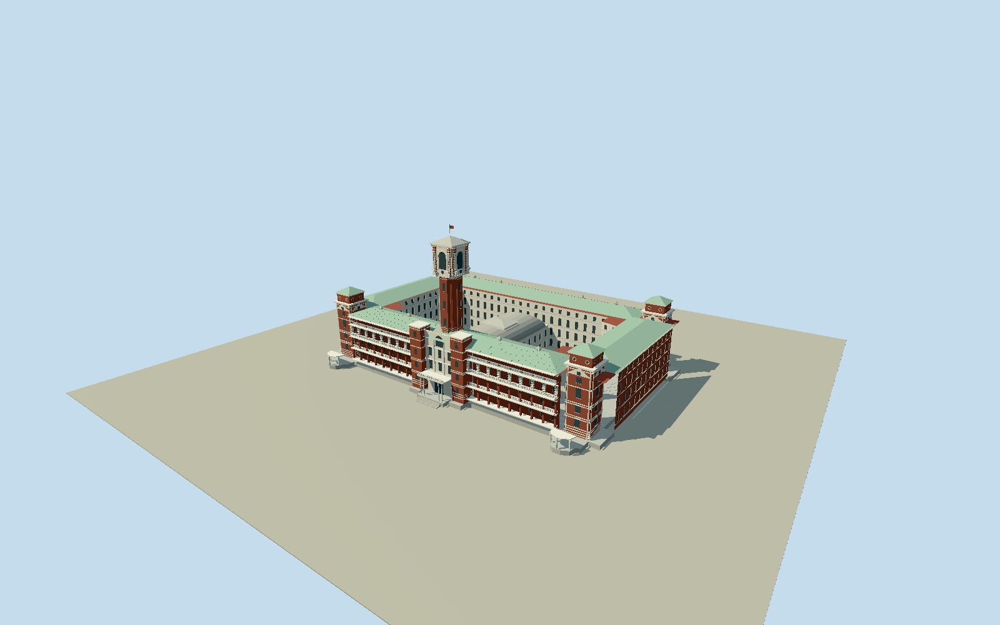

# Presidential Office Building, Taipei

Surviving red-brick and pale aggregate presidential office: two open courtyards with white internal elevations, lower central hall with curved roof, approximately60m tall cruciform central shaft and ornate arched crown/pyramidal gray cap. Four green-hipped corner towers, paired flat guard towers and present flat entrance porches, differentiated deep arcades on east/south/west with north facade solid, perforated balustrades, raised vents and green metal wing roofs. Service/security annexes and precinct landscaping excluded.

Authoring state: **review-in-qa.json**. Current completion evidence is in [qa.json](qa.json) and the [local 100 ledger](../../../../qualla-structures/batches/PROGRESS.md).

- [Presidential Office Building, Taipei](https://qualla.com/presidential-office-building-taipei/)

Bounded exterior preview; see current hash-bound QA. Geometry, hidden foundations and fine ornament are approximate, not surveyed.

Official approximately140m×85m overall plan and60m tower are approximate references. Native main outline is quantized; photo-directed roof levels, arcade bays and hidden foundations are not surveyed.

North exterior lacks portico per official description; central hall and courtyard chambers generalized. Interior rooms and security/service annexes omitted.

Original rejected composite is preserved separately. Replacement is an independently decoded published third-party reencoding claimed as2024NLSC20mDTM; original official raster and publisher conversion pipeline unavailable. Zoom13 pixels17.3m;1m review grid interpolates, not1m accuracy. Preview accepts only retained source relative ground; other DEMs require independent contact review.

Reference imagery remains local provenance; no photograph used as facade texture.

Build: `node packages/worldgen/scripts/generate-authored-places.mjs --ids=presidential_office_building_taipei`. Add `--check` to verify exact regeneration. 59007 triangles; 7 materials; no embedded photographs.
