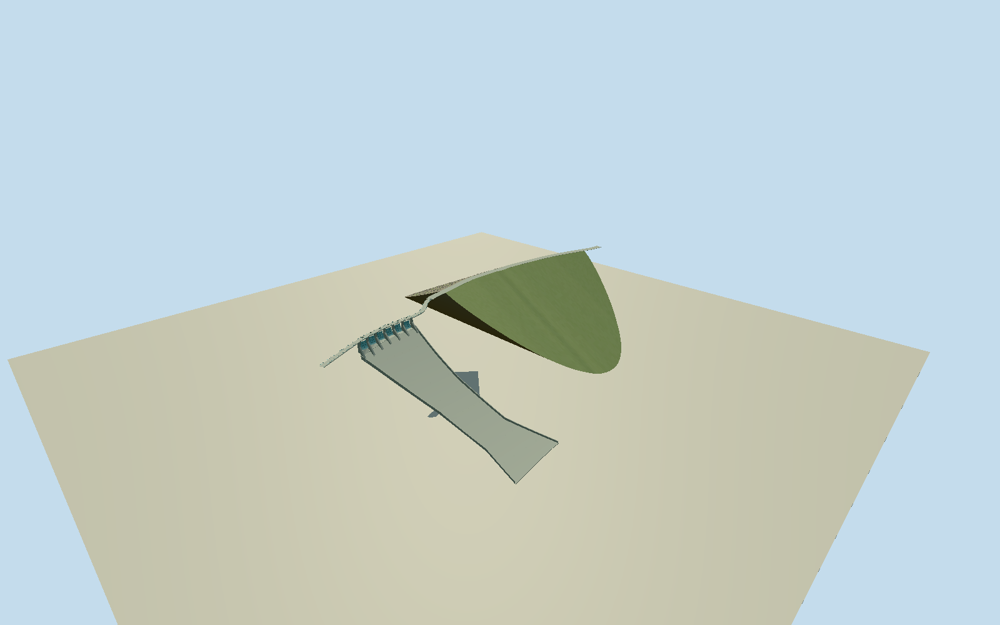

# Shihmen Dam, Taiwan

Whole principal nominal360m rolled-earth/rockfill Shihmen Dam and intrinsic right-bank six-gate spillway/whole dry chute/crest crossing. Retain original22-node436.61m crest-access road including both landward approaches, original19-node spillway bridge/17-vertex chute area/11-node upper line. Main earthfill uses the central original road nodes3–18/353.50m curved crest as a bounded interpretation of nominal360m core, without stretching geography; approach portions are retained. Broad sloping riprap/green ground-cover faces,11.9m crest, original-engineering maximum520m base/133.1m foundation height, six14x10.61m radial gates within100m weir, hoist piers/crossing and curved concrete chute walls. Exclude reservoir/afterbay water/site floor/whole hills/downstream afterbay weir/independent pink powerhouse/underground tunnels/visitor buildings/trees/people/vehicles/remote roads. Use shallow valley-end taper with broad riprap/ground-cover faces as original maximum-section approximation, not a giant rectangular green block or surveyed natural hill. Do not claim a whole main-dam photo was inspected. Native main curvedcrest353.50m vsnominal360m discrepancy explicitly retained; original whole436.61m road and all approach nodes unchanged. Six curved radial gate leaves/physical piers/hoist beams, original full bridge and dry chute, actual open channels and curved wall/fins; height relative primary crest/gate datum, chute profile/hoists/hidden foundation estimated. No extra water, powerhouse, gardens or reservoir plane. Freeze independent1024m129x129 field at fixed original east approach first; no fit/flatten/reacquire. Host/foundation contact preview only.

Authoring state: **review-in-qa.json**. Current completion evidence is in [qa.json](qa.json) and the [completion ledger](../../../../qualla-structures/batches/qualla-002.PROGRESS.md).

- [Shihmen Dam](https://qualla.com/shihmen-dam/)

Whole original native crest-access road548718547/all22nodes (436.61m) and spillway bridge548718553/all19nodes, closed spillway/chute132864629/all17vertices and upper mapped dam line244379008/all11nodes. Fixed story coordinate anchor/+Xeast/+Zsouth before field. Central crest-access nodes3–18/353.50m define original bounded main-crest interpretation (nominal engineering360m), retaining all approach portions separately. Main earthfill ground boundary is not mapped: nominal520m maximum base/133.1m foundation height, valley-end taper/visible slopes and abutment profile are original engineering approximations, not surveyed polygons. Native133.1m height attribute on chute is overall dam height and is not extruded on spillway. Gazette specifies right-bank100m weir/six14x10.61m gates/bottom235m vs crest252.1m.

Two exact published2025丘崈ownCC0chute/riprap originals individually inspected/nativeSHA1matched/explicit creator grants bound; Qualla-first30families/zero conflicts and existing published policy pass. Not an inspected whole-embankment photo. Whole main body follows primary engineering dimensions and native crest interpretation with bounded original valley taper/slope/material pattern. Assumed-author Jiang image/museum models/agency images/diagrams unused. No photo textures/generated bitmap/downloaded mesh.

Native interpreted main crest353.50m vs nominal360m retained without geography scaling; entire436.61m road including approaches and full19-node spillway crossing preserved.133.1m maximum depth and520m maximum base width with sin^0.8 valley taper are original engineering approximations, not a surveyed exposed section or natural-hill mesh. Riprap/green-cover distribution,1100 representative rocks and2000 small irregular ground-cover patches at close detail are bounded; no rectangular grass checkerboard. Mitered road/crossing joints preserve original path centers without cracks. Main crest11.9m width, six14x10.61m radial leaves/100m weir/relative gatebottom-17.1m follow primary dimensions; pier/hoist/bridge7m width and lower chute-112m floor/retaining walls/partition fins are estimates. Underground tunnels/independent powerhouse/downstream weir/visitor buildings/water/site floor omitted.

Independent1024m129x129/16641values/four original Terrarium tiles frozen before geometry at fixed eastern crest-crossing junction. Provider datum245.9893m, whole absolute[-3793.6964,361.1883]m retained unchanged; implausible deep inland composite pits are not bathymetry/foundation controls. No fit/flatten/reacquire. Primary252.1m official crest and provider-relative datum not surveyed-compatible; model uses crest-relative engineering heights. Portable/shared/context stageY-142m separate. Native preview/replaceFootprint=false; live-host bank/foundation/threshold contact unverified.

Build: `node packages/worldgen/scripts/generate-authored-places.mjs --ids=shihmen_dam`. Add `--check` to verify exact regeneration. 43244 triangles; 5 materials; no embedded photographs.
