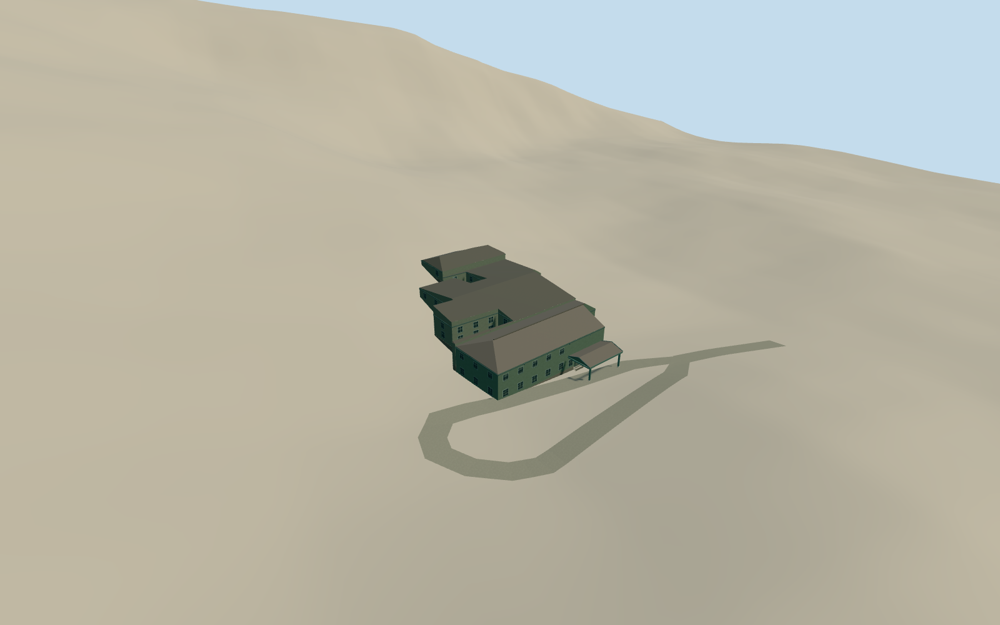

# Shilin Official Residence

Shilin Official Residence in Taipei, its green walls, grey tile roofs, connected wings and open-column covered entry.

Authoring state: **review-in-qa.json**. Current completion evidence is in [qa.json](qa.json) and the [completion ledger](../../../../qualla-structures/batches/qualla-003.PROGRESS.md).

- [Shilin Official Residence](https://qualla.com/shilin-official-residence/)

The full connected house footprint and driveway are mapped. Roof subdivisions, unphotographed façades, wall heights and the vertical site registration are estimates.

The public-domain photo fixes the visible entry form, column and roof character, and cool green finish. The exact columns and canopy dimensions are estimated.

The Shilin park, separate guest accommodation, Victory Chapel and hilltop pavilion are outside the footprint of this main house model.

The preserved elevation rises substantially into the garden behind the house. The three section levels and foundations use approximate contacts on that slope.

Build: `node content/worldgen/source/places/ws/wsq/shilin_official_residence/models/generate-shilin-official-residence.mjs`. Add `--check` to verify exact regeneration. 2474 triangles; 7 materials; no embedded photographs.
