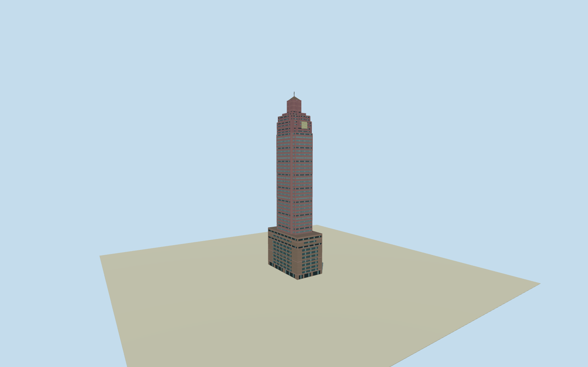

# Shin Kong Life Tower

A rose-colored 244-metre Taipei tower with teal ribbon glazing, broad department-store podium and a stepped pyramidal crown.

Authoring state: **review-in-qa.json**. Current completion evidence is in [qa.json](qa.json) and the [completion ledger](../../../../qualla-structures/batches/qualla-003.PROGRESS.md).

- [Shin Kong Life Tower](https://qualla.com/shin-kong-life-tower/)

The exact 2014 Qualla photograph controls the rose tower and visible façade bands. The lower retail openings are partly obscured and their layout is approximate.

The footprint, office setbacks and crown profiles follow the mapped relation. The retail roof height, pale crown screen, shallow glazing and some rooftop equipment are interpreted.

The local permit-derived 244.15 m mast figure controls scale. The international tall-building database reports 244.8 m.

The original composite elevation field contains urban surface artifacts. The model uses the north plaza sample for approximate placement and a display opening confined to the mapped building so the podium is visible.

Build: `node content/worldgen/source/places/ws/wsq/shin_kong_life_tower/models/generate-shin-kong-tower.mjs`. Add `--check` to verify exact regeneration. 9896 triangles; 6 materials; no embedded photographs.
