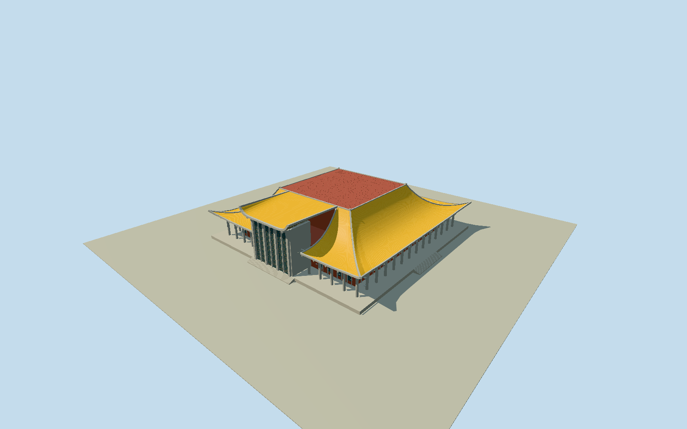

# Sun Yat-sen Memorial Hall, Taipei

Broad modern Chinese memorial hall: flat red central roof deck, four concave yellow glazed slopes, upcurled gray-edged corners, tall projecting south entrance dormer with gridded glazing, gray round perimeter columns, real recessed red walls and open colonnade, own masonry terrace and stairs. Park, fountain, gate piers, statues, trees, auditorium/interior and temporary construction excluded.

Authoring state: **review-in-qa.json**. Current completion evidence is in [qa.json](qa.json) and the [local 100 ledger](../../../../qualla-structures/batches/PROGRESS.md).

- [Sun Yat-sen Memorial Hall (Taipei)](https://qualla.com/sun-yat-sen-memorial-hall-taipei/)

Dated surviving exterior interpreted from inspected local originals and official illustrated front/aerial. No claim to represent temporary construction or current site access.

Official100m square and30.4mheight are approximate controls; quantized native curled eaves span about109m. Roof curves/tiles, column proportions, terrace/stairs and unseen returns are photographic estimates, not survey/photogrammetry.

Open outer colonnade only; auditorium, memorial statue, indoor galleries, signage, parks, fountain, trees and gate piers excluded.

Ground is a retained public third-party Terrarium reencoding attributed by publisher to2024NLSC20mDTM. Original official raster/private conversion pipeline unavailable. One-metre review interpolation is not one-metre accuracy. Native main footprint clips only covered ground beneath own masonry hall/terrace/entrance; source heights and exterior ground unchanged. Isolated portable stage reviews geometry; actual source-field medium-fi fixture reviews bounded contact. Another DEM requires independent review.

No photographic pixels redistributed; portable fallback and five shared architectural surfaces use authored geometry and local glazing.

Build: `node packages/worldgen/scripts/generate-authored-places.mjs --ids=sun_yat_sen_memorial_hall_taipei`. Add `--check` to verify exact regeneration. 42748 triangles; 6 materials; no embedded photographs.
