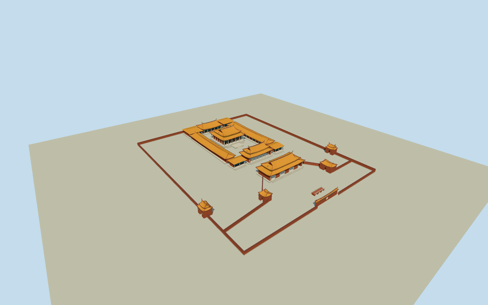

# Taipei Confucius Temple

Native ceremonial compound with double-eaved Dacheng Hall, seven-tier ridge pagoda and Tong Tian cylinders, separate Chongsheng rear shrine, open lower side colonnades, Yi/Lingxing gates and true side passages, four outer arched gates, south screen wall, approximate masonry enclosures and three-arch Pan Bridge. Orange ceramic roofs, red brick, gray granite columns, green/blue/gold timber and ridge ornament; own platforms and stairs only. Modern Minglun Hall, service buildings, park, pond water, interior ritual objects and temporary ceremony fixtures excluded.

Authoring state: **medium-fi-exterior-source-preview-reviewed-in-qa**. Current completion evidence is in [qa.json](qa.json) and the [local 100 ledger](../../../../qualla-structures/batches/PROGRESS.md).

- [Taipei Confucius Temple](https://qualla.com/taipei-confucius-temple/)

Approximate photographic exterior with bounded source-ground preview; source/story completion requires current QA. Native map controls are quantized, not surveyed elevations or doorway dimensions.

Each native component has its own mapped location. Quantized footprints/roof-wall interpretation, hidden elevations, outergate details, roof profiles and PanBridge dimensions are photographic estimates, not survey/photogrammetry.

Official42Dachengcolumns include unmodeled interior; exterior circulation and ceramic/dragon/flower carvings are deliberately simplified volumetric medium-fi. No photo pixels or baked lighting used.

Third-party published ground is attributed by publisher to2024NLSC20mDTM; original official raster/private encoding unavailable.1m review grid is interpolation only. Compatible source preview and another host DEM need independent contact review.

Modern Minglun Hall, toilets/services, neighboring temples, park, PanPond water, interior ritual objects, signage and temporary ceremony installations excluded.

Build: `node packages/worldgen/scripts/generate-authored-places.mjs --ids=taipei_confucius_temple`. Add `--check` to verify exact regeneration. 61478 triangles; 5 materials; no embedded photographs.
