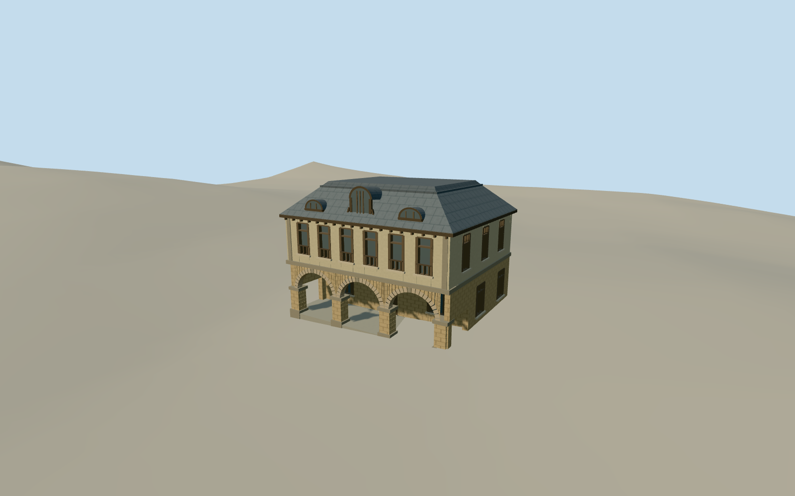

# Taipei Futai Street Mansion

Futai Street Mansion in Taipei, with a sandstone arcade, timber-framed upper storey and three-dormer copper mansard as restored in 2009.

Authoring state: **review-in-qa.json**. Current completion evidence is in [qa.json](qa.json) and the [completion ledger](../../../../qualla-structures/batches/qualla-003.PROGRESS.md).

- [Taipei Futai Street Mansion](https://qualla.com/taipei-futai-street-mansion/)

The exterior represents the restored mansion at 26 Yanping South Road as it reopened in 2009. The model covers the named building and public street arcade.

The municipal description establishes the sandstone arches, timber upper floor, washed aggregate, copper mansard and three dormers. Exact roof pitches, profiles, sash arrangement and side and rear elevations are estimated.

The original elevation field is preserved. The rendered sidewalk, thresholds and column feet have approximate grade registration.

Build: `node content/worldgen/source/places/ws/wsq/taipei_futai_street_mansion/models/generate-taipei-futai-street-mansion.mjs`. Add `--check` to verify exact regeneration. 5683 triangles; 6 materials; no embedded photographs.
