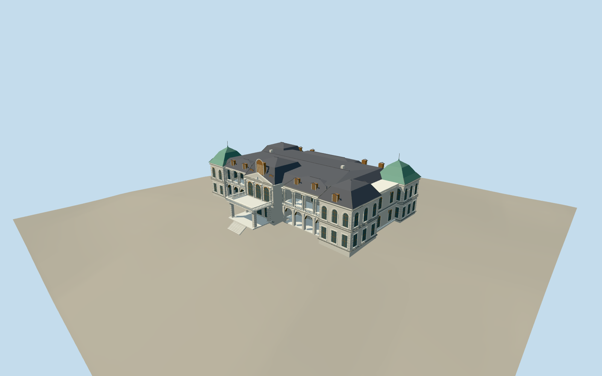

# Taipei Guest House

South-facing grey classical mansion with open paired-column loggias and lower round arcades, three-arched central pavilion/pediment and balustraded entrance canopy, slate mansards/dormers, green concave corner roofs and rounded north garden bay. Japanese bungalow and garden structures excluded.

Authoring state: **review-in-qa.json**. Current completion evidence is in [qa.json](qa.json) and the [local 100 ledger](../../../../qualla-structures/batches/PROGRESS.md).

- [Taipei Guest House](https://qualla.com/taipei-guest-house/)

Original medium-fi exterior checked against two cleared published Qualla public-domain north/garden originals first, then exact creator-public-domain southeast and close roof originals. Heights, column counts, dormer distribution, fine ornament and unseen west wall are estimated rather than surveyed.

Earlier attribution-licensed south hero and uncertain Gongyuan Road building are excluded from current approval. Main mansion identity and major envelope follow mapped vectors and the four inspected public-domain originals.

Separate Japanese bungalow, connector, gardens, pool, garden pavilions, interiors, temporary items and fine lettering excluded. Source photographs are not redistributed.

Independent Terrarium ground remains unchanged; own entrance/loggia/terrace contact is reviewed only against this bounded source preview. Other host elevation fields remain unverified and generic-footprint replacement stays disabled. Fine capitals, stone ornament, copper profile and slate courses are simplified by distance. No physical-device performance or survey accuracy claimed.

Build: `node packages/worldgen/scripts/generate-authored-places.mjs --ids=taipei_guest_house`. Add `--check` to verify exact regeneration. 43706 triangles; 6 materials; no embedded photographs.
