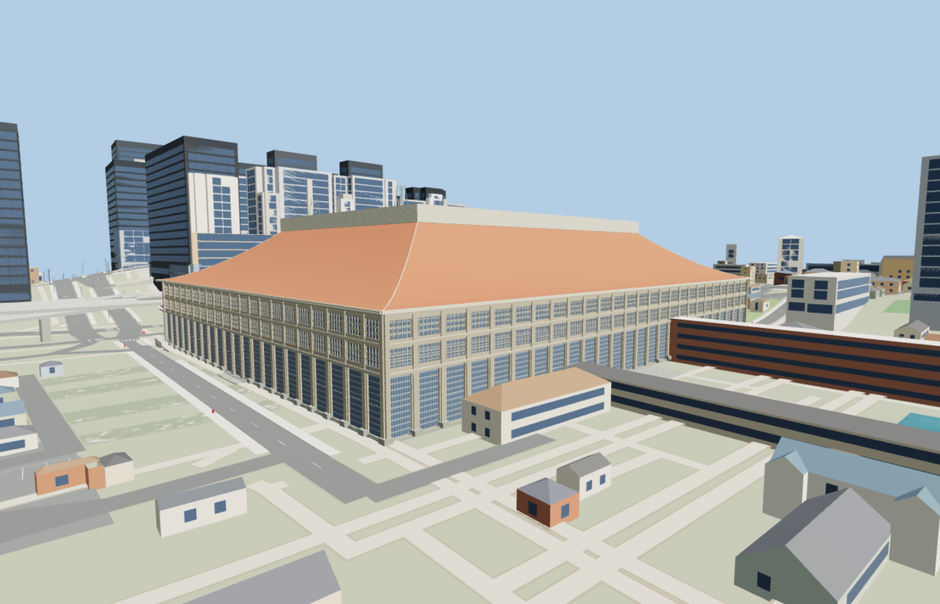

# Taipei Main Station

The four façades, glazed entrance leaves, continuous soffit, curved red hip and six roof gables resolve the rectangular station. The entrance proportions and rooftop equipment are interpretations of the retained photographs.

A bounded 5.80 m visualization grade exposes the headhouse plinth. All four two-step landings join the rendered sidewalks within 9 mm at the sampled points. The station replaces its exact mapped footprint, and the other buildings, MRT entrances, roads, rail lines and water retain their map inputs.

The native fixture retains 917 neighboring buildings, all 820 transportation records and four water inputs. A failed load restores the original station footprint. All four levels pass the entrance, soffit and outer terrain probes. 304 placement checks passed.

| Detail level | Triangles | Download bytes | Draws |
| --- | ---: | ---: | ---: |
| skyline | 736 | 62,980 | 1 |
| district | 2,533 | 224,084 | 7 |
| street | 15,857 | 1,365,400 | 7 |
| closeup | 30,353 | 2,627,188 | 7 |

The first two levels total 287,064 bytes. Six GLBs validated with zero errors or warnings. Four focused tests passed and 75 views were reviewed.

The local visualization grade removes high urban returns in the global Terrarium data. The exterior threshold, bed heights and roof proportions are photographic and terrain-based estimates, with a smooth transition to the host field.
The modeled headhouse uses the mapped 30 m height and 18 m roof-height tags as coarse controls. The visible eaves, roof levels and communications frames are reconstructed from photos.
The independent MRT entrances, bus shelters and surrounding buildings retain their map-derived geometry. Exact lettering, rooftop equipment and navigable interiors are outside this exterior model.

[Site controls](models/site-fit.json) · [QA evidence](qa.json) · [South-front photograph](https://commons.wikimedia.org/wiki/File:Taipei_Main_Station_and_Zhongxiao_West_Road_20260928.jpg)
