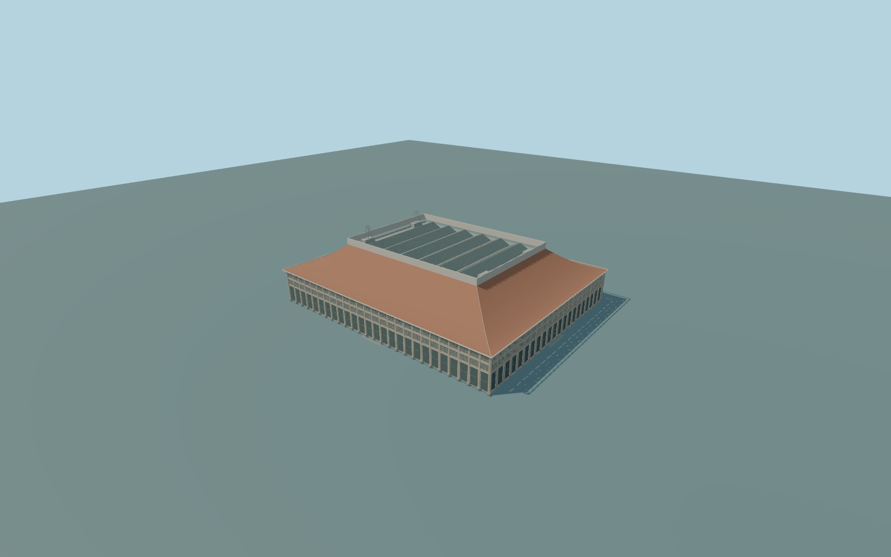

# Taipei Main Station

Complete individual above-ground Taipei Main Station terminal: whole exact-Q main headhouse footprint,all four facades and colonnades,large four-sided curved red hipped roof and pale upper collar,central six-gable glazed main-hall roof,visible rooftop service blocks and simplified structural communications frames. Underground railway/metro rooms,public MRT/mall entrances and forecourt canopies,external elevated roads and independent surrounding buildings remain separate;no trains,people,lettering,emblems,adverts or navigable interiors.

Rebuild: `node packages/worldgen/scripts/generate-taipei-main-station.mjs`;append `--check` for exact source bytes. Select import/LOD/placement with `--ids=taipei_main_station`. Detailed source and four browser tiers are separate ignored GLB outputs.

Complete individual above-ground Taipei Main Station terminal: whole exact-Q main headhouse footprint,all four facades and colonnades,large four-sided curved red hipped roof and pale upper collar,central six-gable glazed main-hall roof,visible rooftop service blocks and simplified structural communications frames. Underground railway/metro rooms,public MRT/mall entrances and forecourt canopies,external elevated roads and independent surrounding buildings remain separate;no trains,people,lettering,emblems,adverts or navigable interiors.

Retained exact-Q way/23641610 supplies Q700588,footprint and undirected axis. Current standard PMTiles whole building35184395730442 has native height30m. Retained tags also give7above-ground levels,4underground levels and roof:height18m;these are source facts,not independent proof of visible eave/crest levels. Ordinary2007roof-overview and September2026southern-front pictures agree on the main hipped/collar roof and stacked beige facade grids;hidden roof details and intermediate levels remain picture-based estimates. Resolve visible wall/roof proportions explicitly before final authoring. +X ESE follows the long facade;+Z SSW faces Zhongxiao West Road;-Z NNE faces Beiping Road and the current independent QSquare building. The older roof photograph includes neighboring construction that is excluded from this model. Source exterior proportions use estimated eaves22m,curved hip inner edge38m and pale collar42m,with central glazed gables to40m and simplified communications frames to48m. The native30m envelope and18m roof-height tag are retained as conflicting coarse map controls rather than treated as surveyed visible levels;seven levels do not establish seven exposed facade rows. Pictures show three strong visible facade bands,which the model retains. Main floor+.65m uses one unchanged outside western street datum[-90,-60],5.704483m absolute. Exact wall/roof heights,threshold steps,hidden facade bays,current rooftop equipment and native contact remain unverified. The original southern sample [0,90] is27.724827m, inconsistent with two western street samples [-90,-60]5.704483m and[-60,-80]5.923095m. Use the single western street reference; retain the unmodified field and explicit native-contact uncertainty.

Two ordinary whole-roof and current southern-front photographs, retained exact-Q footprint and current standard PMTiles. Native height 30m, roof-height tag 18m and seven above-ground levels remain source facts; visible eaves, curved hip, collar, central gables and communication-frame levels are explicit picture-based estimates. Hidden elevations, facade bay inventory, current rooftop services, threshold steps and native terrain contact remain unverified. Independent underground rail/MRT/mall parts, entrances, forecourt shelters, elevated roads and surrounding buildings remain separate. Physical-device/dense-city timing and numerical LOD errors remain unmeasured.

Seven existing shared 256px graphs: stone_ashlar, concrete_plain, stone_limestone, tile_flat, metal_standing_seam, metal_painted and window_grid. Seven merged near groups and one far palette group, metric UVs and linear colours. No embedded/private images. Beige facade masonry, pale collar/coping, muted red tile slopes, service-box metal, painted structural frames and actual glazing retain semantic slots. All four tiers preserve the whole headhouse, all four colonnade facades and visible horizontal bands, complete curved four-sided red hip, pale solid collar and six complete central glazed gables. Near tiers add recessed windows, actual lattice members, piers/base blocks, steps, coping, roof framing/seams, rooftop boxes and simplified communication frames. Rooftop equipment uses the dated overview as an explicit visual interpretation.

Original geometry:repository license. Map:© OpenStreetMap contributors,ODbL-1.0;Protomaps. Standard terrain:terrain-grid.json. Ordinary pictures stay local and are not redistributed or used as textures. Current acceptance:qa.json.
