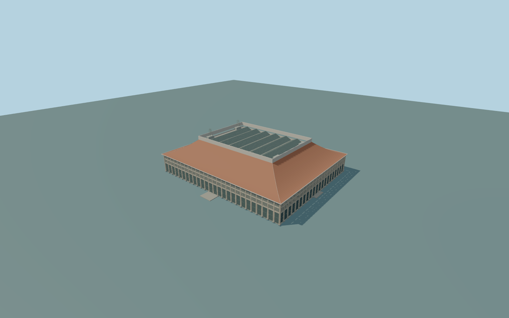

# Taipei Main Station

The main headhouse includes the four colonnaded façades, the overhanging soffit and curved red hipped roof, the pale collar and six glazed gables. Underground rooms, MRT and mall entrances, bus shelters and external rail and roads remain separate.

Rebuild: `node packages/worldgen/scripts/generate-taipei-main-station.mjs`;append `--check` for exact source bytes. Select import/LOD/placement with `--ids=taipei_main_station`. Detailed source and four browser tiers are separate ignored GLB outputs.

The local visualization grade removes high urban returns in the global Terrarium data. The exterior threshold, bed heights and roof proportions are photographic and terrain-based estimates, with a smooth transition to the host field.

The modeled headhouse uses the mapped 30 m height and 18 m roof-height tags as coarse controls. The visible eaves, roof levels and communications frames are reconstructed from photos.

The independent MRT entrances, bus shelters and surrounding buildings retain their map-derived geometry. Exact lettering, rooftop equipment and navigable interiors are outside this exterior model.

Original geometry:repository license. Map:© OpenStreetMap contributors,ODbL-1.0;Protomaps. Standard terrain:terrain-grid.json. Ordinary pictures stay local and are not redistributed or used as textures. Current acceptance:qa.json.
