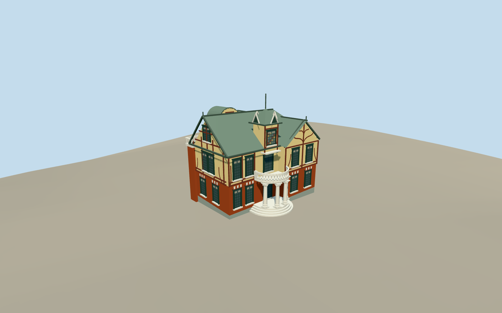

# Taipei Story House

Small Tudor-style villa with red-brick lower floor, yellow upper plaster/red branching timber pattern, dark divided windows, steep copper main/cross gables, spired square attic with coloured glass and louvred rooflets, and semicircular Ionic balcony/round entrance steps, four closed turned columns with low moulded bases/diagonal scroll capitals, profiled porch edge and physical ceiling mouldings. Detached cafe and modern access enclosure excluded.

Authoring state: **review-in-qa.json**. Current completion evidence is in [qa.json](qa.json) and the [local 100 ledger](../../../../qualla-structures/batches/PROGRESS.md).

- [Taipei Story House](https://qualla.com/taipei-story-house/)

Current entrance construction uses exact native photographer PD-self2017original after Qualla-first44paths; first same-creator revision695073380/sole native upload/exacttimestamp/bytes bound. Four turned columns/low moulded bases/diagonal Ionic scroll capitals and curved porch/ceiling craft built. Earlier attribution/private/aerial controls excluded. Full fixed Tudor house/steep roofs/turret/verandas/rear brick return retained pending broader fidelity evidence. Dimensions, profiles, scroll pitch, ceiling geometry and present condition are medium-fi estimates, not measured elevations.

Only the historic villa and its own entrance balcony/steps and rear brick return are included. Detached cafe, park structures, modern glazed access enclosure, signage, interiors and trees excluded.

Photo pixels are not redistributed. Close entrance has physical closed capitals/spiral relief/turned bases and layered curved porch underside with matte lime-plaster finish matching the native photograph; inherited limestone masonry joints were excluded from these painted stocks. Three original lower geometry streams/all outside attributes retained; conservative LODerror estimates.45/.35/.25m updated without measured geometric-error certification. Fine copper courses, balusters, timber and stained-glass frames remain original estimates pending broader evidence. Source ground remains independent and current geographic review is required; footprint replacement disabled.

Build: `node packages/worldgen/scripts/generate-authored-places.mjs --ids=taipei_story_house`. Add `--check` to verify exact regeneration. 36756 triangles; 6 materials; no embedded photographs.
