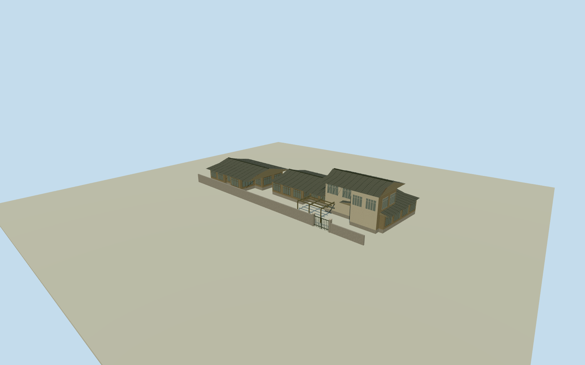

# Wistaria Tea House

Wistaria Tea House’s dark-tiled timber wings, two-storey street wing, glazed display bay and low courtyard wall in Taipei.

Authoring state: **review-in-qa.json**. Current completion evidence is in [qa.json](qa.json) and the [completion ledger](../../../../qualla-structures/batches/qualla-003.PROGRESS.md).

- [Wistaria Tea House](https://qualla.com/wistaria-tea-house/)

The model represents the restored Wistaria Tea House in July 2014. The mapped lower timber wings, two-storey wing, street-side low range, wall and entrance gate are included.

The exact street photograph fixes the two-storey facade, timber siding, long display bay, roof tiles and street gate. Behind-the-gate openings, roof plane heights and courtyard foliage are approximate.

The original regional elevation model provides the surrounding grade. Individual thresholds and concrete courtyard levels remain estimates.

Build: `node content/worldgen/source/places/ws/wsq/wistaria_tea_house/models/generate-wistaria-tea-house.mjs`. Add `--check` to verify exact regeneration. 3761 triangles; 6 materials; no embedded photographs.
