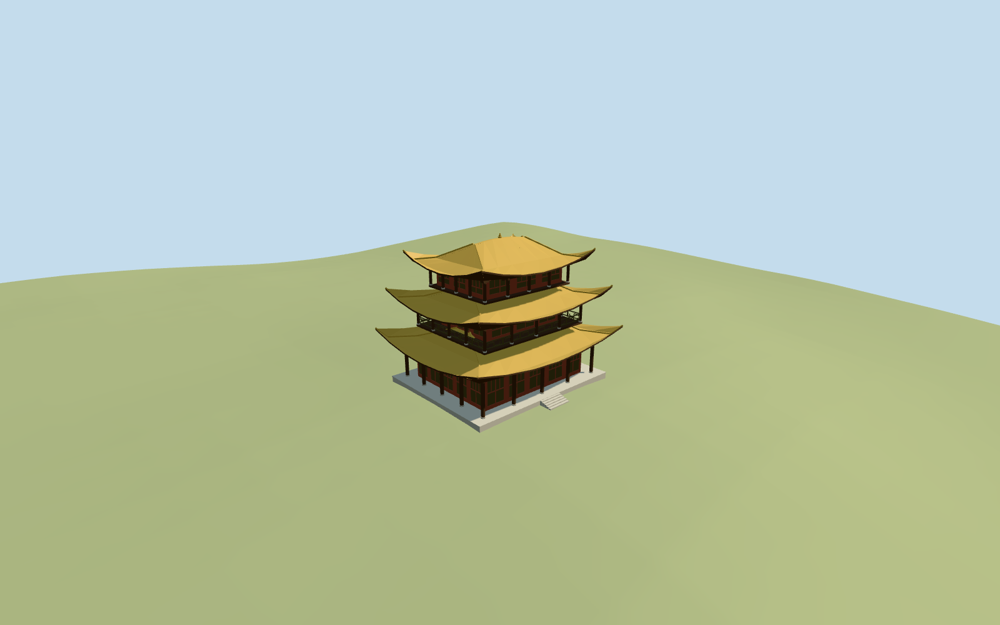
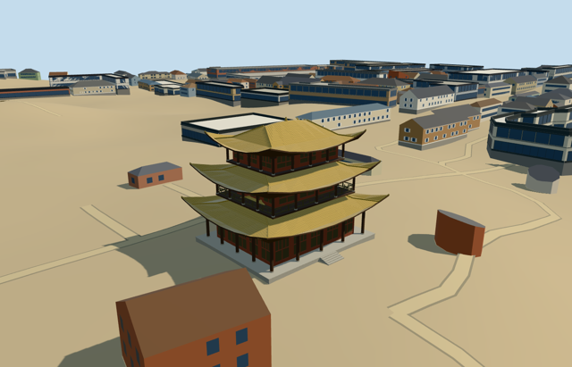

# N0617 — Yueyang Tower

Reviewed 2026-10-20 in one continuous author/build/inspect/fix round.

## Appearance

Inspected47 current source/shared/context/native frames during this continuous picture/map/build/inspection round. Three decreasing golden roofs retain strongly swept corners, curved upper helmet ridge and central finial. Red/brown timber columns and bracket blocks frame closed lower/upper lattice panels, with a genuinely open wraparound middle balcony and original geometric rails. Stone plinth and supported entrance treads meet retained ground. Reused two useful whole/side2018 photographs; no copied inscription, pseudo-calligraphy, photo atlas or furnished interior. The separate city-wall frontage and independent green-roofed pavilion are outside the tower model scope.

## Shared materials and browser levels

Four existing256-square graphs (stone_granite, wood_plain, wood_vertical and tile_glazed) supply four merged material groups/at most four runtime draws. Timber and lattice share the same graph/group with linear palette tints and physical UV repeats. No embedded images, separate GPU vertex streams and matching CPU/GPU byte accounting. Skyline is one flat merged draw with baked graph means; graph reads occur once and eviction disposes all model geometry. Source11920triangles/1433344bytes.

| Level | Triangles | Bytes | Draws |
| --- | ---: | ---: | ---: |
| skyline | 828 | 83480 | 1 |
| district | 3088 | 273468 | 4 |
| street | 9904 | 882700 | 4 |
| closeup | 11920 | 1071068 | 4 |

Inspected street/block/skyline at noon and late afternoon in Economy/High, texture-free silhouette, three detail views, all four authored levels and switches. LODs828/3088/9904/11920triangles remain within1000/4000/16000/64000 ceilings. Skyline+district total356948bytes, below3MB phone/6MB laptop targets. Fine brackets/lattice/shutters drop at distance while golden swept eaves, three storeys and the open middle balcony remain. Tile gloss follows the shared material and real glazed roof color; no baked light. Synthetic context boundaries are fixture edges. Physical-device/dense-city timing remains pending.

## Approximate map fit

Exact-QID OSMway230337579 and corresponding native PMTiles building35184602426411/named tower POI fix the single tower footprint and center[0.044588392198076754,-0.01687645897537804]m relative to anchor113.0883327,29.3846862. Quantized plan measures21.359146694954894 by17.448724766602293m. Model+X follows the long near-north axis[0.04872255546511014,-0.9988123510394479], model+Z near east[0.9988123510394479,0.04872255546511014]. Global heading0 retains native east/south axes. West/lake-side main elevation is a picture/map approximation; directed entrances and precise facade inventory retain30degree/2m uncertainty. No exact surveyed facing is asserted. Retain original6m standard Mapzen grid, all independent mapped neighbors including the nearby green-roofed pavilion, native paths/steps and lake/water. Replace only the tower shell. A bounded level occupied plinth sits just above the highest sampled footprint rim; its buried sides extend below the lowest rim and short supported treads meet native grade. No terrain/water cutout or whole park/city-wall platform. Coarse DEM cannot resolve the city-wall gate masonry and is not surveyed foundation evidence; the separate wall/frontage gate remains outside this tower exterior scope. All four loaded levels remove only35184602426411 with zero residual, preserve238 independent resident building inputs out of239 original, and keep original6m terrain/paths/3511469.9139753035m2 native water geometry unchanged. Failed loading restores all239 original inputs; eviction restores terrain/water bindings and releases every model geometry. The independent pavilion footprint is retained as host context, whose procedural shell is not an authored pavilion reconstruction.

## Limits

Neither retained Wikidata nor the native PMTiles shell supplies measured height. Nominal18.9m above the attachment plane (occupied plinth top0.65m) is a picture-led visualization estimate, not a sourced surveyed dimension. Three roof eaves at5.5/10.7/15.4m, respective rises2.8/2.55/2.6m, strongly lifted corners, upper ridge bulge0.35m and0.55m finial preserve relative picture proportions. Floor/plinth, wall/column/roof dimensions, lattice/bracket inventory and later repair condition remain approximate. Retain original6m standard Mapzen grid, all independent mapped neighbors including the nearby green-roofed pavilion, native paths/steps and lake/water. Replace only the tower shell. A bounded level occupied plinth sits just above the highest sampled footprint rim; its buried sides extend below the lowest rim and short supported treads meet native grade. No terrain/water cutout or whole park/city-wall platform. Coarse DEM cannot resolve the city-wall gate masonry and is not surveyed foundation evidence; the separate wall/frontage gate remains outside this tower exterior scope. Ordinary whole/side photographs were viewed once and carried through construction. Blank tablets stand in for lettering rather than fabricated glyphs. Detailed bracket joinery, roof curvature, hidden timber framing, entrance schedule and exact current repair condition are approximations; the tower does not include the separate city-wall gate, entire frontage, park or furnished interior.

## Selected checks

Six Khronos files: zero errors/warnings.198 actual mesh/material/contact checks; 47 current inspected views. Scene validation/sim30 and strict selected medium-fi audit pass. Source/runtime/LOD hashes and material bindings verified.

Rebuild: node packages/worldgen/scripts/generate-additional-landmarks.mjs --ids=N0617; node packages/worldgen/scripts/import-next-1000-models.mjs --ids=N0617; node packages/tooling/scripts/generate-landmark-lods.mjs --ids=N0617 --force.

Source: sha256:29b85776cf2e014804e284805af8e8b79acbbbb7bd4db4d8072d1f92ebd7f584

Runtime: sha256:33b97da5fe4c0224f2d39133d6c84793578a5004076df2aeb92e97125b28ab22

Input: sha256:5009cb61a730c8f95578297d26a2cefb34a47b30ec4b743bbf0b8ede8f869db9

## Viewed ordinary pictures

https://commons.wikimedia.org/wiki/File:Frontal_view_of_Yueyang_Tower,_Hunan,_China1.jpg — Huangdan2060; CC0-1.0. Viewed only; no pixels copied.

https://commons.wikimedia.org/wiki/File:Yueyang_Tower,_photographed_from_the_side.jpg — Huangdan2060; CC0-1.0. Viewed only; no pixels copied.
