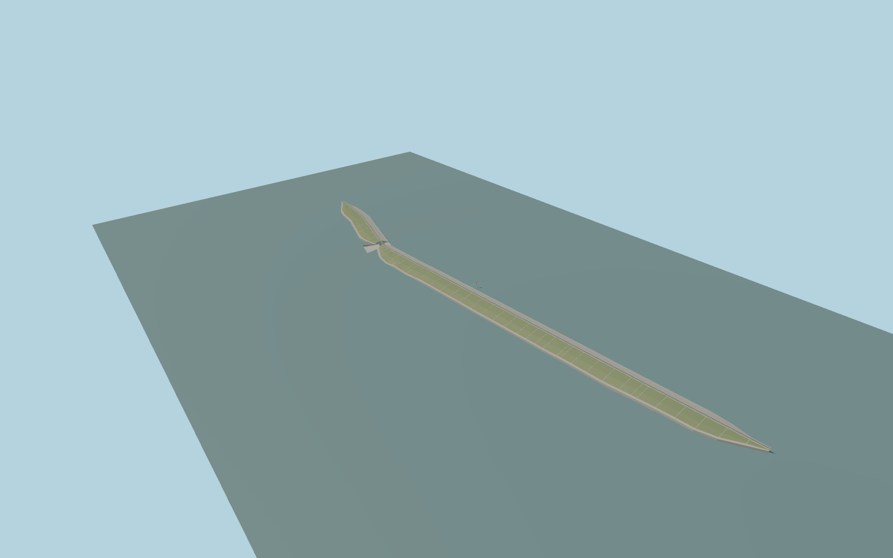

# Banqiao Dam

Current rebuilt Banqiao Dam with both grass embankment wings, paved crest and toe, steps and lights, modeled release channel and gate crossing, and the reservoir intake hut and catwalk.

Rebuild: `node packages/worldgen/scripts/generate-banqiao-dam.mjs`;append `--check` for exact source bytes. Select import/LOD/placement with `--ids=banqiao_dam`. Detailed source and four browser tiers are separate ignored GLB outputs.

The standard Terrarium water reference at local [0, −420] gives a 105.04 m model datum. The 16 m ground field fits the outer toes and release apron. Crest and release elevations are visual estimates.

The short release crossing is mapped. The four gate leaves and sill arrangement are interpreted where the ordinary photographs do not resolve the machinery.

The roofed intake hut follows the visible form, with approximate position and dimensions. The nearby museum and park are separate site components.

Only the mapped reservoir has a water surface in the review. The native downstream river and side canal remain linework. Live reservoir levels and engineering elevations are unverified.

Original geometry:repository license. Map:© OpenStreetMap contributors,ODbL-1.0;Protomaps. Standard terrain:terrain-grid.json. Ordinary pictures stay local and are not redistributed or used as textures. Current acceptance:qa.json.
