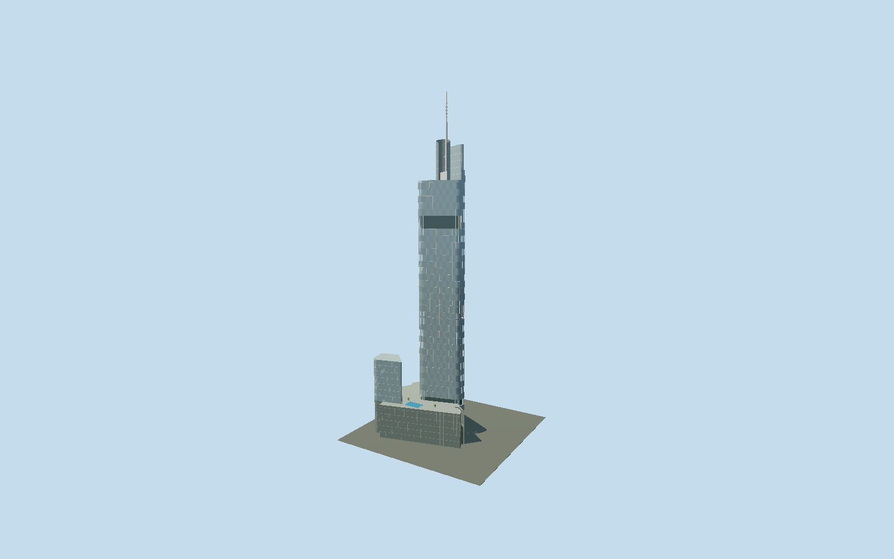

# Zifeng Tower

Rounded triangular interlocking scale-glass tower with staggered recessed atriums, curved crown pair,450m ringed mast and complete mapped podium/northwest annex.

## Evidence and reconstruction

Published dimensions and reconstructed details are separated in spec.json. Primary references:

- [Reference](https://www.smithgill.com/work/zifeng_tower/)
- [Reference](https://www.skyscrapercenter.com/building/zifeng-tower/165)
- [Reference](https://www.swagroup.com/projects/zifeng-tower-nanjing/)
- [Reference](https://swacdn.s3.amazonaws.com/1/41a6271b_zifengtower-nanjinggreenland.pdf)
- [Reference](https://www.openstreetmap.org/way/140809508)

No third-party geometry, photograph or bitmap texture is embedded. Shared surface graphs come from the central library; vertex tints carry model colors. Glazing uses PBR materials; transparent surfaces are declared per model.

## Model and axes

41,020 triangles; 114,938 vertices; 5 material groups; 4,633,180 bytes. Native bounds: -84.238, 0.000, -50.841 to 43.476, 450.000, 68.084. Source hash: `sha256:243cccfecec6d3f3ed41e7e951533199369844af7b7c28e1828f32d9570e9b9a`.

{"up":"+Y","longitudinal":"+X southeast","front":"+Z southwest; exact doors unverified","origin":"Ground-contact center of mapped main tower"}

The geographic proposal uses exact-QID OpenStreetMap evidence. Map-derived orientation and estimated architectural details require real-site visual review; preview eligibility is distinct from geographic/fidelity approval. Map attribution: © OpenStreetMap contributors, ODbL-1.0.

## Reproduce

Run `node packages/worldgen/scripts/generate-signature-towers.mjs --ids=N0168` (or add `--check`). The generator preserves manually edited masters by checking their baseline hashes. Import through the standard authored-model workflow with optimization disabled; then capture all QA cameras, including shared-surface views.

## Pending work

- Complete main tower with triangular rounded shaft, staggered angled scales, recessed horizontal/vertical seams and exposed braces, two separate curved crown forms,450m pipe mast,44m podium and added99.5m northwest office annex. Original154955-triangle/17290264byte recipe preserved. Built450m/occupied316.6m/observatory271.8m followCVU, not architect earlier458m design text. CVU66floors differs from map89; map count not imposed on facade. Source/closeup group panes across4.3m by8.1m; street8.6m/16.2m, district17.2m/32.4m representative modules rather than exact pane count or tilt. Both horizontal recesses156–172m and268–284m, lower41–49m band,2.1m depth,339.25/327m shoulder heights,381.25/370.5m crown, mast offsets/radii and compass phase reconstructed from architect photos, not survey. Exact porch/doors/rooftop plant arrangement unknown. Static outdoor pool and two tree planters on supported44m roof are a declared layout approximation from architect garden/pool description.99.5m annex height approximate map, rounded corners/pane grid reconstructed from actual photos04/05. Larger ground plaza, adjacentDrumTower park, subterranean floors and interiors excluded. Shared256px concrete/granite/paintedmetal graphs with tint; opaque palette glass/recess/pool water, zero embedded photos. Source geometry intentionally polygonal; exact scale tilt, signage, night illumination, terrain slope and physical-device timing unmeasured.

This bundle follows the medium-fi standard. Medium-fi appearance and geographic fit are reviewed separately. Hash-bound visual acceptance is recorded separately after capture inspection.
