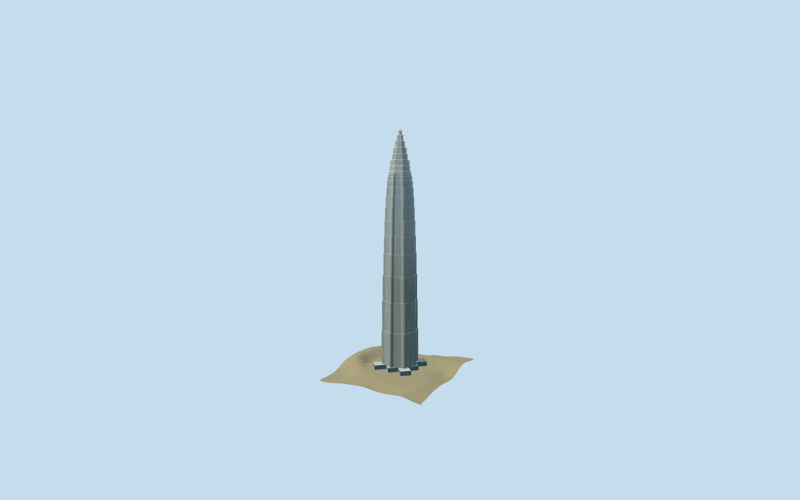

# Jin Mao Tower

Compact Jin Mao exterior preserves the mapped star-shaped base, twelve occupied setbacks, horizontal courses and eight crown stages. Far levels merge corner facets and glazing; closer levels restore fins and bracing. Detailed original master stays reproducible.

## Evidence and reconstruction

Published dimensions and reconstructed details are separated in spec.json. Primary references:

- [Reference](https://www.som.com/projects/jin-mao-tower/)
- [Reference](https://www.som.com/news/som-and-jin-mao-tower-part-1/)
- [Reference](https://www1.hkexnews.hk/listedco/listconews/sehk/2017/0419/ltn20170419629.pdf)
- [Reference](https://www.siadr.com/projectdetails/5d9eed58e4d1cc030e241f00/)

No third-party geometry, photograph or bitmap texture is embedded. Shared surface graphs come from the central library; vertex tints carry model colors. Glazing uses PBR materials; transparent surfaces are declared per model.

## Model and axes

29,601 triangles; 88,803 vertices; 3 material groups; 3,554,468 bytes. Native bounds: -40.437, 0.000, -39.491 to 40.437, 420.500, 39.491. Source hash: `sha256:1eec5337a770b7d2407155ff6f18390365110187c586c234ff14da4dd5af9b3d`.

{"up":"+Y","longitudinal":"+X along the mapped building long axis","front":"+Z","origin":"Ground-level center of exact-QID mapped footprint frame"}

One inspected architect exterior picture confirms the silver pagoda form, repeated setbacks, horizontal courses, corner ribs and stepped crown. Preserve original420.5m height, twelve authored occupied setback zones and eight crown stages. Retain the existing exact-QID star-shaped ground envelope and signed eightfold axes; standard viewer PMTiles confirms the Lujiazui tower/road context. Off-footprint PMTiles[0,80]12.9977m sets approximate terrain contact; center17.5403m is coarse. Raw terrain remains separate from bounded local preview contacts. Exact setback elevations, crown widths, stainless finishes, rib sections, glazing schedule and thresholds remain approximations; separate attached exhibition/retail podium excluded.

## Reproduce

Run `node packages/worldgen/scripts/generate-signature-towers.mjs --ids=jin_mao_tower` (or add `--check`). The generator preserves manually edited masters by checking their baseline hashes. Import through the standard authored-model workflow with optimization disabled; then capture all QA cameras, including shared-surface views.

## Pending work

- One inspected architect exterior picture confirms the silver pagoda form, repeated setbacks, horizontal courses, corner ribs and stepped crown. Preserve original420.5m height, twelve authored occupied setback zones and eight crown stages. Retain the existing exact-QID star-shaped ground envelope and signed eightfold axes; standard viewer PMTiles confirms the Lujiazui tower/road context. Off-footprint PMTiles[0,80]12.9977m sets approximate terrain contact; center17.5403m is coarse. Raw terrain remains separate from bounded local preview contacts. Exact setback elevations, crown widths, stainless finishes, rib sections, glazing schedule and thresholds remain approximations; separate attached exhibition/retail podium excluded.
- Two shared granite/painted-metal graphs reused with opaque glass PBR and zero copied textures. Silver vertex tint approximates the metal finish using the common graph. Low tiers merge facade bays and eightfold corner facets; street and closeup restore full facets, fins and crown bracing. Physical-device timings pending.

This bundle follows the medium-fi standard. Medium-fi appearance and geographic fit are reviewed separately. Hash-bound visual acceptance is recorded separately after capture inspection.
