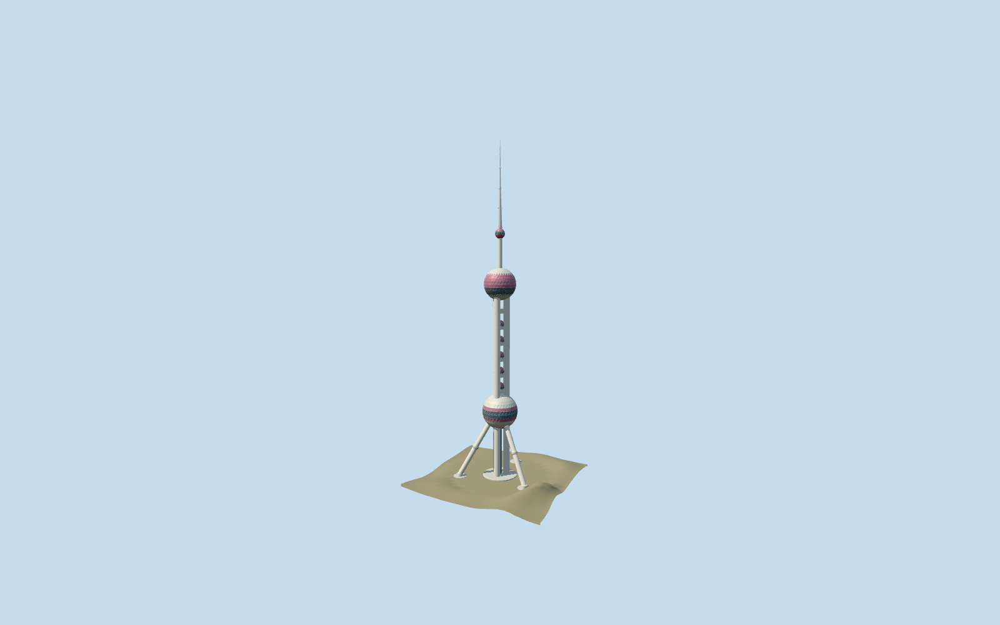

# Oriental Pearl Tower

Budgeted Oriental Pearl exterior preserves three shafts, three buttresses, all eleven spheres, observation belts and communications mast. Small buttress-joint spheres receive a picture-led correction; original detailed master stays independent.

## Evidence and reconstruction

Published dimensions and reconstructed details are separated in spec.json. Primary references:

- [Reference](https://www.otis.com/en/us/our-company/global-projects/project-showcase/oriental-pearl-tower)
- [Reference](https://www.cnssce.org/52/201102/1152.html)
- [Reference](https://www.cnssce.org/50/201308/1220.html)
- [Reference](https://english.shanghai.gov.cn/en-ScenicSpots/20231205/19a5f5184eca45728fd57a4d4c8efc61.html)
- [Reference](https://www.shda.gov.cn/dawh/csjy/202509/t20250919_75918.html)
- [Reference](https://www.icppcc.cn/newsDetail_1000332)

No third-party geometry, photograph or bitmap texture is embedded. Shared surface graphs come from the central library; vertex tints carry model colors. Glazing uses PBR materials; transparent surfaces are declared per model.

## Model and axes

60,876 triangles; 182,628 vertices; 5 material groups; 7,308,416 bytes. Native bounds: -58.763, 0.000, -66.400 to 58.763, 468.000, 37.900. Source hash: `sha256:9f16c039d90dd9495feaf1f248772ab924d04f78da164364584c872f266872ee`.

{"up":"+Y","longitudinal":"+X between the two southern buttress feet","front":"-Z toward the single opposite radial buttress","origin":"Ground level below the circular middle of the mapped tower, not the outer-envelope rectangle center"}

Inspected skyline and close exterior pictures confirm the three concrete shafts, inclined supports, ruby/pale principal spheres and triangulated shells. The close picture shows three small pale joint spheres partway up the inclined supports; browser derivatives move them from the old entry-foot positions to approximate42m support-joint locations with4.4m radii. Original detailed source remains reproducible. Retain468m height, eleven spheres, authored main sphere heights and the corrected mapped center/alternating shaft-brace phase. Standard viewer PMTiles confirms the tower and plaza context. Off-footprint PMTiles point[-80,0]11.7337m sets approximate ground contact; center34.2199m contains coarse urban imprint. Bounded preview contacts preserve raw samples separately. Exact joint-sphere positions, shell fabrication, hotel pearl layout, shaft connections, maintenance equipment and entrance thresholds remain approximations; wider exhibition complex excluded.

## Reproduce

Run `node packages/worldgen/scripts/generate-signature-towers.mjs --ids=oriental_pearl_tower` (or add `--check`). The generator preserves manually edited masters by checking their baseline hashes. Import through the standard authored-model workflow with optimization disabled; then capture all QA cameras, including shared-surface views.

## Pending work

- Inspected skyline and close exterior pictures confirm the three concrete shafts, inclined supports, ruby/pale principal spheres and triangulated shells. The close picture shows three small pale joint spheres partway up the inclined supports; browser derivatives move them from the old entry-foot positions to approximate42m support-joint locations with4.4m radii. Original detailed source remains reproducible. Retain468m height, eleven spheres, authored main sphere heights and the corrected mapped center/alternating shaft-brace phase. Standard viewer PMTiles confirms the tower and plaza context. Off-footprint terrain point and bounded preview contacts provide approximate fit, not survey accuracy. Exact joint-sphere positions, shell fabrication, hotel pearl layout, shaft connections, maintenance equipment and entrance thresholds remain approximations; wider exhibition complex excluded.
- Canonical granite/concrete/painted-metal graphs reused across semantic slots; glass uses opaque PBR and no copied photography. Far tiers merge sphere panels and omit shaft rings and maintenance equipment; closeup adds inset triangular joints, observation rims and representative mast details. Physical-device timings pending.

This bundle follows the medium-fi standard. Medium-fi appearance and geographic fit are reviewed separately. Hash-bound visual acceptance is recorded separately after capture inspection.
